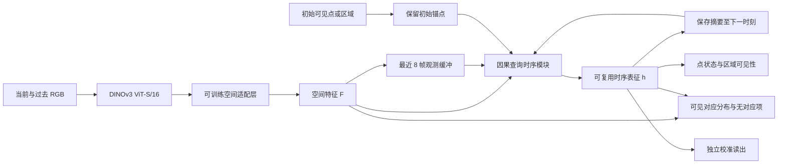

# 视频遮挡模型与训练目标

版本 v0.2，2026-10-20。属于[视频研究方案](PROTOCOL_VIDEO_V02_DRAFT.md)的实现设计，参数为建议值，尚未实现、下载新权重或训练。学习对象是可复用的空间适配特征与查询时序表征，永久身份编号由下游关联器维护。

## 1 输入和输出

时刻 t 的学生输入为 RGB 历史、当前帧、有效时间间隔和初始可见提示。点提示为初始帧坐标；区域提示为初始可见框或掩码及其中的点。提示只在创建查询时提供，之后不得逐帧用 GT 框裁出目标。初始 GT 提示可以用于公开点跟踪的条件能力协议；自动系统必须使用检测器实际输出。

| 输出 | 定义 | 不能混淆的量 |
|---|---|---|
| F_t | 空间适配后的稠密特征 | 原底座冻结不等于整个表征被冻结 |
| h_{q,t} | 初始锚点、近期视频和当前观测形成的查询时序表征 | 不含物理 ID、隐藏位置或未来 RGB |
| p_{q,t}(u), p_{q,t}(∅) | 当前可见对应位置及“当前无可见对应”的概率分布 | ∅ 不等于目标不存在，也不等于拒绝做任何历史推断 |
| 点状态与实例状态 | 点的可见/外遮挡/自遮挡/出画；区域查询的入画概率与实例可见比例 | 一个表面点不可见不代表整个动物被遮住 |
| c_{q,t} | 当前给出的可见匹配是否正确的可信度 | 可见比例不充当正确率或不确定性标签 |

对称或相同外观目标可能产生多峰对应分布。输出 ∅ 表示没有可见对应；“有多个可见候选，暂不确认”由分布与置信阈值表达，两者分开评价。

## 2 首版架构

选用 [DINOv3 官方实现](https://github.com/facebookresearch/dinov3)中的 ViT-S/16 作为首版候选。这里采用其现成视觉初始化，不假定它天然免于捷径。

- 输入建议为 512×320，底座 stride 16。首轮冻结底座；残差空间适配为 384→64→384，再投影到 256 维，所有对照采用相同实现。
- 时序模块建议两层、宽度 256、4 个注意力头。每个初始查询对各时刻图像 token 读取证据，再在最近 8 帧内作因果时间注意力；使用真实时间差编码。点与区域采用相同模块及不同提示类型编码。
- 初始锚点长期保留。近期缓冲只保存真实观测及其时间，不按 GT 可见性选择记忆。另将前一时刻摘要 h_{q,t-1} 作为记忆 token 传入当前模块；读写由相同可训练模块完成，首次初始化仅用初始提示。该摘要能跨越 8 帧窗口，但训练段仍只有 48 帧，不能据此声称长视频稳定。
- 对应头与当前空间特征做相似度计算，加一个可学习无对应 logit；空间格点附带有界偏移细化。区域状态头预测入画概率与可见比例；点状态头处理局部可见原因。
- 梯度进入空间适配层、时序模块和普通训练头。校准头的输入停止梯度，避免通过改变匹配难度来“改善”校准目标。相同模型的有效参数和前向次数在执行前实测。

同一查询输出只读 t 及以前信息。训练批次可以并行展开整段视频，但时间掩码必须阻断未来；视频级归一化、未来特征缓存、GT 选记忆和基于未来的候选筛选同样属于泄漏。

## 3 对应与无对应目标

令 q 是曾经可见的物理表面查询，u 是当前空间格点，∅ 是当前无可见对应。网络给出联合分布：

\[
p_{q,t}=\operatorname{softmax}
\big(\{s(h_{q,t},F_t(u))\}_{u\in\mathcal U},\,b_{\varnothing}(h_{q,t})\big).
\]

若该物理表面当前可见，用几何投影生成格点软标签 y（如相邻格点双线性权重）；若当前外遮挡、自遮挡或出画，令 y(∅)=1。投影/拓扑无效则记录为无效标签，不伪装成遮挡。

\[
\mathcal L_{\mathrm{corr}}
=-\sum_{u\in\mathcal U\cup\{\varnothing\}}y_{q,t}(u)\log p_{q,t}(u)
+\mathbf1[v_{q,t}=1]\,\lambda_x\,\operatorname{Huber}(\widehat x_{q,t},x^*_{q,t}).
\]

Huber 坐标误差按图像宽高归一化，具体容忍尺度随执行配置冻结。隐藏帧的主目标是无可见对应；重现帧恢复位置监督，梯度由当前及过去观测传回。物理轨迹的未来真值仅用于生成各时刻标签，不作为网络输入。

训练覆盖连续可见、进入遮挡、隐藏、重现、离开和未返回事件。不能只在双可见帧训练，否则“别乱接”和“重现后接回”没有直接监督。隐藏比例不能主导全部批次；事件阶段采用预定均衡采样并报告自然分布测试结果。

在有严格可观测等价构造的歧义集合中，用等价构造的目标分布或多正例监督；不能因为渲染器知道物理 ID 就要求网络确定性分辨像素完全相同的历史。一般困难样本仍保留原监督，不由模型置信度自行删掉。

## 4 可见证据目标

点级状态 s_q∈{可见、外部遮挡、自遮挡、出画}；对象级入画标签 a_i=1[|A_i|>0]，在 a_i=1 时实例可见比例 r_i=|V_i|/|A_i|。对象级标签只监督区域查询，不能从单个点状态直接推导。

\[
\mathcal L_{\mathrm{evidence}}
=\operatorname{CE}(\widehat s_q,s_q)
+\operatorname{BCE}(\widehat a_i,a_i)
+\mathbf1[a_i=1]\operatorname{Huber}(\widehat r_i,r_i).
\]

不同项分别按各自有效查询归约，再取固定权重和；没有区域查询的点跟踪样本仅计算点项。出画时 r_i 无效，禁止填 0 后混入完全遮挡。实例的部分/完全遮挡由真实投影统计定义，具体像素容忍另行冻结。

边界混合 patch 不作纯内容强拉近，但仍参与位置、点状态和区域监督。这样不会为了获得干净特征样本而排除最重要的遮挡边界。逐遮挡者关系和完整 amodal 重建不作为首轮额外训练头；所需真值保留，供机制核验与后续有依据的扩展。

## 5 条件反事实对应目标

对同一视频事件生成不同遮挡/环境版本 a、b。Ω_t 包含两边在对应时刻均可见、物理轨迹可靠的同一表面。内容投影 z 从可复用 h 及局部 F 读出，约束只作用于此内容投影，不把全部 h 强行变成相同。

\[
\mathcal L_{\mathrm{cf}}
=-\frac1{|\Omega|}\sum_{q\in\Omega}
\log\frac{\sum_{k\in\mathcal P(q)}\exp(z_q^\top z_k/\tau)}
{\sum_{k\in\mathcal P(q)\cup\mathcal N(q)}\exp(z_q^\top z_k/\tau)}.
\]

P(q) 是同一可辨表面的有效正例集合；N(q) 是当前任务可辨的不同表面或个体，优先包含近邻和相似外观的竞争者。同一表面不同版本不互为负例；明确的观测等价对象不强行当硬负例。普通重复纹理的歧义规则在生成合同冻结，不能用不同物理 ID 自动保证可辨。

| 视频干预 | 保持的内容 | 应响应的输出 |
|---|---|---|
| 换遮挡者外观或背景，几何不变 | 同一可见表面的内容对应 | 状态应基本不变 |
| 改遮挡轨迹、持续时间，目标运动不变 | 同时可见区域的内容对应 | 可见性、无对应项随物理标签变化 |
| 改相机或目标位置 | 表面身份保持，坐标按真实投影变化 | 坐标必须等变，不能匹配固定像素位置 |
| 目标全部不可见 | 初始历史锚点仍保留 | 当前输出无可见对应；不施加当前隐藏纹理对齐 |

反事实不是保证不变的任意增强。目标纹理通常是合法身份线索，首版不把“不同目标纹理”全部拉近；颜色与光照变化只有在身份和对应定义仍有效时使用。遮挡物对关系判断有用，关系/状态通路保留它。

普通视频基线 B 使用相同四个前向视图、相同有效 Ω、相同正负例数量，但正例为同一渲染版本的两次可逆增强；P 将正例改为不同物理变体。两者均得到全部原始视频及常规几何监督。Ω 为空时仅该项不计算，完整事件的其他损失照常计算。

## 6 可信度与隐藏位置的区分

令 e_{q,t}=1 表示当前提议的可见匹配在预定距离内且归属正确，否则为 0。隐藏时提议任何可见位置均为错误；无对应判定的正确率另由 p(∅) 评价，不混入 e。

\[
\mathcal L_{\mathrm{cal}}=
\big(c_\phi(\operatorname{sg}(h),\operatorname{sg}(p))- \operatorname{sg}(e)\big)^2.
\]

sg 为停止梯度。该项仅训练校准头，不作为新增表征机制贡献；所有臂都使用同样的校准训练。由于分组采样改变训练先验，还需在自然分布验证集报告未校准与校准后结果。部署确认阈值仅在验证集确定，测试不得重新调节。

合成真值还提供隐藏表面位置。CoTracker3 与 TAPNext++ 使用过隐藏位置监督，因此不能先验断言它无用。首轮另设 Hpos：在 P 相同模型上增加 0.2 权重的画内隐藏位置辅助 Huber，使用现有空间 logits 条件归一化后的定位读出，不增加参数。它训练的是位置先验，同时仍监督“当前无可见对应”；不能把隐藏先验当作可见检测或已恢复身份。只对几何有效的隐藏帧使用，歧义构造不强迫唯一位置。[CoTracker3 监督定义](https://arxiv.org/html/2410.11831v1)，[TAPNext++](https://tap-next-plus-plus.github.io/)。

## 7 总目标与第一版建议

\[
\mathcal L=
\mathbb E_{g\sim\mathrm{Uniform}(\mathcal G)}
\left[\mathcal L_{\mathrm{corr}}
+0.5\mathcal L_{\mathrm{evidence}}
+0.1\mathcal L_{\mathrm{cf}}
+0.1\mathcal L_{\mathrm{cal}}\right].
\]

建议 λ_x=1、对比温度 τ=0.07。G 为预先定义的事件类型，先按家族、再按事件和有效查询平均；不把每个像素当独立场景，也不按预测置信度给主任务降权。此处采用分组均衡，不是 GroupDRO。权重是设计起点，正式数值在训练前冻结，不用测试表现搜索。

不默认加正交、梯度反转、信息瓶颈、IRM、PCGrad 或高频抑制。正交不等于统计独立；梯度冲突不等于捷径；边界高频和自身纹理可能正是任务所需证据。若后续增加这些项，需新的实测动因和同预算消融。

## 8 接入 YOLO 与表征迁移

预训练交付物包含底座版本、空间适配、时序模块、提示编码及输入归一化。迁移实验先丢弃训练投影/状态头，用冻结的 (F,h) 训练新的弱读出，并另报只用 F 的结果；只有训练头好用不能叫可迁移表征。

YOLO 保持自身检测分割，提供真实框/掩码候选。当前帧没有检测时可保留历史查询，标为暂不可见；候选重现后用预训练表征给出对应分数和拒接概率。数据关联器及阈值选择规则对所有表征对照相同。候选缺失与关联失败分别计分，不用 GT 补框。

首版采取旁路特征适配；直接替换 YOLO 骨干、蒸馏和联合微调属于后续独立实验。SAM 的记忆/分割结果可作为另一前端验证，但不在首轮同时叠加。这样可以分别判断表征收益和前端能力，保留明确的归因。
