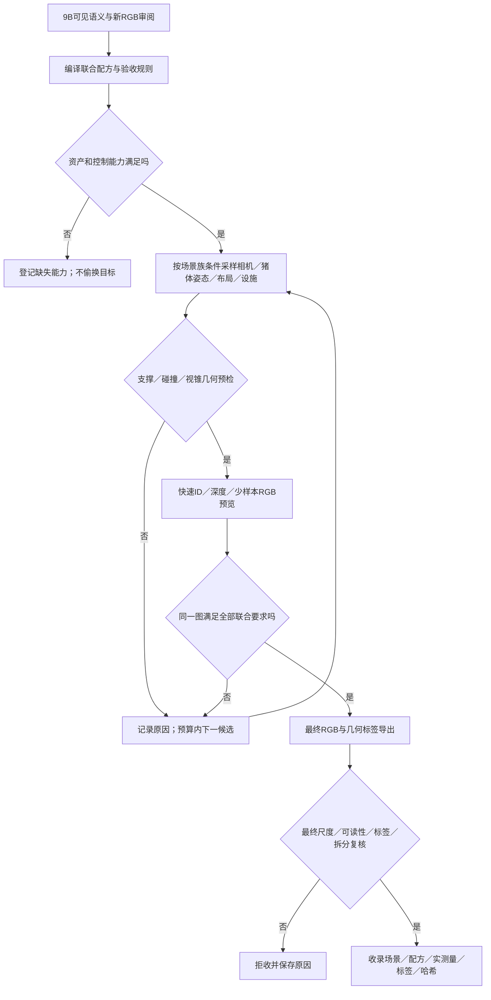

# 联合场景约束如何落到Blender

2026-10-30。回答用户“提取出这些特点后，如何让blender去生成这些联合约束数据”。这是可审阅接口设计，不是已实现的完整生成器或新运行协议。无真实RGB/既有标签读取、模型调用、渲染、训练或新增预算；已有loop_v1冻结代码与Run不改。当前工程唯一下一步仍为原始MAMMAL接回导出器。

**选择：固定的配方编译器＋条件采样＋几何/投影检查＋最终图像联合验收。** Qwen9B提出带证据的语义条件与配方候选，程序将其转换成支持的控制量；Blender负责构建/渲染。图像空间约束必须在生成结果上实测，不能把参数设置或模型自述视作满足条件。

## 1. 三种数据必须分开

| 层 | 内容与例子 | 权限 |
|---|---|---|
| 观测证据 | 当前允许TRAIN RGB中可辨的站/卧、相机观察面、栏杆切过哪个区域、邻猪前后关系，以及unknown和审阅状态 | 未核的9B输出只作覆盖提示；不从旧标签或单图估出唯一隐藏三维量 |
| 配方要求 | 同时要求“斜俯视、目标猪站立、邻猪遮后腿、设施切躯干、指定最终投影尺度”，区间/类别、证据来源和规则版本 | 示例区间不是自然频率。每条要求写测量定义、可判条件和硬/软性质；缺少可靠真实数值时用明确的工程覆盖档位 |
| 已构建场景 | 实际资产/姿态ID、所有实例变换、相机、设施网格、材质、灯光、随机种子、最终成像政策 | 由固定程序生成，另存实际测量、验收结果和失败原因；合成标签来自几何而非9B |

配方不含可执行Python字符串；JSON只允许白名单字段，禁止eval/任意脚本路径。Qwen可辅助解释/编写设计，由人工审阅的固定Python/bpy执行。这样可以复现一张图，也可追踪一条要求究竟由哪个控制量实现。

## 2. 属性、控制量、验收量一一对应

| 联合要求 | 固定程序怎样构造 | 必须怎样核 |
|---|---|---|
| 身体形态与耳/尾/肢蹄 | 选有来源的资产/形态族；MAMMAL用已有矩阵LBS和源部位；耳26/31、尾根46、四肢等按RIG_BINDINGS。用已验证的姿态库及有限扰动 | 源部位/蒙皮映射、附着、形变与碰撞；单模板只有统一缩放并不会产生真实胖瘦族。无已核形态/姿态即unsupported，不靠贴图或任意Euler角冒充 |
| 俯视角与最终大小 | 设置相机外参/投影及最终分辨率；投影可见区域/声明的资产区域，调整允许的距离、焦距或布局 | 最终输入中的归一化尺度、截断、部位像素宽；相机角度设对不等于图像尺度合格，投影方法/比例必须统一 |
| 邻猪遮住指定部位 | 在猪栏合法区域内按条件放置目标与遮挡猪，约束距离、朝向与支撑；近似边界预筛后做窄相检查 | 首命中owner、深度和部位图；遮挡像素在目标部位孤立自可见区域内，首命中必须为指定邻猪。bbox重叠不作遮挡证据 |
| 栏杆切过躯干/腿 | 选合法猪栏设施模板，在允许的猪位置/相机/栏杆参数域内投影和采样；允许逆投影辅助初值 | 设施真实三维支撑和不穿透，实际遮挡者、遮挡部位、最终像素宽及断片。不能把每根栏杆自由漂浮到镜头前只为凑像素条件 |
| 低对比/阴影/污湿外观 | 调整已有合法材质、粗糙度、污渍UV、灯光和曝光，保持声明几何不变 | 在最终RGB中对声明边界带/部位ROI测量对比和清晰度；材质底色不是最终图像颜色，设置阴影参数也不证明阴影落在目标部位 |
| 模糊/压缩/缩放与截断 | 按冻结相机后处理链执行，同步跟踪所有空间变换 | 几何变换同步标签；RGB模糊/噪声不模糊ID；畸变/重采样须定义一致像素政策和边界可用性。重核细部位可读性 |

现有代码可复用：[PigGeometry.pose](../spm_spatial_object_memory_20261025/pig_geometry.py)读取原始template并接受每关节合法旋转矩阵，输出变形顶点/关节；不必先重写作者求解器或复用旧拟合场景。接入Blender可直接创建/更新这些网格顶点，绑定owner及源表面映射。姿态矩阵合法不等于动物姿态自然，后者仍需姿态库/支撑/表面检查。

## 3. 具体生成流程



循环必须有启动前冻结的总次数/时长/资源上限；耗尽时保留本配方缺口，不继续采样直到出阳性。若允许确定性修复（例如投影尺度二分调整），其可改参数、步骤上限和重测顺序也须提前写明；任何改变影响其它条件后，重验全部条件。当前不执行这个循环，不沿用旧10图协议的预算，也不修改其“禁止事后调参”的原规则。

先做便宜的几何预检；用代理几何时，代理只作粗筛，不作为最终表面碰撞证明。ID/深度能判几何，低采样RGB只能预筛颜色；需要最终分辨率判的条件不能仅凭小预览通过。最终RGB样本数、抗锯齿、色彩管理或后处理改变后，都要复核目标测量，不能把预览与最终差异藏在“已满足”里。

## 4. 同时满足是可以明确计算的

以语义示例“斜俯视＋目标站立＋邻猪遮后腿＋栏杆切躯干＋中等像素尺度”为例。该示例不是新真实观测，也未声明已存在自然站姿库。

令z为构建参数，m(z)为投影/几何/最终RGB测量：

`accept(z) = supported(z) AND geometry_valid(z) AND label_valid(z) AND all_j[m_j(z) in allowed_j]`。

“全部条件”在同一候选成立才收录，不能把一张图的栏杆、另一张图的侧卧和第三张图的低对比合并成一个满足联合要求的记录。软目标只可在硬条件通过后评价，不能用高画质或特征分数抵消穿透/owner错误。

例如，S_p为目标后腿**在目标整猪孤立渲染时自可见**的像素集合，O_j为完整场景首命中指定邻猪j的集合，后腿被该邻猪遮挡比例可定义为`r = area(S_p intersect O_j) / area(S_p)`；S_p为空则不可判，不以0通过。S_p与既有部位自可见层定义一致；其它设施不计入这项比例，全部遮挡者身份保留。真实单图没有这个完整几何分母时，不把9B估值当观测真值。

对“栏杆切开躯干”另测指定设施遮住的MAIN_BODY像素、最终可见连通分量及最小片段像素支持；连通性、抗锯齿/中心采样政策与小片段阈值要冻结，不套用旧head案例的阈值。相同图上再测归一化尺度、截断和RGB局部对比，才能确认所需联合状态。

## 5. 保证整个数据集的联合覆盖

先选有依据的联合格（例如场景/相机族×姿态族×设施切割部位×尺度档），只展开实际支持且与目标困难相关的交互，避免全维笛卡尔积。每格记录计划量、尝试量、几何失败、最终通过量、资产族和种子；覆盖按**最终通过样本**统计，不按发出的随机参数统计。

拒收会改变分布：`q_accepted(z) ∝ q_proposal(z) * 1[accept(z)]`。因此只设置各字段的采样比例，不能保证最终联合频率。分格配额和可复现的条件提案策略须预先规定；某格预算内不足就报告不足，不放松阈值、偷换姿态或把简单格补成总数。配额只叫设计权重，除非有充足审阅证据，不称真实自然频率。

同一场景父族/资产族/固定几何外观对按既有拆分合同成组。只有同一个MAMMAL模板时，不能把换姿态/材质的图称为新资产泛化测试；必要身体形态缺项要继续登记。

## 6. 已实现与待接入

**已经实际完成的子集：** 现有[render_loop.py](loop_v1/render_loop.py)根据一个固定正交相机与粗头部投影，生成1无栏＋9栏杆位置/宽度候选；[audit_measure.py](loop_v1/audit_measure.py)计算部位/设施遮挡、片段、像素比例并核独立射线。旧结果证明一个粗头部/栏杆案例的受限构造与导出，不是任意联合场景系统，也不是MAMMAL结果。

**需要实现的差距：** 原始MAMMAL适配；有核验姿态/形态能力的资产目录；场景族条件配方编译；多猪owner/接触与碰撞；最终像素联合测量；通过样本配额与缺口账本。Blender已有对象、相机、材质和渲染接口，不会自动补齐这些逻辑。当前唯一工程动作仍为第一项，不启动远端生成或训练。

实现依据：[Blender 4.2.1 world_to_camera_view源码](https://github.com/blender/blender/blob/v4.2.1/scripts/modules/bpy_extras/object_utils.py)支持相机投影坐标；[BlenderProc renderer文档](https://dlr-rm.github.io/BlenderProc/docs/tutorials/renderer.html)说明RGB/深度/距离和实例属性输出。后者为可选封装，不是本项目已安装依赖；其对象实例输出也不能直接代替单mesh的解剖部位映射。官方docs.blender.org三个页面本次网页访问失败，未冒称读取成功，改核版本源码及已有本地实际实现。设计依据集中在[理论D55](../../paper/manuscripts/spm_yoloseg/SPATIAL_OBJECT_THEORY_SUPPORT_20261025.md#d55-联合约束的配方编译条件构造与最终像素验收)。

## 7. 每条语义的参数表达合同

2026-10-30补充。任务内的主要语义可以表达为数值、类别/资产库选择、关系谓词及其组合；开放自然语言不能保证全部自动、准确转成可控参数。每条语义的最小合同是：

`concept + entities/parts + coordinate_space + measure_definition + allowed_range_or_set + controls + verification + capability_status + evidence/unknown`。

坐标/单位须标明世界、猪体局部、相机还是最终像素；阈值有版本和来源。`controls`为固定执行器的白名单键，不是可执行代码。`measure_definition`必须在固定注册表中已定义；拼出一个名字不等于函数已实现。分别记录“可定义、真实RGB可观察、当前资产可控制、生成结果可验证”四项能力。

| 语义 | 参数/关系的操作性定义 | 控制与未解决边界 |
|---|---|---|
| 斜俯视 | 相机观察方向相对世界水平面的俯角、方位角、投影类型；目标尺度另约束 | 相机外参/焦距；不从一个俯角推导所有部位都可见 |
| 体型厚实 | 规范姿态/猪体坐标下躯干宽长比、高长比、截面描述＋资产形态族 | MAMMAL现有单template没有shape basis；描述/测量可以有，独立控制这些比例尚无自然形变保证，不能直接非均匀缩放宣称解决 |
| 站/俯卧/侧卧 | 已核姿态族ID、有限关节旋转、允许的支撑/接触集合 | 用合法姿态库/rig；旋转矩阵有效只是数学检查，不是自然性验收 |
| 头朝向食槽 | 已定义头部前向轴与头到槽目标向量的夹角、归一化距离 | 头颈rig/目标位置；不把朝向命名为进食行为或注意状态 |
| 耳下垂/折叠 | 耳型/折叠族、耳根变换、猪体局部耳尖相对耳根方向/高度、耳廓曲率描述 | 左右耳分开；耳根旋转不等于耳廓折叠，有骨不代表软耳形变已支持 |
| 尾卷曲 | 尾形族、已映射尾链关节，或明确中心线的累计转角/曲率描述 | 当前已核尾根不自动提供完整卷尾控制与尾尖定义，链/曲线接口待核 |
| 猪群拥挤/贴靠 | 区域内可见实例数/占比、归一化近邻间距、局部部位互遮等组成的向量 | 猪布局/姿态与相机；二维贴近、遮挡和三维接触分别约束，不用一个bbox IoU代替全部 |
| B遮住A后腿 | `area(S_A,part intersect O_B) / area(S_A,part)`，指定owner、侧别及部位 | 布局/深度/姿态/相机共同控制；S为空未决，单图真实隐藏分母不能凭空补 |
| 栏杆切出多个片段 | 指定设施与部位ID、遮挡像素、最终像素宽、声明连通性/最小面积下的可见分量数 | 合法设施与布局；参数调整后重验所有关联条件 |
| 耳/尾/蹄太小 | 最终输入中的可见面积、局部短轴/宽度、截断与可读性状态 | 相机、构图、声明缩放链；有几何像素不保证语义可读 |
| 污渍/湿亮/低对比 | 污渍覆盖/尺度/位置；材质族、粗糙度/法线等；最终RGB规定边界带亮度/颜色差与高光描述 | 材质/灯光/曝光耦合；roughness不是通用“湿度”，不能一数涵盖所有湿亮现象 |
| 模糊/低清 | 声明PSF/运动模型与像素尺度、噪声/压缩；最终边缘清晰度和部位可读性 | 后处理及必要相机运动；“模糊”语义与具体核参数需锚点审核，不设未经校准的通用阈值 |
| 自然/真实感强 | 拆成支撑、解剖比例、附着、穿透、材质/成像一致性与来源域覆盖等检查，并保留RGB审阅 | 当前无单一充分判据；不是新模型分数或一个naturalness参数，不能声称全自动证明 |

**示意关系合同（只展示格式，非真实估计、冻结Gate或可执行配置）：**

```json
{
  "status": "illustrative_not_executable_or_frozen",
  "concept": "specified_pig_occludes_part",
  "subject": {"instance": "pig_A", "part": "L_B_LEG"},
  "occluder": {"instance": "pig_B"},
  "space": "final_input_pixel_grid",
  "metric": "occlusion_fraction_of_part_self_visible",
  "desired_interval": [0.2, 0.4],
  "denominator_zero": "unresolved",
  "controls": ["instance_layout", "pose_family", "camera"],
  "verification": "isolated_whole_pig_part_mask_and_scene_first_hit_owner",
  "real_evidence_status": "not_provided_in_this_example",
  "measurement_adapter_status": "multi_pig_MAMMAL_pending"
}
```

示例0.2–0.4只说明格式，未从真实图推定，也不授予运行。范围须由任务定义/有证据的观察锚点或明确覆盖要求冻结。Qwen可以选现有定义并输出unknown，不能为“严重/自然/胖”自行赋一组任意数值。组合时将这些合同按同一场景/实例身份关联；若同时要求某部位完全不可见和存在多个可见片段，应在构造前判矛盾。隐藏矛盾及预算内无解也须保留。

构造参数与验收量是多对多关系：相机调整会同时影响尺度、遮挡、片段和高光；执行器需记录每种操作影响的测量，变动后重验相关条件和全部硬护栏。用有限分布/区间表达歧义，不用伪精确点值；类别定义及阈值先用语义锚点、合成样例和新RGB审阅校准，不读真实旧标签。

[Scenic原始论文](https://arxiv.org/abs/1809.09310)及其[Scene Generation文档](https://docs.scenic-lang.org/en/latest/reference/scene_generation.html)已实现“对象属性/分布＋关系require＋条件采样”的通用表达，支持此形式可行；不证明猪体所有语义或当前Blender适配已实现。本项目优先借用其表达思想，在现有JSON/bpy链上建立有限注册表，不新增Scenic安装或其它训练；完整依据见[理论D56](../../paper/manuscripts/spm_yoloseg/SPATIAL_OBJECT_THEORY_SUPPORT_20261025.md#d56-有限语义词表的参数类别关系与能力分级)。
