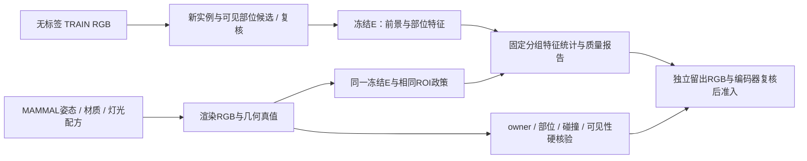

# 合成链路的专用模型：检索、选择与接入边界

2026-10-29采集来源，2026-10-30整理裁决。本文是检索与工程设计，不是猪场模型效果比较。27项维护者文档、源码及论文原始来源已保存，定向阅读范围与SHA见[来源索引](../../literature_search/synthesis_specialists_2026-10-29/sources.json)。没有把27项材料称为27篇论文或全部全文精读。

**2026-10-30范围修订：按用户要求移除对抗生成、判别器训练及其反馈优化分支。** 保留冻结实例/部位特征的质量比较；历史采集来源仅留作记录，不属于当前接入计划。

**2026-10-30任务优先级补充：** 用户指出合成需要语义与数学建模，而非优先逐图找关键点。按[理论D54](../../paper/manuscripts/spm_yoloseg/SPATIAL_OBJECT_THEORY_SUPPORT_20261025.md#d54-从逐图关键点转向任务相关场景语义与联合属性覆盖)，9B优先提炼可见身体/姿态、空间关系、设施、成像与不确定性，并辅助形成条件采样配方。真实图关键点仅在补自然姿态库或重投影诊断时按需使用，不是合成必经步骤；下表表示可选工具能力，不表示所有组件都应安装或逐图调用。最终覆盖重点为猪体、像素尺度、局部遮挡/owner、边界外观及其联合条件。

**主判断：把精确像素、关键点、局部特征和材质任务交给相应专用模块；9B负责语义、关系和未知项解释。** 当前最有直接工程依据的底座是已有MAMMAL原始资产、缓存SAM2.1、缓存DINOv2和已接通Blender导出器。猪专用PointRend/HRNet值得优先比较，但须先核公开预训练集与本项目RGB池的来源关系，再决定准入。新模型的任务匹配性不等于本项目已测更好。

## 1. 针对哪个实际缺口

[已运行首例](CLOSED_LOOP_REPORT_20261029.md)的4张真实RGB/8次9B调用中，4份局部输出复述占位内容，精确数值条件0/4准入。随后依靠新RGB复核和固定测量接通一个粗头部/立栏例，完成10图、40960条独立射线和290项RLE核验；没有证明自主实例解析、真实腿部断片、细解剖或写实性。已有MAMMAL确含左右耳、尾等9个源部位和62关节，当前导出适配尚未切换，见[资产纠正](ASSET_SELECTION_CORRECTION_20261029.md)。这些事实支持按任务补接口，而不支持继续靠9B提示词承担所有数值任务或扩低模图数。

## 2. 逐环节选择

| 环节与优先级 | 专用模型/工具、输入→输出 | 接入位置与主要限制 | 原始依据 |
|---|---|---|---|
| 实例轮廓：先复用 | **SAM2.1-base-plus**：RGB＋新点/新框→候选Mask及分数 | 已有源码/权重；用无标签RGB新提案作prompt，不借旧GT框。断片是否同一猪、栏杆是否误吞仍须复核；分数不是owner证据 | [SAM2](https://github.com/facebookresearch/sam2)，S03 |
| 猪专用轮廓：来源合格后优先对照 | **pig_silhouette_det / PointRend**：RGB→猪实例框、轮廓Mask | MAMMAL作者提供猪预训练权重入口；不是SOLOv2。旧Detectron2 v0.2/Python3.6环境，须隔离或移植推理。巴马猪训练来源与本项目来源关系未核，重叠/不清楚时不能直接作为无目标标注主链 | [作者代码](https://github.com/anl13/pig_silhouette_det)，S24 |
| 自动文本找猪：条件升级 | **SAM3**：RGB＋“pig”等概念/视觉提示→多实例Mask、框、分数 | 减少9B逐个报框，但不是身体部位语义/密集归属真值。权重须申请访问；官方Python≥3.12，当前Qwen解释器3.11.6不能原地照装。SAM3.1多路视频跟踪不作为静态猪解剖提升证据 | [SAM3](https://github.com/facebookresearch/sam3)，S01–02 |
| 猪姿态：按姿态库缺口选用 | **pig_pose_det / HRNet-W48**：新预测框对应RGB裁剪→23点二维候选及置信度 | 用于补姿态/重投影诊断，不是逐图必经解析。demo读取boxes_pr旧文件，不能照搬；改成当前RGB新生成框。23个表面地标须显式映射到MAMMAL定义，不等于62个rig关节；遮挡侧推断另记inferred | [作者代码](https://github.com/anl13/pig_pose_det)，[demo](https://github.com/anl13/pig_pose_det/blob/master/pose_estimation/demo_BamaPig3D.py)，S22–23 |
| 猪/部位向量：先复用 | **冻结DINOv2-ViT-S/14**：统一尺度前景/局部RGB→patch tokens；**DINOv3**作后继对照 | DINO源码明确区分patch与全局CLS。先验证耳、尾、肢蹄改变是否反映在局部特征，再纳入质量比较。DINOv3访问及效果待核；Qwen2B保留检索/去重，不作唯一默认逼真度目标 | [DINOv2](https://github.com/facebookresearch/dinov2)，[DINOv3](https://github.com/facebookresearch/dinov3)，S04–07 |
| 皮肤、污渍、粗糙度：第二优先 | **Hunyuan3D-Paint 2.1**：已有MAMMAL网格＋参考图→纹理/PBR材质 | 只用Paint分支，不生成替代猪体；官方纹理显存约21GB，不是本项目实测。默认重网格及UV顶点重排会破坏原标签/蒙皮映射，须按下节保护。**Paint3D**可作去烘焙光照纹理备选 | [Hunyuan3D](https://github.com/Tencent-Hunyuan/Hunyuan3D-2.1)，[Paint3D论文](https://openaccess.thecvf.com/content/CVPR2024/html/Zeng_Paint3D_Paint_Anything_3D_with_Lighting-Less_Texture_Diffusion_Models_CVPR_2024_paper.html)，S11–14 |
| 相机与遮挡排序：按缺口加入 | **GeoCalib**：RGB→内参/重力先验；**DepthAnythingV2**：RGB→相对深度 | 前者含畸变相机选项，比让9B猜俯角更直接；主点居中等假设须检查。后者常规权重不输出可靠公制猪深度；只作深度顺序候选，不生成几何真值 | [GeoCalib](https://github.com/cvg/GeoCalib)，[DepthAnythingV2](https://github.com/DepthAnything/Depth-Anything-V2)，S15–16 |
| 鼻眼蹄等剩余细表面：暂缓 | **PartField**：原始3D网格→部位特征/层级聚类候选 | 辅助人工指定细区域，聚类不会自动成为猪解剖命名；MAMMAL已有耳/尾不重做。新增语义边界仍需核对源网格和多视图 | [PartField](https://github.com/nv-tlabs/PartField)，S10 |

**姿态备选不全部叠加。** [SuperAnimal-Quadruped](https://deeplabcut.github.io/DeepLabCut/docs/ModelZoo.html)与[X-Pose](https://github.com/IDEA-Research/X-Pose)可在猪HRNet来源不合格或视角泛化不足时比较。前者主要训练视角、后者预定义骨架及提示敏感性均需验证；不自动启用video adaptation。[FMPose3D](https://github.com/AdaptiveMotorControlLab/FMPose3D)输出多种可能3D姿态，可作未来姿态种子，不是单图隐藏身体真值，26点到62骨架需retarget，不能直接写rig角。其torch<2.5约束也不能原地套在当前2.8环境。[SwinePose](https://github.com/AryaanVedak/SwinePose)可参考15点定义，但本次README未核出可直接下载的预训练推理权重，隐藏侧对称估点不能当所见。S09、S25–27。

## 3. 身体部位不能被工具分工遗漏

| 部位 | 可交给模型的工作 | 必须保留的几何/证据约束 |
|---|---|---|
| 头、吻鼻、眼 | HRNet/通用关键点候选；DINO头部局部特征；纹理细节 | 明确鼻尖/鼻盘/眼中心定义，是否原像素可辨；纹理画出的眼不自动形成真实眼球表面或眼地标 |
| 左右耳 | 源MAMMAL左右耳表面/关节；模型观察耳尖/耳根/折叠候选 | 左右为动物自身侧别，未知不强填；薄面/背面、遮挡、贴头状态须在渲染中正确 |
| 躯干、背腹、臀 | 实例轮廓与局部特征约束；源表面再定义细区域 | 单个巴马猪template不覆盖所有体型；材质不能代替腹部/背线几何 |
| 四肢与蹄 | 关键点候选驱动有限IK/姿态提案；源四肢分区 | 四条腿身份、前后/左右、着地点、设施断片owner分开核；隐藏关节预测不当观测，脚骨不等于已定义分蹄表面 |
| 尾 | 现有尾根/尾链、源TAIL区域；局部特征与可见候选 | 尾根、尾尖不是同一地标；细尾像素不足时保持unknown，不用全局向量近似掩盖漏尾 |

任何模型都不能单凭一张遮挡RGB准确恢复全部隐藏解剖。本链的真实图只给有证据的约束/不确定性；**合成标签由已核3D几何、实例owner、相机与可见性重算**。源3D部位标签允许使用，与禁用真实既有标签是不同权限。

## 4. 实例与部位特征的质量比较

E先用已有DINOv2，输出实例及头、耳、四肢、尾等有足够像素证据的局部patch表示。真实/合成使用一致的ROI、填充、缩放与前景提取约定；真实SAM噪声与合成完美GT的边缘差异可能成为域捷径，不能只给两域各用一种不同的抠图方法再把判别能力归因到猪体。几何GT另供质量审计。真实没有可靠部位证据的样本不硬分组、不配伪真值；必要时只纳入实例层。

比较视角、姿态、可见性相近组的**分布**，不把每只合成猪强拉向一个真实平均向量，也不假定非配对猪有逐像素对应。背景/栏杆特征另记，避免靠换背景掩盖猪体差距。编码器保持冻结，多样性、细部位存在性、几何真值独立核验。保留TRAIN来源组和另一冻结编码器/新RGB审阅，检查同一特征指标的偏差，真实dev/test不进入调参。

特征统计用于说明差距和审核合成结果，当前不连接自动生成参数优化。配方按明确的身体部位、姿态、材质与成像要求编制，实际RGB与标签继续由Blender导出，并接受几何与可读性核验。

## 5. 材质接入中发现的标签风险

Hunyuan的[textureGenPipeline.py](https://github.com/Tencent-Hunyuan/Hunyuan3D-2.1/blob/main/hy3dpaint/textureGenPipeline.py)默认`use_remesh=True`；[uvwrap_utils.py](https://github.com/Tencent-Hunyuan/Hunyuan3D-2.1/blob/main/hy3dpaint/utils/uvwrap_utils.py)即使不remesh也调用xatlas并按`vmapping`重排/复制顶点及面索引。因此，关闭重网格仍不足以保证原rig权重、部位ID与新顶点一一对应。

优先将生成纹理烘回受保护的原网格/UV；若必须改变UV拓扑，保留明确源顶点/面映射并转移蒙皮与部位，逐项复核，不按旧序号直接粘贴。纯外观对禁用改变轮廓的alpha/displacement；允许的法线/粗糙度变化仍单独审核可读性。不能因纹理看起来更真就跳过owner、表面和标签对应检查。

## 6. 准入顺序及不同结果对应的动作

以下是将来冻结小集的决策条件，不是新数值Gate或运行授权。

| 必要条件 | 合格后动作 | 阴性/信息不足时动作 |
|---|---|---|
| 权重来源、公开训练集和目标RGB来源关系可追溯；接口能只读新RGB | 才纳入冻结推理对照；有重叠的猪监督模型隔离出主链 | 来源不清先隔离，不用其预测生成目标域答案；权重不可得不把README当已部署 |
| mask对密集猪owner/栏杆/断片有实用改善且新RGB可核 | 替换对应提案接口，不把其confidence当真值 | 精确度不足保留review/unknown，停止该版扩量；结果不清不扩大调用 |
| 关键点定义、裁剪逆变换、可见/推断与MAMMAL映射明确 | 作为姿态候选，交几何约束/IK和重投影 | 隐藏侧/前后腿错误不通过调prompt硬填；退回可辨地标子集 |
| 特征对耳尾/肢蹄删除敏感，背景替换不能主导分数 | 纳入冻结实例/部位质量报告 | 不敏感则不用该E评价相应部位，改用局部高分辨率、另一冻结E或RGB审阅 |
| 上材质后表面/owner/蒙皮映射保持，细部位可读 | 才用于固定几何外观变体 | 拓扑/标签对应损坏即拒收该导出；纹理质量不足保留材质基线 |
| 特征差距在最终Blender及独立留出复核中一致，且多样性/几何合格 | 作为配方质量依据；下游效用另做同预算比较 | 只改善同一E分数或背景时不准入该质量结论；不宣称真实迁移 |

**唯一下一步仍是接回原始MAMMAL到当前Blender/标签导出器。** 在这个几何底座上，专用模块的首个资格组合选缓存SAM2.1＋冻结DINOv2；猪PointRend/HRNet先补来源审查及推理适配，不因这次检索直接安装全栈或启动训练。先复用有权重且能明确解释输入输出的组件，比同时增加SAM3、DINOv3、PartField、三维姿态提升器更能定位问题。

## 7. 本次实际核验与产物

| 维度 | 本次检索与缓存核验整体链路 |
|---|---|
| 问题 | 9B数值候选0/4准入，当前低模示例不能支撑细部位与写实性；需确定专用组件能补什么，避免漏查已有模型/资产 |
| 机制假说 | 不适用：只读来源与接口设计，未验证模型机制。待检验工程判断是任务专用输出可减少自由生成数值的负担 |
| 针对性方法 | 27项原始文档/源码/论文快照；定向读接口/默认参数/环境；只读核注册服务器两项现有权重SHA和环境元数据 |
| 整体结果 | 27/27保存；SAM2.1与DINOv2权重存在且SHA匹配旧登记；发现猪专用PointRend/HRNet与纹理拓扑风险。模型前向/渲染/优化器更新/新增安装均0；无相对原生或其它模型的猪场效用成绩，不可填造改善 |
| 研究决策 | 选择“原MAMMAL几何底座＋专用像素/局部特征接口”，优先依据是已有资产/缓存与明确输出；唯一下一步接回MAMMAL。猪专用模型通过来源与接口审查后再比较；未启动新模型/渲染/训练 |

采集Run：[21项主来源及缓存核验](runs/RUN_SPECIALIST_MODEL_RESEARCH_418c5617337f/run.json)、[6项猪/姿态补充](runs/RUN_SPECIALIST_SOURCE_SUPPLEMENT_c6a4861608b6/run.json)。当前缓存见[EXISTING_CACHE_METADATA](runs/RUN_SPECIALIST_MODEL_RESEARCH_418c5617337f/EXISTING_CACHE_METADATA.json)：SAM2.1 SHA `a2345aede8715ab1d5d31b4a509fb160c5a4af1970f199d9054ccfb746c004c5`；DINOv2 SHA `b938bf1bc15cd2ec0feacfe3a1bb553fe8ea9ca46a7e1d8d00217f29aef60cd9`。只读字节不等于checkpoint可加载或猪场效果通过；未找到包的结论只限本次Qwen解释器，不能泛化到整台服务器。
