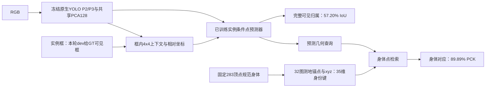

# V15实际对象、训练与可见归属可视化

11组主要PNG/SVG均来自真实训练/评价；原始3D图布局版另保留，不覆盖旧产物。几何着色图只在GT可见身体区域显示对应，以便与真值比较；它不是网络自动分离出的Mask。完整归属分数和FP/FN另在下排直接展示，不能把两者拼成完美预测。

## 结果与训练

- [能力总图](runs/RUN_SPM_V15_ACCEPTANCE_905695f75845/figures/00_object_capability.png)：历史V14与新框条件对象、六姿态、双猪同点与归属IoU。新增GT实例框/上下文在图中明确标记。
- [真实6000步训练曲线](runs/RUN_SPM_V15_ACCEPTANCE_905695f75845/figures/01_training.png)：训练目标、测地风险、采样归属BCE。低BCE没有替代完整Mask评价。
- [身体定位误差累积曲线](runs/RUN_SPM_V15_ACCEPTANCE_905695f75845/figures/02_pck_curve.png)：同147456身体点，输入信息有变化；不作单机制因果归因。
- [完整归属IoU分布与提示交换](runs/RUN_SPM_V15_ACCEPTANCE_905695f75845/figures/03_visible_ownership.png)：57.20%未过75%；交换另一猪提示后6.41%。提示敏感性不等于独立几何机制证明。
- [规范3D身体误差与实际覆盖](runs/RUN_SPM_V15_PRESENTATION_5f1c7ab85ba9/figures/04_canonical_body.png)：固定模板上的实际逐顶点误差/观察量。原始[布局版](runs/RUN_SPM_V15_ACCEPTANCE_905695f75845/figures/04_canonical_body.png)保留；修订只缩短轴标签和减少刻度，模型/数据/统计不变。

## 身体对应和可见实例

每图六格依次为：RGB和提供的实例框、GT身体位置、实际预测身体位置、图测地误差、完整可见归属分数、TP/FP/FN。绿为正确前景，红为多分，蓝为漏分。GT框/GT身体展示权限均有标记；归属Mask未作运行后额外裁框或阈值搜索。

- [站立](runs/RUN_SPM_V15_EVALUATE_4a9ce44bd9ee/figures/single_f024_p0_v0_a0_o0.png)
- [俯卧](runs/RUN_SPM_V15_EVALUATE_4a9ce44bd9ee/figures/single_f024_p3_v1_a0_o0.png)
- [侧卧](runs/RUN_SPM_V15_EVALUATE_4a9ce44bd9ee/figures/single_f024_p4_v2_a0_o0.png)
- [双猪000](runs/RUN_SPM_V15_EVALUATE_4a9ce44bd9ee/figures/crowd_000.png)
- [双猪024](runs/RUN_SPM_V15_EVALUATE_4a9ce44bd9ee/figures/crowd_024.png)
- [双猪048](runs/RUN_SPM_V15_EVALUATE_4a9ce44bd9ee/figures/crowd_048.png)

身体颜色由固定规范xyz决定，跨姿态相同颜色表示相同身体位置。双猪为2D受控cutout层叠，不能当作真实猪群图片。预定固定样例没有按结果重选。

## 本轮实际技术链路

本轮没有真实Mask融合或YOLO整网微调。相关事实见[完整报告](REPORT.md)、[完整对象权重与用法](USAGE.md)、[下一真实读出设计](NEXT_MASK_READOUT_PLAN.md)。
