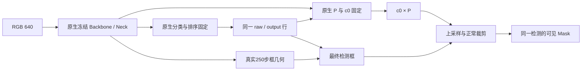

# 框优先结果与技术可视化

最终图使用实际固定分数几何候选；V9对象字段/响应是历史技术证据，不能当成当前原生首选的模块贡献。

## 当前首选的结果

实际变化图及6组修复/损伤/共同成功PNG/SVG位于[最终验收图目录](runs/RUN_SPM_V13_ACCEPTANCE_VISUALS_e307004b68ea/figures)。图中白色是GT，蓝色为原生N，橙色为当前几何；每一对固定同图、同GT和**同raw预测**，Box/Mask IoU均由这一条具体检测计算。GT仅作展示选择，不进入模型或AP预测。

- [整体实际变化](runs/RUN_SPM_V13_ACCEPTANCE_VISUALS_e307004b68ea/figures/00_actual_tradeoff.png)：相对N的Box AP、Mask AP及Box75成功数；原型F虽然Mask稍高，定位条件未过。
- [案例身份与自己的IoU](runs/RUN_SPM_V13_ACCEPTANCE_VISUALS_e307004b68ea/CASES.json)：各类按GT ID升序前两条，修复/损伤/共同成功都保留。
- [72项独立统计复算](runs/RUN_SPM_V13_ACCEPTANCE_VISUALS_e307004b68ea/RECALCULATION.json)。

## 学到的对象字段与失败融合

- [真实拟合的身体表面字段](../spm_box_first_joint_20261023/runs/RUN_SPM_V9_ACCEPTANCE_CPU_89494f930822/figures/03_actual_surface_field.png)：283顶点/562面，视觉分量着色；不是部位正确率证明。
- [真实RGB对象/背景/部位/残差响应](../spm_box_first_joint_20261023/runs/RUN_SPM_V9_INSPECTION_GPU_6be372015b8f/figures/image_1_object_response.png)：V9真实3000步末模型，前景绝对色标0–1。
- [V11两臂实际曲线](../spm_detection_only_prototype_20261023/runs/RUN_SPM_V11_ACCEPTANCE_CPU_c41d441d53ab/figures/01_training_AP.png)：原型F未超过强原生。
- [V12实际低置信像素删除](../spm_surface_evidence_readout_20261023/runs/RUN_SPM_V12_EVALUATE_100fa242b252/figures/1.png)：减少背景也侵蚀真前景，Mask AP对强B下降0.0795pp。

## 当前首选实际推理链路

当前原生首选不包含新增对象分支。测试过的原型路径及阴性保存在各自Study，不将普通框几何改进写成原型贡献。所有图均为实际数据/权重/响应，未使用生成式示意图代替实验结果。
