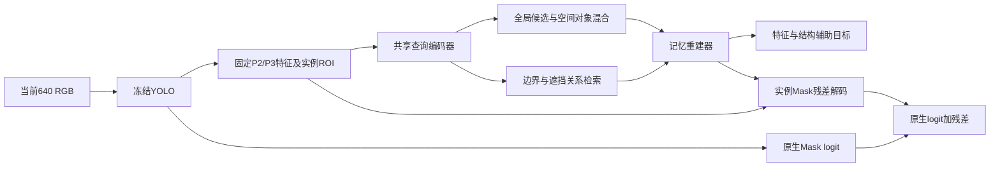

# V17 对象记忆：网络与优化设计 v2

2026-10-24。**设计修订，未实现该网络、未完成实际梯度/吞吐检查、未开始训练。** 本文件与[配置 v2](CONFIG_DRAFT_V2.json)替代[设计 v1](TRAINING_DESIGN_V1.md)中网络、检索、优化器和损失权重的对应建议；v1的数据权限、三阶段顺序、任务评价和旧实验边界继续适用。[Study](study.json)记录版本；[当前总控](../../project/ACTIVE_PLAN.md)是唯一执行路由。所有数值是首轮可检验设计，不能称已找到最优超参数。

## 1. 本次修正的理由与主判断

我主张先建立**全局选对象、局部组合空间内容**的可重建记忆，再学习遮挡条件下的检索，最后适配可见分割。优先解决“记忆表达能力、实例检索和训练目标是否相配”，保持YOLO冻结。

依据仍是[V15](../spm_canonical_object_training_20261023/REPORT.md)合成身体对应较好、完整归属不足，以及[V16](../spm_instance_body_readout_20261024/REPORT.md)同检测前景过删。它们没有证明新记忆有效，但支持把形状重建和当前像素归属分开监督。v1整对象Top-4全局混合还有一个可直接推导的表达约束：固定四个候选后，和为1的四个权重只有三个连续自由度；把每条内容加宽不会消除这一约束。

本次用空间混合解除该特定限制，不把它宣称为历史失败的已证根因。竞争解释仍是冻结视觉信息不足、有限数据上的过拟合或额外读出训练本身产生变化。A检验完整参照的可重建性，B检验遮挡输入的可取回性，C才检验正常部署效用。两臂效用范围不增加，M1–M4与干预预案沿用v1第七节；不据本方案宣称记忆的独立因果效应。

## 2. 张量流与网络规格

图中A/B的参考分支仅存在于训练。部署始终只读取当前RGB、正常预测框及预测邻框；真实遮挡背后的未知区域不成为伪标签。

### 2.1 固定视觉输入与查询器

基础YOLO沿用v1登记的V13候选，权重、BN、Box/Class/P/c0均冻结。已有接口是P2与上采样P3拼接的`512×160×160`；实际输入为640 RGB。仅在train拟合通道统计与128维PCA，冻结后实例ROI为`128×32×32`。PCA误差单列，不能将丢弃维度后的重建误差称512维信息全部恢复。

| 部件 | 明确规格 | 选择目的 |
|---|---|---|
| 局部编码 | 32²上2个128通道残差块；平均池化到16²后1块；再到8²后1块 | 保留局部轮廓，再形成空间对象表示 |
| 残差块 | 两个3×3卷积，无bias，各带GN(8组)及SiLU，恒等残差 | 不依赖微批次的BatchNorm统计 |
| 对象交互 | 8²的64个token上2层pre-LN自注意力，宽128、4头、FFN512、GELU、dropout=0，固定二维位置编码 | 让身体不同区域共同参与对象匹配 |
| 全局检索投影 | 对8²表示保留2×2池化布局，展平512→32，无bias | 避免全局均值完全抹去粗空间布局 |
| 对象局部投影 | 128→32，无bias | 每个空间位置分别匹配候选对象内容 |
| 边界/关系投影 | 每个4×4×128局部块展平2048→32，各一套无bias投影 | 读取两侧形态，不只用单点特征 |
| 关系上下文 | 16²查询对5个token做一层交叉注意力：目标、最多3个相交预测邻框、1个扩展场景；宽128、4头、FFN256 | 处理“本猪/邻猪/背景”的关系 |

上下文token为相应16²编码的均值，加6维相对几何`dx,dy,logw,logh,IoU,present`经6→64→128 MLP与三类角色嵌入。场景框为目标框中心不变、宽高1.5倍后裁到图像边界。邻居按预测框IoU降序，平局按输出ID；缺失邻居有显式掩码，均不读取GT。上下文ROI使用同一卷积编码器并复用每图缓存，不再次递归查询邻居。

新卷积路径采用GroupNorm，是因为小微批和相关的实例裁剪会使batch统计难以稳定；GN的独立批量统计依据见[Group Normalization](https://arxiv.org/abs/1803.08494)。基础YOLO原有BN保持eval，不替换其归一化。

### 2.2 持久记忆与检索

| 记忆 | 内容参数 | 最终检索 | 可表达知识 |
|---|---|---|---|
| 对象 | 128条，每条128×8×8 | 全局Top-4；64个位置在这4条内分别组合 | 对象的有序空间形态与视觉结构 |
| 边界 | 64条，每条128×4×4 | 在16²上的16个不重叠4²位置各Top-2 | 局部轮廓及相邻区域模式 |
| 遮挡 | 64条，每条128×4×4 | 上述固定位置各Top-2，查询加入关系上下文 | 局部可见性与前后归属模式 |

三库共1,310,720个内容参数，FP32为5 MiB。**检索键由内容经共享投影计算，不再另学一套可与内容脱节的自由键。** 32维查询与键先L2归一化，内容仍保留128维。低维检索/高维内容及归一化的经验依据来自[ViT-VQGAN §3.2](https://arxiv.org/html/2110.04627)；128/64/64的条目数是本项目起点，不是该论文证明的最佳容量。

对对象位置u与条目k：

\[
g_k=\cos(W_g\operatorname{pool}_{2\times2}H,W_g\operatorname{pool}_{2\times2}P_k)/\tau_g,
\quad S=\operatorname{TopK}(g),
\]
\[
b_{uk}=\operatorname{softmax}_{k\in S}\left[g_k+\cos(W_lH_u,W_lP_{ku})/\tau_l\right],
\quad Z_u=\sum_{k\in S}b_{uk}P_{ku}.
\]

同一实例的全局候选一致、局部权重可变。固定Top-4支持时，混合权重最多有64×3=192个连续自由度，而全图共用权重仅3个；这不是实际表示秩或性能提升的证明。共享全局项约束各位置来自相关候选，解码卷积进一步整合局部内容。空间格位是ROI坐标，不宣称对应已知身体解剖坐标或已学会任意姿态形变。

局部边界/关系用投影后的4²查询与4²内容余弦分数，Top-k内softmax再重建4²块。不在GT边界上挑推理位置。A阶段对象记忆从较完整参照查询，边界/关系从当前场景查询；B训练当前图像的对象查询取回参照内容。

这是可微稀疏软字典，不是硬量化VQ-VAE：**不直接照搬commitment loss的0.25，也不同时采用梯度更新与VQ码本EMA更新。** [VQ-VAE](https://arxiv.org/html/1711.00937)区分这些更新方式；其损失系数依赖重建项尺度。本设计的内容用AdamW更新，EMA0.999只保存整模型的平滑候选，两者身份不同。

### 2.3 重建与任务解码

对象8²表示上采样到16²，经3×3 128通道卷积；与边界/关系的两个128通道图拼接成384通道，1×1压到128，接2个残差块。再上采样32²、3×3卷积与1个128通道残差块，形成共享重建表示R。

- 特征头：1×1输出128×32×32，监督固定参照特征的已知对象区域。
- 结构头：上采样64²、128→64卷积、64通道残差块；再上采样128²、64→32卷积、32通道残差块；1×1输出12通道。分别为可见Mask 1、合法完整形状1、符号距离1、边界类型3、归属3、局部前后关系3。未知完整形状/顺序使用有效性掩码，不补背景标签。
- C细节支路：当前冻结512维特征采64² ROI，1×1到64通道并接2个残差块；与结构解码器64²的64通道表示拼接，128→64卷积、1个64通道残差块，上采样128²后64→32卷积、1个32通道残差块，1×1输出单通道残差。

所有普通卷积后带GN(8组)/SiLU；输出头有bias、没有GN/激活。最后残差输出层权重和bias均初始化为0。残差映射到640坐标，与原生阈值前logit相加，沿用原生预测框裁剪与阈值；Box/Class/score/排序/输出ID均精确不变。结构Mask损失也映射到相同640坐标；特征重建保留32²。

**A的主重建器无原图/查询跳接；C允许细节支路，但保留独立记忆重建监督。** 这使A无法完全绕过检索，不保证C必然依赖记忆；若没有后续定向对照，不能称已证机制。

按上述模块定义的解析参数量：记忆1,310,720，查询/投影/关系网络1,871,680，记忆解码器1,432,908，C细节支路365,793；A合计4,615,308，完整部署新增4,981,101，约4.98M。B冻结内容与共享检索投影后，查询器可训练参数为1,720,128。此为规格算术，不是已实现模型的参数枚举或前向测试；见[解析检查](DESIGN_CHECK_V2.json)。

## 3. 三阶段优化参数

| 参数 | A 记忆形成 | B 遮挡检索 | C 真实分割 |
|---|---|---|---|
| 轮次预算 | 30完整轮 | 15完整轮 | 30完整轮 |
| 有效批量 | 64个案例 | 64个案例 | 32个检测/实例案例 |
| 网络峰值LR | 候选1e-4或3e-4，起步标定后冻结 | 1e-4，迁移已训练查询器 | 查询器/解码器/细节1e-4 |
| 内容与共享检索投影LR | 所选网络LR的1/3 | 全部冻结 | 前5轮冻结；后25轮1e-5 |
| 原生YOLO | 全冻结 | 全冻结 | 全冻结 |
| 优化器 | AdamW，betas=(0.9,0.999)，eps=1e-8 | 同A | 同A |
| 权重衰减 | 普通Conv/Linear权重1e-4；内容、bias、归一化与角色嵌入不衰减 | 同A | 同A |
| 日程 | 1轮从峰值1%线性预热，再余弦至峰值1/30 | 同A | 网络同A；记忆第6轮单独预热后余弦 |
| 数值保护 | 全局梯度范数裁剪1.0；EMA0.999 | 同A | 同A |
| 候选权重 | 固定末轮EMA | 固定末轮EMA | 固定末轮EMA |

B初始化为A编码器；冻结的检索投影仍允许梯度传回查询输入。不能一边宣称B记忆固定，一边训练共享键投影。C后期内容与投影按较小学习率一起更新，保持查询/键坐标一致。

实际单卡micro-batch拟8案例；A/B单卡累积8次，双卡各8并累积4次；C单卡累积4次，双卡各8并累积2次。**64个配对案例可能包含128个图像特征视图，不是64张独立RGB。** 双卡不额外放大学习率；最后不足一批按实际案例权重归约，不丢样本或用填充复制增加样本权重。共享源对象的多个遮挡版本尽量不进入同一批。

仅编码器/解码器主计算使用已核支持的BF16；不支持时明确冻结为FP16+GradScaler。记忆主参数、余弦归一化、softmax、距离和损失累加用FP32。梯度累积结束、反缩放后裁剪；EMA只在成功optimizer step后更新。基础特征提取保持无梯度；冻结BN统计也核验哈希。

### 3.1 稀疏化、温度与初始化

v1在2轮后直接跳到Top-4可能使未选条目失去重建梯度。本版先广后窄，日程在正式训练前固定：

| A轮次 | 对象候选数 | 边界/关系候选数 | 全局/局部温度 |
|---|---:|---:|---|
| 1–2 | 128 | 64 | 对象全局0.2起步，至第10轮线性降到0.1；对象局部与边界/关系保持0.2 |
| 3–5 | 16 | 8 | 同一连续日程 |
| 6–10 | 8 | 4 | 同一连续日程 |
| 11–30 | 4 | 2 | 对象全局0.1，其余0.2 |

B/C使用最终候选数和温度，不再次热启动为全库。Top-k支持选择不可微，所选分数和内容仍有梯度；不假设硬索引本身可导。相同分数以条目ID打破平局。

卷积采用Kaiming初始化，注意力/Linear采用Xavier，归一化scale=1、bias=0，除C末层零初始化外不另加零门控。记忆从当前初始编码器的train输出初始化：对象使用8²表征，边界/关系使用4²块；选唯一train锚点并按固定种子最远点取样，缺少足量锚点记输入不足。局部库初始化可按已知类型分层，但正式训练保持既定真实频率。

每轮记录按来源分组的Top-1占用、soft分配质量、条目间相似度及重建误差。**取消v1未定义清楚的usage损失，首轮设0，仅监测占用**，不强迫真实稀有姿态与常见姿态等频。正式Run不自动重置死条目、扩库或改变温度来追结果。很多条目闲置时先检查检索/数据覆盖；多数条目被用且训练重建仍不足时，才有理由在下一版本考虑增加容量。

### 3.2 损失按归约和梯度定标

保留“固定视觉特征为主，掩码/边界/归属辅助”的目标，但撤回v1未经标定的统一0.25建议。所有项先按有效像素/通道平均，再按案例及来源组归约；真实/合成域的整轮期望贡献为3:1。不同域以各自完整无放回序列合并，不以循环小域凑批量；实现须用域内案例数校正微批贡献，并核对整轮分母。

\[
L_A=L_f+\lambda_m L_m+\lambda_b L_b+\lambda_o L_o+0.05L_{pair}.
\]

- `Lf`：标准化固定特征的Smooth-L1(beta=1)与逐位置余弦误差各1/2，忽略无合法对象目标的位置；零范数目标不计算余弦项。
- `Lm`：各合法可见/完整形状头内部BCE与Dice均值，再在有效头之间平均；不存在的完整形状不补损失。
- `Lb`：640坐标的符号距离截断到±8像素后除8，Smooth-L1；与已知边界类型CE在有效项间平均。
- `Lo`：self/other/background归属CE，与有标签的局部前后关系CE在有效项间平均；未知顺序忽略。
- `Lpair`：同姿态同相机配对的对象检索分布KL，参照分布stop-gradient；全局KL与64位置局部KL均值各1/2，在Top-k前的全库分布计算。边界/关系不强制遮挡不变。

拟在至多16张合法训练图组成的8个固定微批上做零更新反向标定，含原始真实、再遮挡、合成完整监督。以共享重建表示R上的梯度为尺度，`Gh = median ||∂Lh/∂R||`：

\[
\lambda_h=\operatorname{clip}\left(0.2G_f/(G_h+10^{-12}),0.02,1.0\right),\quad h\in\{m,b,o\}.
\]

若三个辅助项的加权梯度范数之和超过0.6Gf，再同比缩小三个系数。随后冻结并写入真实合同，不在正式Run中动态追AP。该方法只标定此共享层的相对尺度，不保证所有参数无梯度冲突或权重最优；同时记录方向夹角。梯度为0、非有限或标签缺失时先修路径/输入，不能计算一个极大系数顶替。

`Lpair`作用于检索分布，不能拿它在R上的零梯度参与上述公式；0.05作为明确的初始设计值。B采用`Lf + λm Lm + λo Lo + 0.1 Ldistill`，冻结解码器后按同样原则另做零更新定标，两个辅助项总梯度尺度上限0.4Gf。蒸馏同时覆盖全局/空间对象分布及合法当前边界/关系分布，各组先均值；全部在Top-k之前计算，参考分支冻结。

C沿用`BCE640 + Dice640 + 0.1 Lboundary + 0.1 Lmemory + 0.05 Lpreserve`作为任务起点，BCE/Dice按有效实例归约；原生正确且离边界>3像素的内部才受保持项约束。C残差末层为0时，上游细节梯度和保持损失梯度首次可为0，这是预期；应在首个有效输出层更新后核验上游梯度，不能误报断链或据零梯度重新计算无限权重。其系数仍是待验证设计值，不伪称已完成标定。

## 4. 如何选择超参数，而非全参数盲搜

首轮固定网络宽度128、条目128/64/64、最终Top-k为4/2/2、有效批量和三阶段结构。优先核验**学习是否稳定、训练重建是否能拟合、留出误差是否同步改善**，不同时搜索几十种K/损失/模块组合。

提出一次独立登记的A起步标定：网络LR只比1e-4与3e-4，同初始化、同数据顺序，各最多2个完整标定轮；内容/投影均为对应LR的1/3。用原train内部按视频/源图/几何来源划出的20%组作标定留出；对象及其全部增强、遮挡者来源必须随组隔离。PCA/统计/码本初始化只拟合内部80%，不能先用全部train拟合再声称留出独立。原432 dev和test均不用于这次LR选择。

选择规则在标定前冻结：先排除非有限/明显失稳；在合法标定留出上比较实例宏平均固定特征误差，差异小于1%相对误差时选较低LR。两者均不稳定则停止修工程；未跑完共同轮次或预算不足则记选择未完成，不以中途读数选胜者。2轮主要检查起步稳定性，**不能确定稀疏化后的最佳学习率或证明收敛**。标定权重丢弃；正式A重新初始化、按已选规则使用全部train重新拟合固定统计，记录这一差异。

标定提议上限2 GPU小时，**计入原A含准备的16 GPU小时**，不增加总32 GPU小时；因此A正式训练可用预算会减少，需吞吐检查后确认能覆盖30轮。它不是≤8步工程烟雾的一部分，也没有在本轮执行。B以A权重迁移，用1e-4起步；C再以0.1倍更新记忆，避免新分割目标快速改写已学对象。若之后需要搜索B/C参数，应另冻版本，不能暗中增加预算。

30/15/30是完整覆盖预算而非收敛结论。每阶段同时保存train与固定留出的特征误差、归属IoU、实际unique-case覆盖及梯度范数曲线；有效步数由真实manifest与batch求得，不能先写4000步再宣称充分。若末轮训练/留出都仍明显改善，报告预算不足以判断收敛；若train低、留出高，优先视为泛化问题；若A在完整输入下都差，不进入B/C掩盖重建失败。正式Run不临时加轮或挑中间checkpoint。

## 5. 数据、成本与下一步

沿用v1的14642原始真实train实例和9039合格donor登记；每donor三种新增遮挡得到27117新案例、真实来源合计41759案例/轮，当前尚未生成。30轮为1,252,770次案例曝光，不能称125万独立对象。合成来源仍主要为单一基础资产，重排外观不等于增加身体资产多样性。真实隐藏形状只有未知，人工再遮挡才提供原可见区域的恢复目标。

完整640 RGB上提取每个增强版本的冻结特征；不持久缓存所有512×160²大图，否则容易超200 GiB。A/B优先缓存可追溯的ROI、邻域描述和标签；C细节特征按图流式计算或有界缓存。每个缓存条目必须对应实际RGB/框/变换哈希。吞吐、显存、I/O与总存储尚未测量，解析参数量不能代替它们。

能力门槛与退出沿用v1：A检查留出重建是否胜过train均值参照，B检查受遮挡检索和归属，C检查同输出的实际Mask AP增量及损伤；+5点仍是未达项目目标。仅原生V13与完整方法作任务效用比较；不因设计细化就增加机制对照臂。

**唯一下一步：按v2实现配对manifest与记忆重建最小网络，完成参数/张量/梯度/成本工程核验，再冻结实际标定和A训练合同。** 当前新训练0步、远程作业0；本次完成的是网络与超参数决策设计，未把计划写成实验结果。
