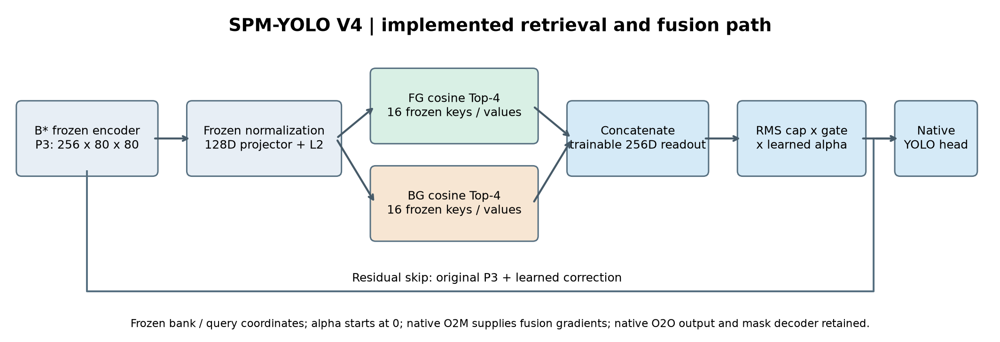
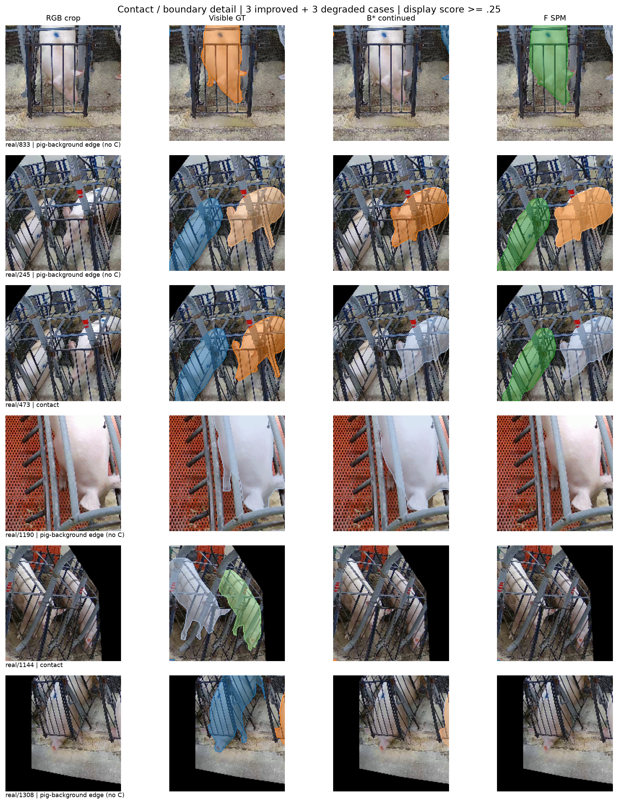
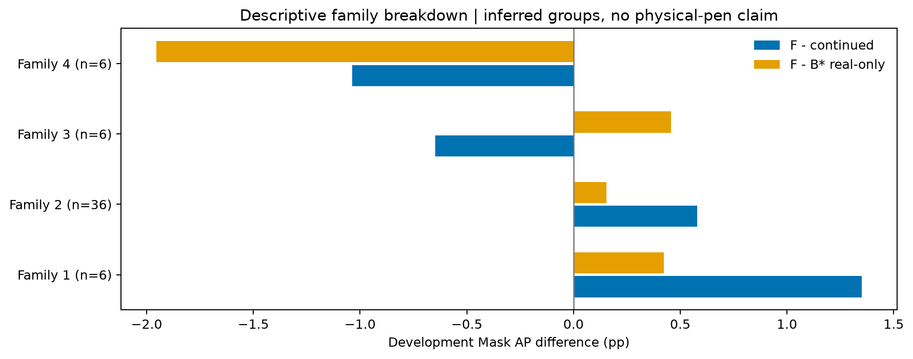

# SPM-YOLO V4重点技术与最终结果可视化

**实际训练已完成，单seed、54张real-dev图。** F Mask AP=50.9267，比同预算continued +1.3045pp，比G +1.3725pp，比B* +0.2306pp；AP75相对B*下降1.1407pp。

推理关闭检索几乎不改变结果；优先使用已导出的原生head权重。图中的gate/相似度/残差全部来自真实checkpoint。开发选例不是独立test或统计显著性证据。

接触放大图经复核：不存在C token的样本改取猪-背景边界，并在图下注明；旧版crop保留在原Run，不再作为正式展示。

[完整报告](REPORT.md) · [权重与推理](USAGE.md) · [独立验收](ACCEPTANCE_RECEIPT.json)

## 实现结构与冻结/训练边界

## 训练曲线与四臂真实开发成绩

## 独立原型训练损失和梯度

## 数据来源、猪体尺度和姿态分布

## 16个前景原型的真实近邻与来源

## 16个背景原型的真实近邻与来源

## 32槽原型利用率与来源占比

## 真实/合成及C/B/I/BG嵌入分布

## 固定开发样本的改善与退化全图

## 接触与猪-背景边界放大；无接触时明确标注回退

## 实际检索相似度、分配、gate和有效残差

## 推理开销与同checkpoint必要干预

## 4个推断family的开发收益与损失

