# SPM-YOLO V4 technical visualization gallery

Single seed; 54 real development images; 640 canvas. F - continued: +1.3045 pp; F - G: +1.3725 pp.

Checkpoint selection uses development AP. These are not independent test results.

## 01_training_and_results

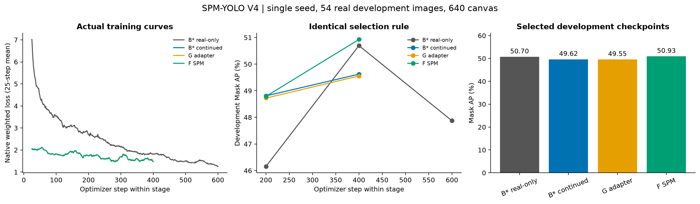

## 02_prototype_training

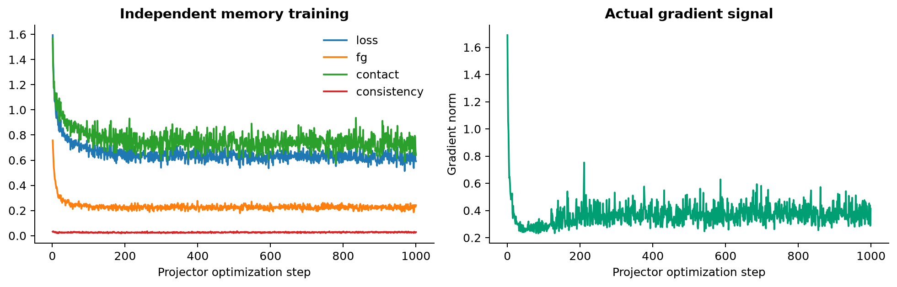

## 03_data_distribution

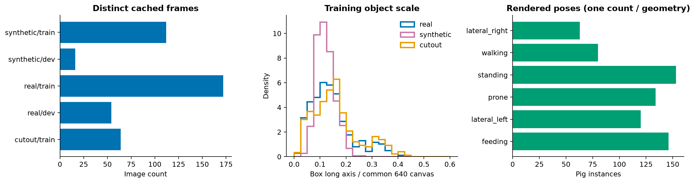

## 04_prototype_atlas_bg

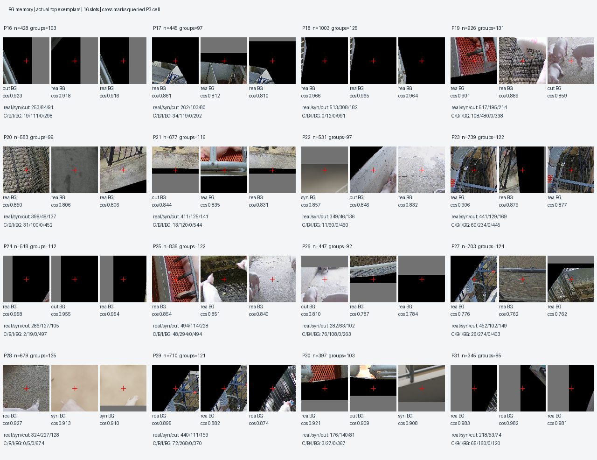

## 04_prototype_atlas_fg

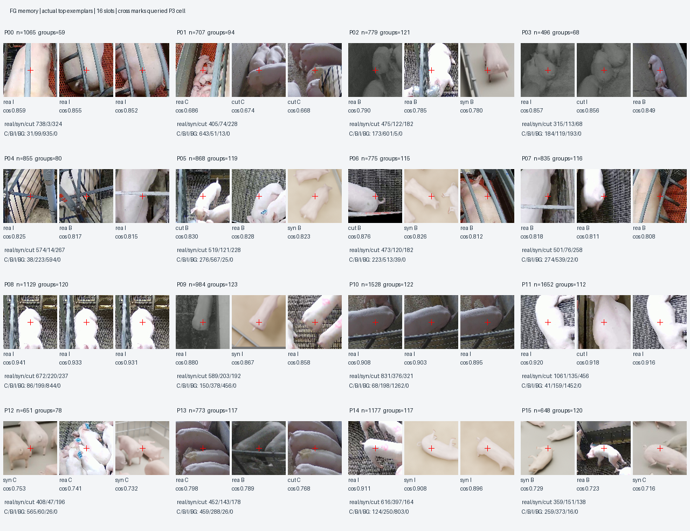

## 05_memory_support

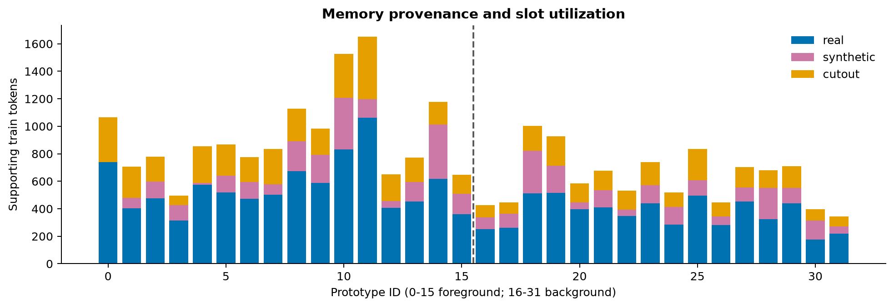

## 06_embedding_PCA

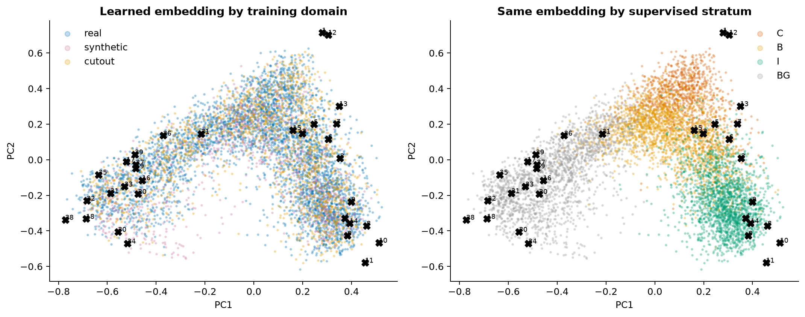

## 07_improvement_and_damage

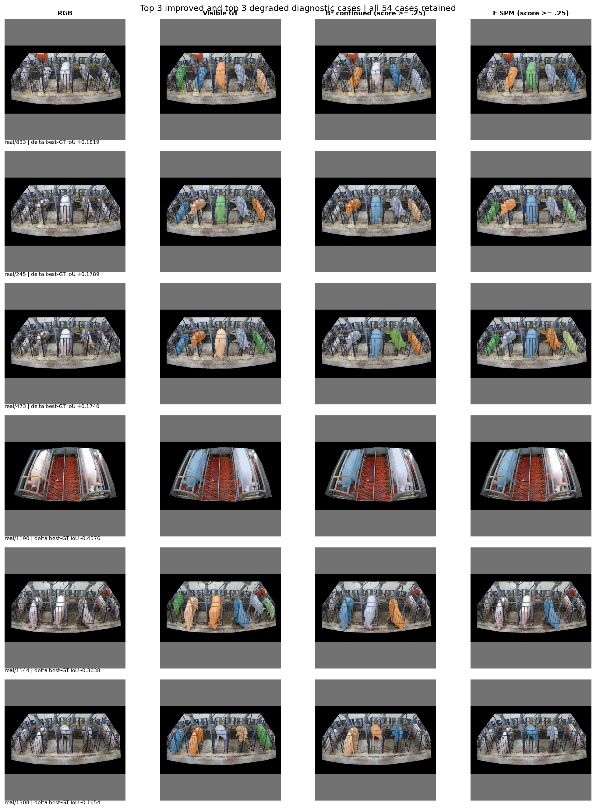

## 08_contact_zoom

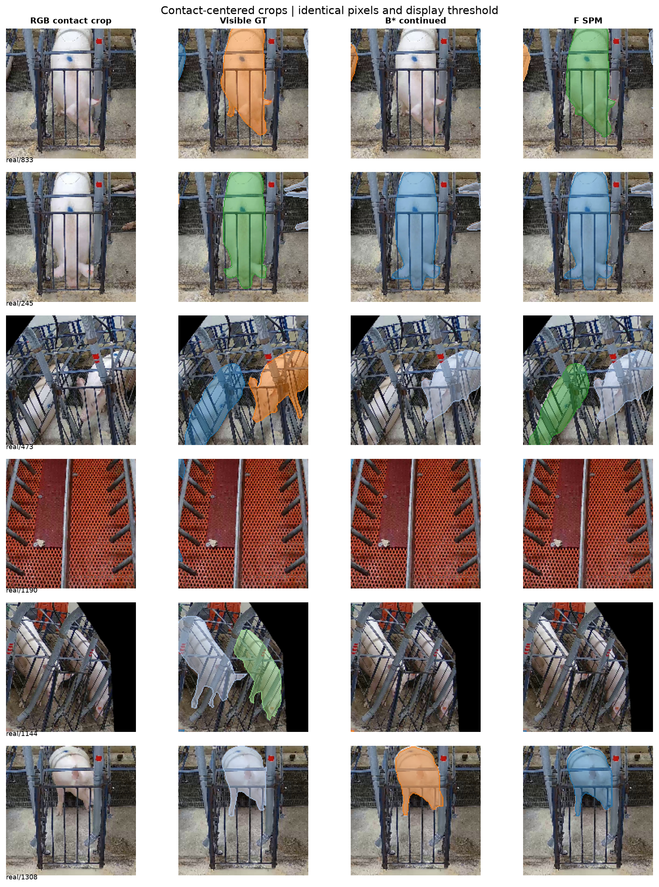

## 09_retrieval_gate_residual

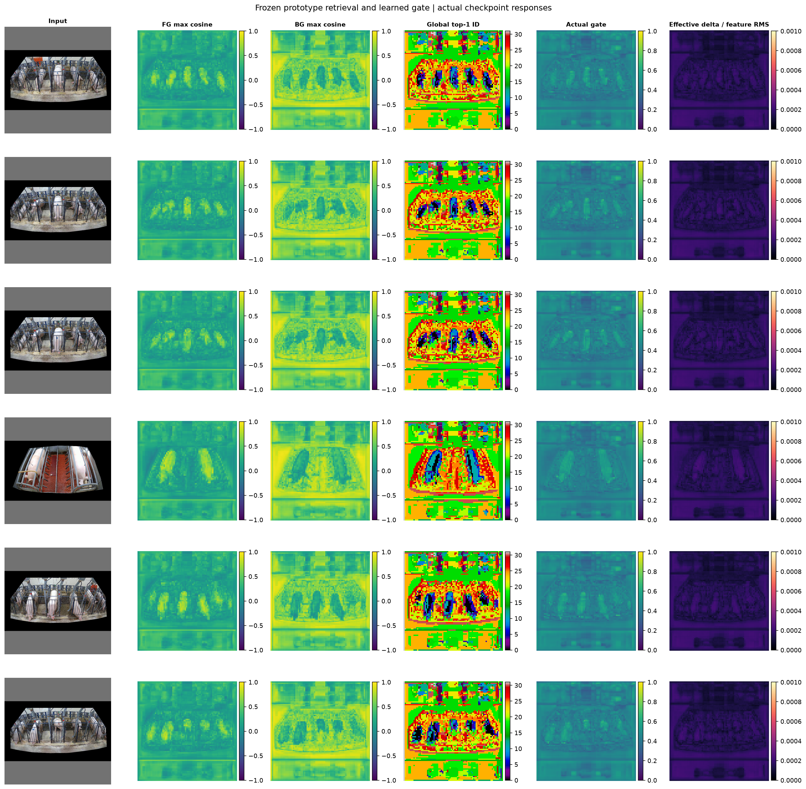

## 10_cost_and_interventions

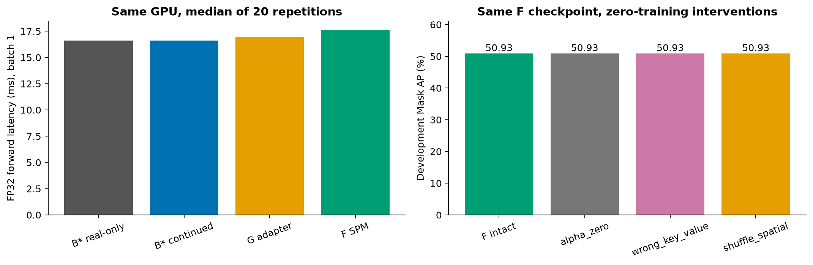
