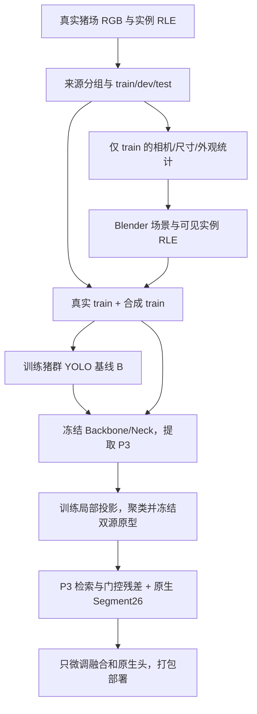

# SPM-YOLO 基础实现方案 V0.1

**2026-10-22｜设计已细化，代码未实现、数据未核齐、未渲染、未训练。**

用户本轮要求：先完善必须实现的基础链路，效果与大规模对照以后讨论。本文件是基础实现入口；[V2 蓝图](IMPLEMENTATION_BLUEPRINT_V2.md)保留素材和扩展细节，[频率规范](REAL_FREQUENCY_TRANSFER_SPEC.md)保留可选图像处理，[实验矩阵](../../../experiments/spm_yoloseg_20261021/PILOT_AND_ABLATION_V2.md)留待基础链路接通后使用。实际执行配置另行冻结；本文件不创建 Run 或授予远程运行权限。

## 1. 第一版究竟做什么

**用真实训练数据约束 Blender 猪群场景，训练一个猪群 YOLO 基线；从同一个基线提取真实与合成局部特征，学习投影、聚类并冻结视觉原型，再把检索响应以残差方式接入该 YOLO 的 P3 输入。** 部署只输入一张 RGB，输出每头可见猪的 box、score 和可见实例 mask。

这里的“训练原型”包含两个不同动作：① 用对应视图学习特征投影；② 对投影后的训练 token 聚类形成记忆。第一版检索微调时不再更新原型向量。原型是外观/局部模式先验，不是猪身份、已证实的语义部位或被挡住的真实轮廓。

第一版必须包含：真实数据与划分、基本 Blender 几何/材质/成像、可见实例标注、共用 RLE 加载器、一个混合数据基线、P3 投影与双源原型、检索融合、原生训练/推理接口及存取核验。第一版只用 P3；P4、额外教师、域判别器、amodal 预测和跟踪暂不进入基础实现。真实高频匹配是可独立关闭的数据选项，不是原型接入的必经前提。

研究依据是跨图像重复局部模式可压缩为训练先验这一机制推导及已有聚类/表征方法；**本线尚无 Run 证明猪群分割受该因素限制**。因此基础工程可以明确设计，方法有效性仍为待检验假说。

## 2. 一条完整的数据流



真实 dev 仅用于允许的开发检查；test 不进入场景统计、纹理、投影、构库或参数选择。图示中的每个“训练”都是未来独立登记的阶段，不表示已经运行。

## 3. 必需输入、位置与尚缺事实

| 输入 | 第一版必须具备 | 当前核实情况 |
|---|---|---|
| 真实 RGB、实例标签 | 文件可读；可见 mask；帧与视频/猪栏/相机的来源关系 | 真实文件、标签修订、分组与 SHA 待本线清点 |
| 真实数据来源 | 优先核 PigLife 与已有自采数据，不先下载多个新库 | [PigLife 官方资料](https://data.aifarms.org/datasheet/piglife)描述图像/视频和猪的 mask；不等于本地标签已验收 |
| 猪体/场景资产 | 可导入 Blender、姿态/材质可用、米制单位和相机参数可追溯 | V2 所列 pig.dae、24骨骼、1.625秒为已有设计记载，实际资产路径、哈希、蒙皮与尺度待核 |
| 基础权重与版本 | 提议 `yolo26m-seg.pt`、640输入、Ultralytics 8.4.100；只作为本线初版选择 | 仓库有该版本源码；本线实际权重 SHA、运行环境、资源与预算未冻结 |
| 执行位置 | 用户指定的设备和个人项目目录 | 本线未选择执行端；不从旧线继承已开训状态 |

历史资料中有 PigLife/FaroPigSeg 的路径和旧测试记录，可用于找回文件；那些已看过的测试图不能重新宣称全新盲测，其数值也不是本线成绩。清点范围先限仓库及登记路径，未知位置不猜测。

## 4. 数据和标注：先固定可见任务

### 4.1 划分与最小记录

先按实际独立采集单元建立 group_id，再按组划 train/dev/test，最后抽帧。相同猪栏/相机/连续事件若共享静态背景或高度相邻内容，不能仅凭 video_id 不同就当独立。已有使用历史写 exposure_history；独立来源不足时如实限定泛化范围。

每图最少记录 `image_id, relative_path, sha256, width, height, source_id, group_id, video_id, camera_id, split, annotation_sha256, annotation_origin, exposure_history`。缺失来源写 null 并登记原因，不编造 farm_id。

### 4.2 权威标签与训练加载

- 权威标签为原始分辨率的 COCO instance RLE，每头猪一个 annotation；单类 `pig`，COCO category_id=1，训练 class_index=0。完整 mask、深度、姿态只供合成标注核验。
- 可见 mask 是相机首先看到的猪表面；保留被围栏切断的多个区域、孔洞及画面截断。完全不可见实例保留场景真值，但不作为可见猪目标。
- RGB 变换与 RLE 解码后的栅格 mask 使用同一几何映射；实例 ID/mask 用最近邻，RGB 用约定图像插值。原始 RLE→解码→重新编码必须像素完全一致。
- **不得把多个断片连接成单多边形来适配训练器。** 基础实现选择共用 RLE 数据加载适配层；基线与增强模型都使用它，并公开这项与默认 polygon loader 的区别。
- 加载器生成 `img, batch_idx, cls, bboxes, masks, sem_masks` 及原图坐标映射；box 由变换后可见 mask 推导，归一化 xywh。保持所有实例数组同序，合法处理空图、空 mask、出画和小实例。
- 首版 `overlap_mask=false`，每实例独立 mask，`sem_masks` 为原生头所需的类别索引图；猪前景仍是 class_index=0，不能误填成“背景类1”。前景是否存在由实例 mask 并集表达。
- 首版候选 `mask_ratio=4`。原图 RLE 无损核验与训练 mask 下采样损失分账：降采样可能丢细线/孔洞，不能要求其与原图像素完全一致。若需改 mask_ratio，对基线与增强模型一起改并登记新合同。
- 初版关闭依赖 polygon 的 mosaic、mixup、copy-paste、随机透视和多尺度；先保留固定 letterbox、共同作用的水平翻转和基本光度增强。以后逐个支持栅格变换，不依赖框架隐式重建 polygon。

## 5. Blender 基础合成：先得到能用的场景

仅用真实 train 统计确定相机族、猪的投影尺度、数量/位置、肤色与光照范围；统计不够就写明估计范围。场地先实现地面、栏杆、食槽/饮水器及基本光源，不先堆完整农场建模。

每头猪注册独立 instance_id；检查骨骼蒙皮、脚底位置、体长尺度和碰撞体。随机姿态/步态相位、朝向和位置，拒绝严重穿模、漂浮和墙外布局。一个模型的缩放和重复动作不能当作种群/动作多样性已充足。

每个 geometry_id 导出：RGB、可见 instance-id 栅格、COCO RLE/bbox、可选 amodal、相机 K/T、资产/脚本 SHA、seed、姿态与材质参数。amodal 是同猪同姿态在同一画面内移除外部遮挡后的投影；出画面积与外部遮挡分开。

**几何与成像顺序：** 场景渲染 → 共同几何 warp/像素采样 → RGB 光度/相机处理 → 固定网络预处理。镜头畸变、裁切、下采样属于几何合同；RGB 与标签同步，且所有配对视图共用同一映射。PSF/噪声/锐化/编码只改变 RGB，不对 ID 图做模糊或压缩。

第一版无需真实贴图即可用程序性肤色、污渍、粗糙度和基本相机处理生成数据。真实 train 皮肤纹理若可核实来源与纯度，再作为有开关的材质输入。合成数据量和渲染预算由资源与真实数据清点后确定，不把 V2 的600/3000张建议视为当前授权。

## 6. 真实纹理/高频模块的必要接口

该模块独立于构库和检索；配置默认 `enabled=false`，保留用户提出的真实域适配路线。最小接口：

```text
训练域 RGB + 标签/来源 → train-only patch_manifest + 条件谱统计
合成 RGB + instance_id + 同一 geometry_hash + 条件谱统计
    → 处理后 RGB + 相同标签 + 变换/来源清单
```

猪皮、背景统计分开；实际 patch 的像素尺度与处理所在网格一致。不能把在640网格测的频率直接作用于1080p RGB；若在相机原分辨率处理，必须先换算/重估相应尺度统计。腐蚀有效区与边界保护带均在该网格定义。

高频处理保持源 patch 相位，只混合许多真实训练 patch 汇总的振幅包络；不复制 donor 轮廓。不把 real-HF 和相机退化绑成一个不可拆开关。DC保持、共轭对称、有限增益和像素范围检查必须明写；`alpha=0` 用增量重建保证恒等，见[频率规范4.2节](REAL_FREQUENCY_TRANSFER_SPEC.md#42-支路-b类别条件真实高频幅度谱适配容易先实现)。皮肤纹理与相机噪声不是同一信息，不从压缩RGB唯一反演真实albedo/法线或RAW噪声。

## 7. 先得到用于构库的猪群基线

基础模型提议 YOLO26m-Seg，`nc=1, imgsz=640, rect=false, end2end=true`。官方 COCO 预训练权重按本版本规则迁移到单猪类别，分类层形状变化及初始化写入记录；不把原80类分类层直接当单猪分类器。

用同一真实 train 与合成 train 训练一个混合基线 B；原生 Segment26 结构、掩码基底与系数维数、正常 O2O推理和 decoder 保留。**保留结构不代表头参数永久冻结**：B 训练和之后微调允许的头参数分别登记，查询来源在构库后固定。

真实与合成采样表、步数、batch、优化器、增强、EMA及checkpoint选择是未来运行合同的必填项；尚未核数据/设备，当前不填假预算。先有可读 B checkpoint，才能用 B 的特征学习投影和构库，不能倒用增强模型反复重建同名库。

## 8. 原型怎样学出来

### 8.1 特征坐标与采样

冻结 B 的全部 Backbone/Neck 参数及 BN统计，读取**进入 Segment26 之前**的 P3张量 `F:[B,C3,H3,W3]`；640入口通常80×80，C3与具体层号以本线模型实际导出为准。只用P3，避免未验证的跨尺度共同空间假设。

将输入网格与可见mask、已知增强变换相连。对P3位置记录前景占比、主实例占比、到不同实例/背景边界的距离和来源。首版优先采纯猪体内部与纯背景；接触混合位置保留审计记录，不硬当纯单猪token。位置纯度不等于卷积感受野完全不含邻猪。

按real/syn、视频、实例和尺度限制token量；同场景多个风格视图共享支持身份，不能虚增独立支持数。保存采样清单，避免连续视频和大背景占满记忆。

### 8.2 投影训练

学习 `h=W(F)∈R^128`，并保留未归一化h；查询/聚类使用 `q=h/max(||h||,eps)`。首版W为带偏置的1×1线性投影；额外fg/bg二分类头仅用于投影训练，构库后不部署。

正对只有：同一真实训练图的已知变换对应位置、同一合成场景不同外观的同一可见位置。几何变换需将坐标逆映射到共同有效区，剔除遮挡/裁切失效对应。不同猪、未知部位的real/syn特征不强配正对。

候选目标为 `L_proj = w_inv·MSE(h_a,h_b) + w_var·L_var(h) + w_cov·L_cov(h) + w_fg·BCE(logit_fg(h),y_fg)`。**方差/协方差在未L2归一化h上计算**，对应[已有VICReg思路](https://github.com/facebookresearch/vicreg)；不能将单位球128维坐标直接要求每维标准差≥1。使用跨图/视频均衡token形成批次；权重、增强和步数在执行前登记，本阶段不调整YOLO。

训练完成后冻结W，按同一代码、预处理和来源清单重新提取q；不得把投影训练中不同step的token混成一个静态库。

### 8.3 动态聚类与原型文件

保留动态发现K的原设计，明确算法是**球面阈值聚类，受DP-means启发**：按固定seed清单遍历单位token，计算 `d²=||q-p||²`，若最小距离大于λ则建簇，否则累计该簇向量和及支持元数据；中心由向量和归一化得到。λ、遍历轮数、最小支持、合并阈值和总K上限在构库前记录。删除/合并和球面归一化改变了原算法，不能沿用[DP-means](https://arxiv.org/abs/1111.0352)原目标单调下降的保证。

猪体/背景各一个分区；real/syn是来源元数据，不先额外建多个网络。少量纯合成簇允许单独标记，不能全删后仍称双源；也不强制每簇都有真实支持。K上限只防资源失控，触限就报告截断与拒收数，不宣称自动找到最优K。

保存 `memory.pt`：`keys_fg[Kf,128], values_fg[Kf,128], keys_bg[Kb,128], values_bg[Kb,128], projector_state, support_metadata, manifest`。基础版key和value都等于对应冻结中心，以不同字段保存便于明确后续替换语义；Kf/Kb、中心SHA、来源索引与聚类规则一起记录。不依赖事后部位命名执行推理。

## 9. 怎样接入YOLO

同一固定P3位置计算：

```text
q_i = normalize(W(F_i))                   # W冻结，与构库相同
s_i^fg = q_i @ keys_fg.T / tau
s_i^bg = q_i @ keys_bg.T / tau
idx = topk(s_i, min(4, K_partition))       # 两个分区分别取
r_i = Σ softmax(s_i[idx]) * values[idx]
u_i = Wo(concat(r_i_fg, r_i_bg))           # [256] → [C3]
g_i = sigmoid(G(concat(F_i, maxcos_fg, maxcos_bg, gap)))
F_i_enhanced = F_i + alpha * g_i * u_i
head([F3_enhanced, F4, F5])                # 调用原生Segment26
```

相似度统计统一用除温度前的cos，gap=maxcos_fg−maxcos_bg；tau为单个固定正数，第一版不额外学习查询/温度。G提议一个1×1线性层输出每位置一个gate。alpha为单个可训练标量，初始0；Wo与G非双零初始化。库为空、零范数、非有限值直接在加载核验中报错，不在推理静默换随机库。

Wo、G、alpha放在**Segment26前的独立模块**，避免子类被继承forward_head错误重复调用。保留P3/P4/P5通道、步幅和原生头输入结构，parser、stride探测、加载保存、optimizer、EMA、训练/验证返回结构均需显式支持该模块。第一版仅实现普通PyTorch推理，模型导出兼容性另记，不以ONNX未实现否定基础链路。

**该分支会同时影响Box/Class和Mask。** 本线不继承旧fixed-detection约束；跨模型比较使用完整正常输出，不能声称检测行身份始终相同。只在alpha=0等价核验时要求同输入同输出。

## 10. 训练顺序与梯度必须接通

| 阶段 | 更新什么 | 保持什么 |
|---|---|---|
| 基线B | 本线基线合同允许的原生YOLO参数 | 输入/可见任务、共用加载器和decoder |
| 投影 | W与辅助fg/bg头 | B全部参数、BN统计 |
| 构库 | 离线中心累计，不是YOLO优化步骤 | B、W与采样身份 |
| 接入微调 | Wo、G、alpha及原生Segment26头参数 | Backbone/Neck、W、memory及其BN/持久buffer |
| 部署 | 无更新 | 单RGB输入、冻结记忆与打包权重 |

**已做静态源码核查，尚未做运行核验：** 本地8.4.100的`Detect.forward`先构建one2many，再对输入`detach`构建one2one；`Segment26.forward`还将one2one使用的proto分离。对应文件[head.py](../../../shared/vendor/ultralytics_8_4_100/ultralytics/nn/modules/head.py)，SHA256=`759a454e03a9b4ebe4c69628292b0acc0469bb5f9dba278f7bc4b54c214bf209`。

因此第一版保留原生one2many+one2one联合训练及其原生权重调度，由one2many路径给接入模块传梯度，one2one头照常学习，部署仍走O2O。**不能只算O2O损失，再把Wo/alpha无梯度误判成原型无用；也不删除detach来“修好”训练。** 新版本源码需重新核验，不从在线main推定一致。

冻结状态在每次model.train()之后落实：上游requires_grad=false、eval/BN统计固定，W固定，memory注册为persistent buffer且逐阶段SHA不变。optimizer先按名称白名单建立，核Wo/G/alpha实际在参数组内；EMA和checkpoint需携带本模块和memory引用。冻结memory直接共享或精确拷贝，不对其做浮点滑动平均，避免EMA悄悄改变中心。alpha=0首步Wo/G可为零梯度；应先核alpha梯度/更新，再核后续有效梯度，不能要求第一步所有参数同时非零。

## 11. 最少需要实现的代码与文件合同

下列均为**拟建模块/产物**，不表示代码或模型已经存在。

| 模块 | 输入 → 输出 | 必须处理 |
|---|---|---|
| audit_data | 已登记数据根 → manifest、group splits、标签QA | 真实文件/来源与泄漏；不自动下载/扫描其它账号 |
| render_pigs | train profile、资产、seed → RGB/RLE/scene manifest | 坐标/遮挡/标签、确定性与资源上限 |
| dataset_rle | RGB+RLE → 原生训练batch | 断片/孔洞、语义辅助标签、空图、共用变换 |
| train_baseline | 混合train与冻结运行配置 → B checkpoint | 数据调度、初始化和原生loss来源 |
| train_projector | B、成对token → W checkpoint+采样清单 | 冻结上游、有效对应、未归一化防塌缩 |
| build_memory | 固定B/W及token → memory.pt+manifest | 固定遍历、球面聚类、来源和K预算 |
| memory_fusion | F3、memory → 同形状F3' | key/value、Top-k、门控、alpha、buffer |
| train_spm | B+W+memory → 接入微调checkpoint | 两训练分支、白名单、BN/EMA |
| infer_spm | 单RGB+打包模型 → box/score/可见mask | 一致预处理、O2O、原生decode、无GT |

[机器可读配置草案](../../../experiments/spm_yoloseg_20261021/BASE_CONFIG_DRAFT.json)区分默认设计与待核输入，`execution_enabled=false`。未填项必须在启动器中验证，不能用null当成自动猜路径/预算。

## 12. 基础链路何时算做完

这是工程完成条件，不是效果Gate；本轮仅列条件，未新增任何Run，未来真实smoke仍须独立登记：

1. 真实清单、分组、可见mask和资产能够按固定路径读取，所有来源与哈希可核；test未进入训练资产。
2. 一张空图和一张含遮挡/断片实例图能走通RLE训练batch；RGB与标签同坐标，辅助标签不缺失。
3. 同一scene的可见ID/RLE/bbox一致，变换可追溯；可选HF在alpha=0恒等且不改标签。
4. B→P3→W→memory→融合→原生头张量维度合法；构库/查询特征身份相同。
5. alpha=0正常推理与B同输入等价；启用融合后原生训练loss能给alpha及后续Wo/G传有效梯度，上游和memory确实不变。
6. 保存、重新加载、EMA选择后的输出可重放；模型包只需RGB，无训练GT和外部在线更新。

误差容差与工程smoke步数在真实运行前按设备冻结；本轮只完善方案，不执行这些检查或声称已通过。

**当前唯一下一步：按本方案做本地已登记真实数据、可见mask与3D资产的输入清点，补齐配置草案的路径/来源项。** 基础链路接通后，再讨论是否有效及最小对照；不先扩展七臂实验或把真实高频迁移设成必须成功的前提。
