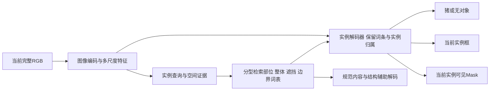

# 密集猪群数据与检测—实例分割预训练：规格V1

2026-10-25。用户要求真实泛化，密集场景至少15头猪拥挤、身体与不同部位相互遮挡；随后明确通过解码器直接训练检测和实例分割能力。本规格将两项要求合并落实，沿用已确认的[512条、128维四类语义词表](SEMANTIC_PROTOTYPE_VOCABULARY_SPEC_V1_20261025.md)。

**状态：设计草案；本版数据尚未准备、网络尚未实现、未启动生成或训练。** 15头实际拥挤互遮是用户确定的数据要求，其余初始比例、阈值、网络规模是工程预设，正式Run前结合资源与真实train统计冻结。本页不替代旧V17/V18/V19冻结协议或改判阴性，不构成远程启动授权。当前动作与状态只看[ACTIVE_PLAN](../../../project/ACTIVE_PLAN.md)。

## 1. 目标、证据和方法主张

目标是让记忆在预训练阶段参与“有几头、在哪里、每个像素属于哪头”的计算，同时保留每条词条的部位、整体、边界或遮挡含义。独立的规范解码仍用于检查词条内容，任务解码器则从完整当前图像直接输出实例集合。

已有基础与缺口：

- [A30](../../../experiments/spm_object_memory_training_20261024/A_STAGE_ACCEPTANCE.md)在参考查询与GT框下，288例干净合成完整形状IoU为0.923019，支持对象重建可学习；不证明真实正常查询或语义词条已成立。
- [B15](../../../experiments/spm_object_memory_training_20261024/B_STAGE_ACCEPTANCE.md)正常查询159个重遮挡匹配例可见IoU为0.487747，同框参考0.486532，削弱仅改善正常查询即可解决当前重建短板的解释。
- [V18](../../../experiments/spm_object_memory_training_20261024/V18_REPORT.md)真实432图Mask AP下降9.646437点；[V19](../../../experiments/spm_boundary_protected_readout_20261024/runs/RUN_SPM_V19_FULL_ACCEPTANCE_5931dbf5a502/SUMMARY.json)下降2.704913点。现有重建/读出能力未兑现任务收益，不归因为单一原因。
- [Blender诊断](../../../experiments/spm_blender_domain_replay_20261024/REPORT.md)中拥挤布局拟合较弱，资产仍只有一个基础低模；旧[完整对象补充](../../../experiments/spm_object_memory_training_20261024/DATA_PREPARATION_PROTOCOL_V3.md)不等于已核验15头实际互遮数据。旧猪场图是否满足新条件需另查真实实例/投影，不能凭文件名推断。

**H（待检验）：** 真实训练来源指导的密集接触数据，加上具有实例身份的联合检测/可见Mask监督，能使带明确语义的部位—整体记忆参与当前对象的定位与归属，而不只重建单体形状。其支撑是已有形状学习能力、已观测的遮挡/读出短板，以及统一实例查询学习框和Mask的既有研究；尚无本版阳性结果。

**H_alt：** 性能变化主要来自新任务解码器、额外训练数据或预算；也可能受资产/成像/标注语义差异限制，词条语义未被实际用于实例分离。两臂AP提高只能支持完整配置效用，不能单独排除这些解释。

## 2. 数据结构与首版采样

真实与合成从原型任务训练开始共同使用。初版按域各50%批次权重准备，loss再按域、图像和有效实例归约，避免一张多猪合成图仅凭实例数淹没真实域；具体冻结前核吞吐与梯度尺度。

合成内部的场景族采样预设如下，比例以独立场景族计数，同场景换材质、相机或相邻帧不充作独立场景：

| 比例 | 组成 | 学习职责 |
|---:|---|---|
| 70% | 每个核心拥挤群至少15头，首版覆盖15–30头；另预留更高密度压力层 | 同类遮挡、部位挤压、实例分离与计数 |
| 20% | 4–14头、中等接触和部分遮挡 | 由清晰局部到密集关系的覆盖 |
| 10% | 1–3头、清晰身体/部位；同场景族配少量空栏负例 | 稳定语义参考、完整结构与拒绝背景 |

70%中的每个核心密集场景必须满足下节15头条件；其它层不能冒充密集样本填配额。主训练持续包含密集层，不到最后阶段才首次加入。少量清晰样本为相同词条提供可追溯参考，不要求所有图都达到15头。

## 3. “至少15头挤在一起”的验收定义

在实际训练输入分辨率计算每头猪的无外部遮挡投影A_i、场景可见投影V_i和像素所属实例ID。A_i保持同一猪、姿态、相机，仅移除外部遮挡者；自遮挡不当作外部遮挡。画面截断与遮挡分别记录。

**必须在同一画面中有至少15头具有有效可见证据的猪，且构成一个实际猪—猪遮挡连通群。** 画外对象、完全不可见对象、15头分散站立或只有检测框相交均不能凑数。完全遮挡对象可保留为场景状态及辅助目标，不自动成为可见检测GT。

可执行检查接口预设：

1. 按场景实例ID统计A_i和V_i像素，检查V_i属于相同实例并包含于A_i；所有变换、RGB和标签共同对齐。有效可见像素与投影面积下限须按实际输入尺寸及真实train的可辨性冻结，不能通过缩小到几个像素满足数量。
2. 根据独立对象深度、场景深度及可见实例ID，计算实际遮挡者j对i的遮挡面积；用显著的真实像素遮挡建立有向边j→i，再检查弱连通群规模≥15。遮挡边的最小面积/比例在冻结前确定，不能仅用框IoU代替。
3. 报告每头猪的邻居数、遮挡比例、同时遮挡别人/被别人遮挡的角色，以及最大遮挡群规模。生成器应覆盖多数猪与多个邻居接触的布局；不能让一头前景猪遮住14个极小碎片充作全部密集覆盖。
4. 逐类覆盖头—头、头—躯干、躯干—躯干、腿—躯干及多腿交错；同时保留前后左右部位和所属实例ID。覆盖在场景集合上核验，不强迫每张图包含所有关系。
5. 输出轻/中/重遮挡及仅露局部的分布；部位尺度不足或确实不可判的样本标未知。保留模糊案例作为不确定输入，不强制赋予站立/左腿等唯一标签。
6. 三维布置允许接触并检查明显穿模、悬空、不合理肢体和地面穿透。拥挤由空间布局、姿态和相机共同产生，不能以身体大面积相穿制造遮挡。

每批先导出RGB、彩色实例/部位图、可见/完整轮廓、深度、遮挡连边和典型局部放大图，再汇总统计与人工视觉QA。数量达标与物理/视觉质量分别记录；低质样本保留拒收原因，按同一冻结规则重生成，不运行后降低要求。

## 4. 面向真实泛化准备场景

所有真实场景统计、纹理、背景及成像参数只取真实train。分别覆盖：

- 多个独立身体资产或可核实的形态族：成年/幼年、胖瘦、头身比例、腹卧/侧卧软组织外形；同一低模换颜色不能计作多个独立资产。
- 站立、行走/采食配置、腹卧和左右侧卧，包含混合朝向、头低入群、腿被邻猪隐藏及画面边缘截断。姿态与背景、光照不固定绑定。
- 真实猪栏的相机俯角、透视、目标大小、栏杆与料槽等已核实遮挡物，按真实train分布组织布局，并补充用户指定的15头以上压力层。
- 皮肤/污渍、湿润反光、地面及金属材质，真实照明/阴影、可见光或IR来源差异；噪声、压缩、模糊和锐化按相机处理后的RGB统计准备，不只叠加白噪声。
- 明确的同实例跨外观、跨视角、增减邻猪及改变遮挡配对。几何变换改变RGB时同步更新全部标签，完整目标保持当前对象与相机一致。

训练输入以原始尺度保留全图上下文，合成渲染覆盖细部所需原生分辨率，不能以放大旧低分辨率图冒充细节。模型输入尺寸、全图/局部采样配比及缓存接口在资源预检后冻结；局部裁切不能替代对15头完整场景的正常检测评价。

## 5. 标签、身份和防泄漏

逐场景/图保存scene_family_id、asset/family_id、source_group、split、相机、每头猪的scene_instance_id、姿态、身体/部位参考、深度及渲染版本与SHA。导出RGB、可见实例/部位、完整对象/部位投影、边界两侧实例ID、遮挡者ID和前后次序。

主任务标签另存task_mask和对应box。合成物理可见Mask、完整Mask与真实数据集的任务标注口径分别登记；栏杆处若存在语义差异，依据真实train的已核规则处理新合成目标并保留转换，不覆盖真实GT或旧Run。隐藏完整轮廓不直接填入最终可见Mask。只有真实可见实例标签的图，允许训练检测/实例Mask；缺失部位、深度、姿态或完整真值用有效域屏蔽，不作负例。

真实继续保留既有1272 train/432 dev/426 test身份。视频按猪栏、相机、视频/时间组隔离；合成先按资产/体形族及场景模板分组，再产生相机/外观变体，同族配对不跨拆分。若几何资产有限，结果明确为同资产泛化，不能称跨资产已完成。

开发集不得用于背景/风格统计或构库；既有dev复刻Blender图保持诊断身份。旧dev已多轮使用，不称盲测。真实留出须单列≥15头密集场景的实际图数、GT数与结果；若既有留出缺此类对象，明确证据缺口并规划新的独立采集/核验，不用合成成绩替代真实泛化。

## 6. 任务解码器直接学习检测与实例分割

初版采用统一实例查询的检测/Mask解码路线，可借鉴Mask DINO的共享查询及联合匹配；不要求完整复刻其大模型或超参数。图像编码可复用已核预训练视觉底座，优先考虑冻结既有YOLO Backbone/Neck以复用特征坐标；这不要求调用YOLO检测头或用它的预测替代任务真值。

预设64个实例查询、128维隐藏状态、3层实例解码器，使用高分辨率像素特征生成Mask。这些是待成本预检的轻量起点。64个查询表示每图的候选实例容量，512个词条表示跨图共享知识；一个词条可被多头猪分别调用。数据预检若发现有效GT超过查询数，必须在冻结前增加查询容量，不截断GT来适配模型。

每个查询读取图像位置/外观证据，按类型检索词条，再通过部位—整体交互更新实例状态；遮挡/边界读取相邻实例与局部两侧信息。每个最终查询同时输出类别/无对象、框、Mask，并保留词条激活及空间归属。姿态或实例数量不由GT输入给正常预测。

规范内容解码只读取声明的词条与参考条件，检查“存了什么”；任务解码器可以读取当前图像的定位和高分辨率边缘，检查“当前哪里可见、属于谁”。两条路径职责不同，不能为防止绕过词表而禁止任务利用真实像素证据，也不能仅有图像通路梯度就称原型被使用。

**联合训练目标：**

`L = L_task(class, box, visible_mask) + L_semantic + L_canonical + L_ownership + L_occlusion + L_boundary`

- L_task使用同一个实例查询与同一个GT实例的联合匹配：分类/无对象，框L1与GIoU，Mask BCE与Dice。不能框匹配到甲、Mask匹配到乙后拼成一个成功实例。
- L_semantic约束部位身份、整体姿态、合法条件内的词条排序与拒绝；L_canonical约束参考结构及跨观察对应。
- L_ownership监督各部位归属哪一头、整体与部位相容；L_occlusion监督遮挡角色/次序和可见性；L_boundary监督真实边界及两侧归属。四类监督的有效域不同，不把同一张二值Mask复制成四个已学会的概念。
- 词表、检索查询和任务解码器均接收相应监督梯度；从少量训练参考初始化词条后，即进行任务联合学习，不能先冻结未经任务约束的整个新词表，再期望解码器修好所有问题。真实缺标项屏蔽，当前可见检测/分割监督保留。
- 任务loss按有效实例及区域归约，语义/关系loss分别记录尺度与有效分母；权重、优化器、步数、输入尺寸和末checkpoint规则在正式训练合同冻结，不以本页公式冒充已调好超参数。

正常推理只输入当前RGB及固定模型参数。训练期GT匹配、完整对象与部位标签只作监督；无对象查询学习抑制重复/虚假实例。计数来自正常保留实例，不能用已知15头把输出硬凑成15，也不以测试时GT选择查询或词条。

## 7. 预训练能力与最终YOLO收益分开验收

首先在独立对象/场景和真实dev上评价任务解码器的正常输出：框AP/AP75、Mask AP、漏检/重复、计数误差，以及≥15头子集的同实例归属。另报告词条语义排序、规范重建、不同条件稳定性与使用覆盖，保留失败例。

训练联合匹配属于监督算法；最终bbox和segm仍各按官方评价独立匹配。若分析“同一预测框准但Mask差”，固定具体输出行再计算，遵守候选身份与评估口径（原路径：`project/科研项目通用规范/候选身份与评估口径.md`；[服务器归档回执](../../../project/research_notes/maintenance/nonrun_file_compliance_20261104T093520Z/ARCHIVE_RECEIPT.json)）。

原型实际使用的预登记检查：固定同一checkpoint/图像/查询和当前像素特征，对词条做语义不相容替换，配合同语义变体替换及范数/幅度控制，观察是否按所声称部位/关系出现定向变化。简单关库后下降不足以独立证明语义机制；若要作机制归因，另冻同参数、同输入/数据/预算的受限训练对照，本页不自动追加训练臂。

正常任务效用先按用户既有比较范围对同配置原生YOLO和最终完整方法报告，额外数据、容量与预训练预算明示为混杂。预训练解码器成绩、漂亮重建图或合成高分不能计作接入YOLO的+5点完成；后续迁移还需同特征版本、正常查询和真实任务微调。

冻结正式Run时必须写清数值门槛、统计簇、资源与停止：语义及真实密集任务均满足必要要求，才进入YOLO迁移；若语义不成立或真实归属仍系统错误，停止当前配置的扩训并据失败对象修订新版本；若缺少合法密集留出或评价/生成无效，先修数据合同，不凭训练loss宣布能力。以上是决策结构，尚不是已执行Gate或允许无限循环。

## 8. 参考依据与当前交付

- [Mask DINO，CVPR 2023，§3](https://arxiv.org/html/2206.02777)：同一内容查询支持类别、框与Mask，高分辨率像素特征及联合框/Mask匹配支持任务协同；论文也展示简单拼接任务头可能伤害性能。本规格借用该原则，不声称其结果证明本项目语义记忆或真实猪群泛化。
- [编码解码与数据审查](PART_WHOLE_AUTOENCODER_REVIEW_20261025.md)：规范内容、当前可见性、成像及数据拆分的既有职责保持。

本轮交付为数据必做条件和直接任务预训练设计。新15头密集数据集、实际网络、GPU工程/训练、独立泛化结果均尚未交付；不得把本规格的场景配额、64个查询或512个词条写作已生成/已学会的事实。
