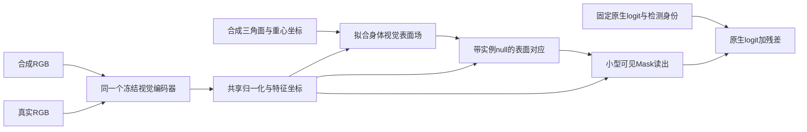

# V8：把身体对象变成YOLO可读取的视觉表面场

2026-10-23。研究线 `spm_yoloseg`。**当前状态：路线选择、源码证据、参考求解器和数据可用性核验；新视觉表面场尚未拟合，新神经训练未启动。** 本稿细化[V7](OBJECT_FUSION_THEORY_AND_LITERATURE_V7_20261023.md)，保留V6冻结协议和全部阴性。用户只要求原生YOLO与完整方法两臂比较，继续按完整方法效用设计，不添加其它训练臂或宣称独立因果机制。

**我选择的唯一优先方向：保留现有身体几何，把对象表面字段锚定到同一个冻结视觉编码器，再用小型实例条件像素读出学习可见Mask残差，先固定最强原生模型的参数及BN状态。** 要解决的具体问题是：身体点特征与真实像素特征没有直接配对语义监督。其支持来自现有训练源码、实际零增益，以及MagicPony/3D-Fauna的视觉表面场先例。它不是已经证明的V6唯一失败根因，也不是通过堆新模块追逐阳性。

## 1. 累计证据使哪些选择应当结束

| 事实 | 应改变的研究取舍 |
|---|---|
| V4.1扩大原型、P/c通道、训练规模后F−B仅+0.0417pp，关闭原型几乎无变化 | 停止扩大同一全局字典来期待出现结构收益 |
| v0在合成几何上有优势，但64维字段没有直接视觉特征目标 | 保留几何本体；补充可被查询端理解的视觉解释层，不把几何重建分数当分割可用性 |
| v1原生冻结时仍损伤；V6既有空间P_i和双向注意力仍无正收益 | “只冻结主路”或“再换融合位置”单独都不足以解释/解决问题 |
| V6选中F/B AP56.2637/56.3548，均低于初始57.3153；独立192项统计重算误差0 | 不以统计口径或继续加步回避当前无效用结论；下一版必须直接对最强保留原生比较 |
| V6选中B成功2101，F损伤11、修复5；损伤0.5236%通过≤1%护栏 | 主要不足是修复量小于损伤量；通过保护门槛也不等于有收益 |

最后两项来自真实零训练验收Slurm246 / `RUN_SPM_V6_ACCEPTANCE_CPU_e77f5712304d`，证据见[CPU验收SUMMARY](../../../experiments/spm_object_fusion_design_20261023/runs/RUN_SPM_V6_ACCEPTANCE_CPU_e77f5712304d/SUMMARY.json)。分母432图/2863普通GT/12906输出；原生762失败仅修复5（0.6562%）。初始最强原生与本轮继续微调B不是同一参照，二者必须同时披露。该开发集重复使用，不作独立测试或显著性声称。

补充的真实技术读数：预先按GT编号选定的6例中，末层四头平均注意力分布的归一化熵为0.9961–0.9966（均匀分布为1），空间项与系数项在实际窗口内的L2范数比为0.172–0.229。见[响应读数](../../../experiments/spm_object_fusion_design_20261023/runs/RUN_SPM_V6_PRESENTATION_22db0b1608ce/RESPONSE_SUMMARY.json)。这些图未呈现鲜明的部位选择，空间项也确实非零；不能推断每个注意力头均匀、全432图如此，或对象信息完全没有被使用。它与源码缺失直接视觉目标共同支持优先补足对应监督，尚不足以证明唯一因果。

## 2. 新找到的具体接口缺口：表面字段缺少视觉锚定

实际源码：
- [object_model.py](../../../experiments/spm_object_prototype_20261023/scripts/object_model.py)：`field(canonical,shape)`输出64维，再经`part_classifier`预测8部位；目标中的canonical坐标监督作用于另一个图像dense head。
- [train_objects.py](../../../experiments/spm_object_prototype_20261023/scripts/train_objects.py)：总损失由上述objective返回，没有另加字段到图像特征的重建/匹配目标。
- [fusion_models.py](../../../experiments/spm_object_fusion_design_20261023/scripts/fusion_models.py)：将零体形码下的64维字段作为V6对象输入。
- [object_fusion.py](../../../experiments/spm_object_fusion_design_20261023/scripts/object_fusion.py)：图像、对象字段各经独立新投影后交互，主要由真实可见Mask损失间接对齐。

**这不等于字段从未间接接收过图像信息。** 体形码来自图像编码器，字段有几何/部位约束；明确缺失的是“该身体点应对应哪个实际视觉描述子”的直接目标。源码事实与“这导致当前无收益”的机制推断要分开。

设部位分类器 \(W\in\mathbb R^{8\times64}\)。固定W时，对任意 \(v\in\ker W\)，

\[
W(E+v)=WE,\qquad \dim\ker W=64-\mathrm{rank}(W)\ge56.
\tag{1}
\]

所以8部位分类不能唯一规定64维字段的视觉含义。这是输出层信息约束的线性论证；并非声称当前网络能实现任意字段扰动、当前训练必然塌缩或每个维度都无用。随机投影后单靠1272真实图的Mask损失同时学语义对应、实例归属和像素读出，是V6尚未分离的学习负担。

## 3. 文献筛选后的取舍

本轮在原22篇基础上新增核验10篇，累计32篇；其中新增6篇核对相关方法段。详见[第二轮文献表](../../../project/research_notes/literature/spm-object-grounding_2026-10-23/README.md)。

| 路线及一手依据 | 决定 |
|---|---|
| [MagicPony，CVPR2023 §3.4](https://arxiv.org/html/2211.12497)、[3D-Fauna，CVPR2024 §3.2](https://arxiv.org/html/2401.02400)：规范表面字段渲染后匹配冻结视觉特征 | **选为当前核心原则。** 身体上的特征应由实际图像语义监督，能够与查询像素对话 |
| [ShapeMask，ICCV2019](https://arxiv.org/html/1904.03239)：先验与实例图像嵌入共同形成细Mask | 采用“形状与实例视觉证据协作”，不照抄固定低分辨率套框接口 |
| [Dessie，ACCV2024](https://arxiv.org/html/2410.03438v1)：合成因素控制、预训练视觉编码、真实数据适配 | 采用跨姿态/外观/背景的控制；其2 A100约2天与单马crop设定不作为当前快速预算 |
| [Depth Anything V2，NeurIPS2024](https://arxiv.org/html/2406.09414)：合成到真实需可靠语义和真实分布桥接 | 保留真实训练图的接口锚定，不假设增加卡通样本自然解决域差；暂不复制其巨型教师/海量伪标签流程 |
| [Farm3D](https://arxiv.org/html/2304.10535)：从生成图学习类别级可变形动物 | 暂不引入新扩散生成及完整3D重建链。该工作偏向较干净的单体图，与密集可见实例任务不同 |
| [PointRend](https://openaccess.thecvf.com/content_CVPR_2020/html/Kirillov_PointRend_Image_Segmentation_As_Rendering_CVPR_2020_paper.html)、[Mask Transfiner](https://openaccess.thecvf.com/content/CVPR2022/html/Ke_Mask_Transfiner_for_High-Quality_Instance_Segmentation_CVPR_2022_paper.html) | 保留图像高分辨率细节原则，暂不叠加点渲染/四叉树结构；当前尚无证据说明主要剩余机会仅是边界 |
| [FeatUp](https://proceedings.iclr.cc/paper_files/paper/2024/hash/c5601d99ed028448f29d1dae2e4a926d-Abstract-Conference.html)、[A Tale of Two Features](https://proceedings.neurips.cc/paper_files/paper/2023/hash/8e9bdc23f169a05ea9b72ccef4574551-Abstract-Conference.html) | 警惕语义与分辨率、语义与几何的一致性；暂不引入额外扩散特征或更多基础模型 |

**有用的反例同样保留。** ShapeMask完整监督表7中，基线35.5，只有实例embedding36.7，只有shape36.9，两者37.2，即整体+1.7AP；跨类别设置的大幅增益不能代替此处的监督任务预期。Dessie表1也不是加入所有直接几何GT后每项都更好。上述论文支持设计原则，不能证明猪群可见分割+5AP一定实现。我们的固定YOLO特征替代论文DINO特征是为复用已有可靠原生模型的项目推论，效果需要本项目数据验证。

## 4. 对象设计：几何本体保留，建立同空间视觉场

固定现有283顶点/562三角面、部位和几何身份；字段改成

\[
\mathcal O=\{\mathcal M,\ \text{part}(s),\ E(s)\},\qquad
E(s)\in\mathbb R^D
\]

其中E的目标是**冻结视觉编码器在该点投影处的描述子**，不再仅是可分类部位的自由隐码。首轮优先复用最强原生YOLO的P2/P3联合特征，避免立刻增加另一套大模型及迁移风险。训练数据统计得到的中心化/降维变换必须同时用于图像查询和字段值，不在两个分支独立拟合或用dev/test更新统计。

对几何已知的合成图t，令 \(R_t\in\mathbb R^{n_t\times283}\) 为可见像素到三角面三个顶点的重心插值矩阵，\(F_t\in\mathbb R^{n_t\times D}\)为同一个冻结编码器的图像特征。拟合字段：

\[
\min_E \sum_t\|W_t^{1/2}(R_tE-F_t)\|_F^2
+\lambda\,\mathrm{tr}(E^\top LE)+\mu\|E\|_F^2.
\tag{2}
\]

L为半正定网格图拉普拉斯，W仅含合法可见像素及预先定义的权重；遮挡身体与背景不能冒充可见图像特征。式(2)是求和归约，正则量的尺度必须在实际特征提取合同中对应样本数，不能事后变更。

当 \(\mu>0,\lambda\ge0\) 时，唯一闭式最优为

\[
\boxed{
E^*=\left(\sum_tR_t^\top W_tR_t+\lambda L+\mu I\right)^{-1}
       \sum_tR_t^\top W_tF_t
}.
\tag{3}
\]

这是给定几何、可见性、编码器和二次目标的严格最优解。283×283系统可用流式充分统计求解，没必要让大网络从随机字段长时间搜索。未见顶点的值只来自正则外推，不能算已观察学习；必须报告可见覆盖。实际神经图像特征尚未提取，当前没有训练好的新E。

## 5. 现有数据够不够启动这项实现

Slurm246只读查到的原缓存包含：
- RGB 128×128×3、full/visible Mask、深度；
- canonical 128×128×3、parts；
- triangle 128×128和barycentric 128×128×3。

[缓存盘点](../../../experiments/spm_object_fusion_design_20261023/runs/RUN_SPM_V6_ACCEPTANCE_CPU_e77f5712304d/OBJECT_CACHE_INVENTORY.json)记录manifest与样本SHA。**重心坐标和三角面身份已经保存，首步无需重新渲染。** 仍沿用1728合成train/576合成dev、1272真实train/432真实dev，不将dev用于字段拟合或特征统计。使用128图学习对应不等于已覆盖640真实密集场景，分辨率和背景差距需要在训练输入合同中处理。

数据变换必须同步作用于RGB、visible、triangle/重心坐标和实例ID。几何不变的外观变化可以形成对应正对；站/走/卧等姿态改变使用其本来的表面身份。其它猪/栏杆遮挡处为本实例null，不能拿完整轮廓覆盖可见标签。先复用已有几何与真实train分布，再决定是否值得扩大场景；不先追加几万张相同风格卡通图。

## 6. 融合与训练：小型、共同特征坐标、原生函数保留

图像描述子 \(f(u)\) 与字段 \(E_k\) 使用同一冻结空间。若学习度量B，必须对两端共享，初始化为恒等，防止重新引入两套随机坐标：

\[
A_i(u,k)\propto
\exp\left[-\|Bf(u)-BE_k\|^2/\tau+
g(q_i,u,s_k)\right],
\tag{4}
\]

另有实例条件null项。g只使用预测实例查询、预测框/anchor及规范几何，不输入真实GT姿态或相机。先用合成对应监督学习其几何分配，真实图只用已有可见Mask及真实图像特征来约束适配；没有真实表面真值时不伪造真值。

以A汇聚视觉字段、规范坐标和部位，再与当前图像细节、原生logit、实例查询和框内坐标形成单一残差：

\[
z_i(u)=\sum_k A_i(u,k)E_k,\qquad
\ell_i(u)=\ell_{0i}(u)+h_\phi
(f(u),z_i(u),\bar s_i(u),q_i,\ell_{0i}(u)).
\tag{5}
\]

h最后一层零初始化。**原生P/c、Backbone/Neck、检测分支、所有原生BN状态先固定**；不再同时引入自由ΔP与自由Δc。最终仍在原生空间网格解码可见Mask，保持框、分数、raw及输出行身份。规范表面归属不是实例ID，同一像素对相邻两头猪的null/归属需由各自查询及真实实例监督区分。

建议阶段顺序：
1. 原有几何身份和可见性 → 冻结原生视觉特征 → 流式拟合视觉场E；
2. 合成跨视角/姿态/外观的表面对应监督，图像/字段共享度量；字段重建与对应均留出原合成dev；
3. 固定原生函数，真实可见任务训练新读出，保持原生assignment和评价；合成辅助是否保留及权重需在正式协议前一次性冻结；
4. 只有固定主路已有正收益且有明确容量证据，才另立有限原生Mask参数适配。当前不默认执行此阶段。

对照使用**最强保留原生起点**，不靠把原生继续微调退化后再取得相对收益。下一版可预注册包含step0的选模集合；若选中step0，仅表示回退原生，判为没有学到正收益，不能当成功。仅两臂无法区分字段语义、额外参数和合成监督的独立贡献，报告为复合方法效用。

## 7. 可执行部分与尚未完成部分

已经实现[流式表面场参考求解器](../../../experiments/spm_grounded_surface_20261023/field_reference.py)，并在真实登记的283顶点/562面拓扑上检查：
- 流式统计与显式设计矩阵解一致，最大误差2.66×10^-15；
- 改变分块不改变解；零可见权重不影响解；
- 未见顶点正确标记，正常方程残差5.33×10^-15；
- 8×64分类器零空间与“只旋转字段会改变视觉目标”的代数例子成立。

[检查结果](../../../experiments/spm_grounded_surface_20261023/LOCAL_REFERENCE_CHECK.json)使用**人为构造特征**，不是实际YOLO特征；因此不能算新原型训练、真实对应能力或AP证据。字段求解器可接真实特征，但整套训练器、输入特征/降维合同、GPU预算和科学阈值尚未冻结。

已补充[视觉接口辅助实现](../../../experiments/spm_grounded_surface_20261023/visual_bridge.py)与[输入合同草案](../../../experiments/spm_grounded_surface_20261023/INPUT_CONTRACT_DRAFT.json)：P2/P3的512维特征、真实train上统一标准化/PCA128、在原128网格像素中心采样特征而不插值三角ID。共享统计与可见采样过滤已用构造数据核验；实际模型前向和空间配准smoke尚未执行。这些是可继续接通的工程接口，不是已训练模型。

## 8. 主假说、竞争解释与下一步

**H：** 将身体表面与图像查询锚定在共同的视觉空间，能减少V6需要从最终Mask损失中同时学习的对齐负担；保留原生函数后，新读出能够利用与原生剩余错误相关的信息。依据是源代码缺失的直接视觉目标、已有合成几何能力及文献中的视觉表面场方法。

**H_alt：** 当前冻结YOLO特征在合成/真实间仍无法给出稳定身体对应，或者原生图像信息已经足够、新字段没有增量。v1原生固定仍损伤，以及V6无增益，使这两种解释仍有实际支持。它们不能靠“同空间”三个字被排除。

下一版若拟正式执行，应预冻结：
- 必要条件：原合成留出上的对应误差/可见性与字段重建，真实train上查询/字段域差的合法检查。未满足则不进入分割扩训，不临时换合成dev/阈值；
- 完整效用：同检测、同评价，F超过最强保留原生且官方成功GT损伤≤1%；+5目标要求至少超过原生57.3153约定参照5个绝对AP点，不能以损失下降或合成IoU替代；
- 正收益但不到+5：保留真实增量，按原目标标注未达，不写成+5成功；
- F≤B或护栏失败：关闭本配置扩训；未完成/无合法数据则只记工程或证据不足。

**我主张下一阶段聚焦“视觉锚定的身体表面场”，原因是它直接补充源码中缺失的配对目标，又能复用已有几何和最强原生模型，比再训练一个自由注意力融合器更明确。唯一后继实现动作是补齐冻结视觉特征提取与真实字段拟合的输入合同，并接通该求解器；不是重复V6或启动完整3D重建。** 当前只完成参考实现与研究准备，没有提交新GPU作业或新训练。既有V6权重回传与其内部技术图验收作为原实验交付继续保留，不把待验收冒充已完成。

