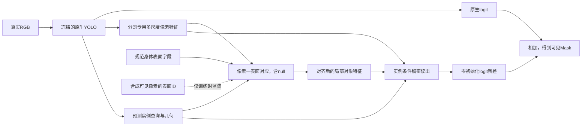

# V7 研究备忘：对象先验怎样进入 YOLO，训练怎样保留已有能力

2026-10-23。研究线 `spm_yoloseg`。**状态：一手文献核验与理论设计，尚未实施新模型或启动新训练。** 本文不替代 [V6 冻结合同](../../../experiments/spm_object_fusion_design_20261023/EXECUTION_PROTOCOL_V1.md)，不修改其源码、预算、选模或旧结论。当前执行动作仍由 [ACTIVE_PLAN](../../../project/ACTIVE_PLAN.md)决定。用户限定完整方法只与无新增模块的原生 YOLO 比较，保留该范围；缺少机制对照时不作独立因果归因。

**我的主张：优先形成有明确表面身份的“像素—身体对应”，把对齐后的对象信息注入分割专用高分辨率像素特征，以实例查询统一读出；先保留最强原生函数，再训练新接口，只有确有必要才有限解冻原生分割参数。** 这比继续扩大固定字典、同时自由修改 P/c 或直接全网微调更值得优先：已有容量扩张没有稳定收益，合成对象已有几何能力，但真实像素到身体表面的关联并没有被直接教过。这个判断是有文献和计算依据的下一阶段建议，不是已证实的增益机制或全局最优架构。

## 1. 现有实测支持什么

| 实验/实际对象 | 已观察事实 | 对本轮设计的意义 |
|---|---|---|
| [V4.1](../../../experiments/spm_v4_scale_20261023/REPORT.md)，1272 train / 432 dev | 额外32通道P和32维c、扩大原型训练后，F/B AP57.3570/57.3153，仅+0.0417pp；关原型几乎不变 | 已经试过扩P和c，不能把“从c移到P”重新说成尚未尝试的根本解法 |
| [对象v0](../../../experiments/spm_object_prototype_20261023/REPORT.md)，2304合成图，S/U各4000步 | S完整身体误差0.01913体长，U0.03557；新视角投影IoU0.89934/0.85639；体形漂移Gate失败 | 有保留几何对象的依据，尚无真实表面对应可迁移、真实分割有效的证据 |
| [真实迁移v1](../../../experiments/spm_object_real_transfer_20261023/REPORT.md)，432 dev | N/S/Q AP57.3153/50.9072/50.2174；关对象输入反而52.1663 | 原生主路冻结仍不保证新增修正有用；错误接口或监督同样可以损伤 |
| V6，1272 train / 432 dev，B/F各8000步 | 18:11只读查看，Slurm243_0/243_1均COMPLETED、exit0；双方按冻结规则选2000步，F/B AP56.2637/56.3548，F−B−0.0911pp；初始共同AP57.3153。8000步F/B55.4339/55.7070 | 本预算未支持完整融合正收益；共同适配过程也退化，继续加步没有正面依据。共同退化不等于已证明遗忘、BN、原型或某一因素是根因 |

V6的432图共有2863 GT、12906输出，框/类别/分数/raw身份合同不变，Box AP均66.4962。上述最新结果来自真实服务器SUMMARY/EVALUATIONS，只是开发集结果；模型回传、损伤护栏、独立统计复核和技术图的最终验收另行记账，不能写成全部验收完成。证据见 [最新只读状态](../../../experiments/spm_object_fusion_design_20261023/STATUS_20261023_1811.json)。

V6实际已经包含P2细节、多尺度像素特征、每实例283标准身体顶点和两层双向注意力，并同时学习ΔP_i/Δc_i。它不是仅在系数头拼接原型。其缺口是：真实图像与身体顶点的注意力主要靠可见Mask损失间接学习；直接输入的是标准体形表面场，未推断每头真实猪的3D姿态，也没有像素—顶点对应标签。

## 2. 哪些文献真正决定取舍

核验22篇一手来源，阅读层级分开记录于 [文献表](../../../project/research_notes/literature/spm-object-fusion_2026-10-23/README.md)和 [机器可读书目](../../../project/research_notes/literature/spm-object-fusion_2026-10-23/sources.json)，不是声称全部全文精读或复现。

| 问题 | 优先依据 | 对我们有用的设计原则 |
|---|---|---|
| 对象是什么、图像怎样找到它 | [DensePose, CVPR2018](https://openaccess.thecvf.com/content_cvpr_2018/html/Guler_DensePose_Dense_Human_CVPR_2018_paper.html)、[CSE, NeurIPS2020](https://arxiv.org/html/2011.12438)、[NOCS, CVPR2019](https://openaccess.thecvf.com/content_CVPR_2019/html/Wang_Normalized_Object_Coordinate_Space_for_Category-Level_6D_Object_Pose_and_CVPR_2019_paper.html) | 对象应提供稳定的规范位置/表面身份；像素到表面的对应是单独需要学习的能力 |
| 怎样融合进分割 | [CondInst, ECCV2020](https://www.ecva.net/papers/eccv_2020/papers_ECCV/html/1105_ECCV_2020_paper.php)、[SAM](https://arxiv.org/abs/2304.02643)、[HQ-SAM, NeurIPS2023](https://arxiv.org/html/2306.01567) | 实例查询和稠密像素共同解码；细节来自当前图像；预训练主路可以保留并学习新增条件读出 |
| 为什么单个均值不够 | [ASGNet, CVPR2021](https://arxiv.org/abs/2104.01893)、[UNICL-SAM, CVPR2025](https://openaccess.thecvf.com/content/CVPR2025/html/Sheng_UNICL-SAM_Uncertainty-Driven_In-Context_Segmentation_with_Part_Prototype_Discovery_CVPR_2025_paper.html) | 局部覆盖、对应分配和可靠性，比只增加全局槽数更直接 |
| 如何保护原有能力 | [L2-SP, ICML2018](https://proceedings.mlr.press/v80/li18a.html)、[LP-FT, ICLR2022](https://arxiv.org/html/2202.10054) | 对齐新增接口后再适配原参数；若解冻，应约束对原始参数/函数的偏离 |
| 形状先验怎样使用 | [C2F-Seg, ICCV2023](https://arxiv.org/html/2308.16825)、[GRASP, arXiv2026](https://arxiv.org/abs/2605.24533) | 形状先验需结合当前图像，并依位置控制影响；完整轮廓和可见分割必须分清 |

GRASP是2026-05-23预印本，页面标注投稿TCSVT，不能记作已经录用。它已采用可学习形状原型、交叉注意力与SDF空间注入，因此这些模块的组合不能直接作为我们的新颖性主张。它的目标是amodal补全，不能将其遮挡区IoU改善推成我们可见Mask AP的预期。上述几条原则的组合与下面推导是本项目的设计推论，论文没有证明这套猪群方案能提升5点。

## 3. 同时训练P和c，为什么不能自动解决对齐

令原生空间基 \(P_0\in\mathbb R^{d\times n}\)、实例系数 \(c_0\in\mathbb R^d\)，原生logit \(\ell_0=P_0^\top c_0\)。联合修正为

\[
\ell=(P_0+\Delta P)^\top(c_0+\Delta c)
=\ell_0+P_0^\top\Delta c+\Delta P^\top c_0+\Delta P^\top\Delta c.
\tag{1}
\]

仅改c时，修正被限制在P的行空间，这确实可能约束可表达的空间变化。然而放开P/c也产生两个问题。

**分解不唯一。** 对任意可逆矩阵A，令 \(P'=AP,\ c'=A^{-\top}c\)，则 \(P'^\top c'=P^\top c\)。Mask监督无法唯一确定某通道或系数的身体含义。

**每实例自由ΔP已经能表示任意logit残差。** 若 \(c_0\ne0\)，对任意 \(r\in\mathbb R^n\)，取

\[
\Delta c=0,\qquad
\Delta P=\frac{c_0r^\top}{\|c_0\|^2},
\qquad \Delta P^\top c_0=r.
\tag{2}
\]

因此“ΔP+Δc能修正Mask”本身并不是结构机制证据。式(2)是函数表示的存在性：并不证明当前网络能学到任意r，也不表示所有参数化优化等价。它说明下一步应让对象对应可学习、可检查，并减少不必要的分解自由度，而不是继续增加两个自由分支。

**建议的读出：**

\[
z_i(u)=\sum_{k=1}^{K} A_{iuk}E_k,\qquad
\widetilde F_i(u)=F_i(u)+B_\phi(F_i(u),z_i(u),q_i,g_i(u)),
\]
\[
\ell_i(u)=\ell_{0i}(u)+
w_\phi(q_i)^\top\widetilde F_i(u)+b_\phi(q_i).
\tag{3}
\]

E为身体表面字段，A为带null的对应分布，q为实例查询，g为预测几何/图像证据；F使用原生分割专用的P2和多尺度信息。最终残差读出层零初始化，保证起始 \(\ell=\ell_0\)。条件信息在稠密特征形成阶段进入，不把最终Mask先压到32×32后再靠输出修补。式(3)是建议的单一实例条件读出，未实现，也不额外并列增加一个自由Δc分支。推理不使用GT框、GT姿态或GT可见Mask。

## 4. 注意力最优，不等于身体对应正确

对固定匹配成本 \(C_{uk}\) 和 \(\tau>0\)，熵正则问题

\[
\min_{a\ge0,\ \sum_k a_k=1}
\sum_k a_kC_{uk}+\tau\sum_k a_k\log a_k
\]

的拉格朗日一阶条件给出唯一解

\[
A_{uk}^*=\frac{\exp(-C_{uk}/\tau)}
{\sum_j\exp(-C_{uj}/\tau)}.
\tag{4}
\]

这只证明softmax在给定成本下最优；若成本仅由最终Mask损失学习，式(4)不保证头部像素对应头、腿对应腿。对固定K×D字段E，若K>D+1，通常存在 \(vE=0,\sum v=0\)；在保持非负的小扰动内，A与A+εv可以聚合出相同特征。这里是聚合映射的非唯一性，并非声称注意力网络能实现所有这类扰动。

[CSE §3](https://arxiv.org/html/2011.12438)提供正面依据：以像素—表面身份监督对应，并用表面测地距离处理附近点。推荐复用现有几何资产，在合成可见像素上提供规范顶点/重心坐标及部位、实例ID；采用带null的对应分类：

\[
Q_k(s^*)\propto
 \exp\!\left[-\frac{d_{\mathcal M}(s_k,s^*)}{2\sigma^2}\right],
\qquad
\mathcal L_{\rm corr}=-\sum_{u\in \mathrm{visible}}
 \sum_k Q_k(s^*(u))\log A_{iuk}.
\tag{5}
\]

上式沿用CSE的测地软标签形式；对应的维度归一化与σ必须在下一协议冻结。本实例以外的像素/其它猪属于null，不能强制匹配身体。真实数据没有表面真值，仅用已有可见实例Mask监督；不能把预测对应当真实3D标签，也不能只用循环一致性就声称解除了常量/置换解。

合成阶段使用**与真实部署相同的冻结YOLO特征接口**学习查询端投影，避免先用另一个已知相机编码器学完再期待特征空间自然一致。现有2304图是否保存逐像素表面ID需读取缓存清单确认；没有则从已保存几何、相机和实例深度重新导出，不能谎称已有标签。该重新导出和对应训练本轮均未启动。

不照搬SuperGlue的一对一平衡传输：像素到表面受投影采样、遮挡和实例切分影响，不满足稀疏关键点双边一一匹配。借鉴其“允许不匹配”的原则即可。

## 5. 完整身体与可见掩码：目标为什么必须分开

令A表示该像素落在实例完整投影内，V表示该身体部分可见，则可见标签Y满足

\[
P(Y=1\mid X)
=P(A=1\mid X)P(V=1\mid A=1,X).
\tag{6}
\]

这是条件概率链式法则，不假设A和V独立。对象本体有助于A，却不能独自决定V；相邻猪、栏杆和背景仍要由当前图像和实例关系判断。若直接把完整身体投影写进可见Mask，会在被挡区域制造假阳性。

GRASP用可见Mask的SDF调节amodal先验注入。对我们，SDF在可见区域外为正，同时覆盖遮挡位置和普通背景，因此它不等于“遮挡概率”，不能凭它保证背景残差消失。对象对应的null、当前图像证据和实例归属，是比“框外或Mask外一律补全”更符合可见分割任务的条件。

## 6. 有效融合应该增加哪类信息

设T为原生模型用于预测的压缩表征，Z为对齐后的对象条件表征。若基线恰为校准的Bayes后验 \(p_0=P(Y=1\mid T)\)，则Bayes公式精确给出

\[
\operatorname{logit}P(Y=1\mid T,Z)
=\operatorname{logit}p_0+
\log\frac{p(Z\mid Y=1,T)}{p(Z\mid Y=0,T)}.
\tag{7}
\]

不需要假设T/Z条件独立。式(7)支持学习**相对原生证据的条件增量**，而不是把来自同一张图的两个后验当独立证据反复相乘。

在无限容量、真实分布已知的理想条件下，最小对数损失之差为

\[
R_T^*-R_{T,Z}^*=H(Y\mid T)-H(Y\mid T,Z)
=I(Y;Z\mid T)\ge0.
\tag{8}
\]

但若给定完整图像X和固定模型/外部对象库G，Z只是它们的确定函数，则 \(I(Y;Z\mid X,G)=0\)。固定对象库不凭空提供新的测试像素。它可能通过外部训练知识、有限样本归纳偏置或补充原生压缩T丢失的信息起作用。当前实验并没有测得正的条件互信息，不能用式(8)宣布实际模型必有收益。

## 7. 能严格推导的“最优”：固定表征附近的残差解

将像素/实例权重吸收到设计矩阵与残差中。记 \(p_0=\sigma(\ell_0)\)、\(r=y-p_0\)、\(W=\mathrm{diag}[p_0(1-p_0)]\)，令新增logit局部线性化为 \(h=G\beta\)。BCE的二阶近似加上正定正则为

\[
J(\beta)\approx L_0-r^\top G\beta+
\tfrac12\beta^\top(G^\top WG+\lambda R)\beta,
\quad \lambda>0,\ R\succ0.
\]

其唯一闭式最优解及相对零修正的二阶目标下降为

\[
\boxed{\beta^*=(G^\top WG+\lambda R)^{-1}G^\top r},
\qquad
J(0)-J(\beta^*)=
\tfrac12(G^\top r)^\top
(G^\top WG+\lambda R)^{-1}(G^\top r)\ge0.
\tag{9}
\]

这说明：
- 对象条件特征必须与**原生剩余错误**相关，即 \(G^\top r\ne0\)，仅仅“能分猪/有形状”还不够。
- 新方向若只重复已有证据，或者对应不准使特征与残差抵消，扩大参数不保证收益。
- 控制可学习方向与更新幅度有数学依据；更深网络和更大原型库不是式(9)推出的结论。

式(9)只对固定G/局部二阶目标成立；不保证大步更新后的真实BCE、开发集表现、非凸网络全局解或COCO AP。这是本文“最优”的严格适用范围，不能给出普适的最优层数、原型数、学习率或+5点保证。

## 8. 训练顺序与保护：为什么先对齐接口

建议以最强保留原生模型为教师，先冻结其**参数及BN运行缓冲区**，只学习新增接口与残差读出。若后续确需解冻，使用函数偏移约束的形式来定义允许的更新：

\[
\min_{\phi,\theta} \mathbb E\,\mathrm{CE}(y,p_{\theta,\phi})
\quad\text{s.t.}\quad
\mathbb E\,\mathrm{KL}
(\mathrm{Bern}(p_0)\Vert\mathrm{Bern}(p_{\theta,\phi}))
\le\epsilon.
\tag{10}
\]

零残差和原始参数构成可行点，故**全局求解训练集约束问题**不会比这个可行点的训练CE更差；实际优化器和开发AP没有这个保证。这里的KL是保护形式，不是本轮临时增加的loss，也不能把ε事后调到出现阳性为止。

单像素若真实概率q已知，对其拉格朗日问题有

\[
\arg\min_p \{\mathrm{CE}(q,p)+
\lambda\,\mathrm{KL}(p_0\Vert p)\}
=\frac{q+\lambda p_0}{1+\lambda}.
\tag{11}
\]

它明确表达“任务适配—保留原能力”的折衷；q在真实训练中未知。KL在初始logit附近约为 \(\tfrac12 h^\top Wh\)，因此与式(9)的局部曲率保护衔接。参数域的L2-SP保护 \(\|\theta-\theta_0\|^2\)，普通weight decay保护 \(\|\theta\|^2\)，二者并不相同。[L2-SP](https://proceedings.mlr.press/v80/li18a.html)是相关迁移先例，[LP-FT](https://arxiv.org/html/2202.10054)支持先对齐再解冻的原则；其分类/OOD定理不直接解释本项目头部微调退化。

推荐顺序，须在后续协议中单独冻结总预算：
1. **对象本体保留，学对应。** 现有合成姿态/视角/遮挡、同部署YOLO特征，学规范表面ID/部位/null；先确认体形和姿态变化下的对应能力，不扩大固定库作为替代。
2. **固定原生函数，学可见任务读出。** 真实1272 train只提供可见实例监督，零初始化单读出；保持原生assignment、两分支与输出身份。合成对应监督可在此阶段保留，但不把合成amodal轮廓当真实可见标签。
3. **确有必要才有限适配。** 若冻结主路的模型已有正收益且训练残差提示容量限制，再在预先设定的参数白名单和保护幅度内解冻Mask专用参数；共享Backbone/检测分支不作为默认新增自由度。

不同时把上游表征、身体坐标语义、匹配空间、分割读出四者从头自由漂移。该顺序仍是完整方法对原生的两臂效用方案，不借阶段输出包装出未经对照支持的机制结论。

## 9. 可靠性权重的闭式例子与边界

若有两个对同一理想logit的估计 \(\ell_v=\ell^*+\varepsilon_v\)、\(\ell_s=\ell^*+\varepsilon_s\)，假设视觉误差均值0、对象误差均值b，方差分别 \(\sigma_v^2,\sigma_s^2\)，协方差c，则组合 \((1-w)\ell_v+w\ell_s\) 的条件MSE最小权重为

\[
w^*=\mathrm{clip}_{[0,1]}
\frac{\sigma_v^2-c}
{\sigma_v^2+\sigma_s^2-2c+b^2}.
\tag{12}
\]

分母为正时成立；若二者误差完全相同，分母为0、权重不可识别。对象越偏、误差越大，或与视觉高度重复，越不应固定强注入。该式只在上述误差模型/MSE目标下成立，可作局部Fisher加权近似的直觉，不是实际分割门控的最优标签。不能用dev/test GT估权重再称无GT部署，注意力熵低也不意味着校准的对应误差小。本轮因此不默认再堆一个复杂门控网络。

## 10. 为什么不能从loss最优推出+5 AP

两像素真值 \(y=(1,0)\)：
- \(p_0=(0.51,0.49)\)，均值BCE约0.673345，阈值0.5后的Mask IoU为1；
- \(p_1=(0.49,0.01)\)，均值BCE约0.361700，阈值后空Mask，IoU为0。

BCE明显改善而IoU恶化，COCO AP还涉及固定分数排序与多IoU阈值匹配，故式(9)不能保证AP增益。[Lovász-Softmax](https://openaccess.thecvf.com/content_cvpr_2018/html/Berman_The_LovaSz-Softmax_Loss_CVPR_2018_paper.html)也区分了对数损失和IoU优化，但它不是当前临时换loss的理由。

## 11. 可改变决策的预测与唯一下一步

**优先假说H：** 身体对象已有部分几何表达能力，但真实查询端尚缺规范对应监督；在保护原生函数的条件下，对齐后的局部对象表征能提供与剩余分割错误相关的方向。支持是对象v0几何实测、V4.1全局字典近零特异效用、V6已有空间容量仍无正收益，以及CSE/HQ-SAM的相关方法证据。

**有依据的竞争解释H_alt：** 合成对应不能迁移到真实猪群，或原生图像表征已有足够信息，新增对象条件只重复已有证据/学习标注偏差。v1在原生冻结时仍显著损伤、V6无增益，是保留此解释的实际依据；不能将“原型没有问题”的工作假设升格为已验收事实。

| 未来若立项，需预冻结的结果 | 对研究选择的影响 |
|---|---|
| 合成留出姿态/视角的对应误差、部位与null判别达标；真实两臂按固定选模F>B，损伤护栏通过 | 支持完整方法继续；≥5pp且超过最强保留原生+5才达数字目标。两臂仍不能独立证明身体对应是原因 |
| 对应必要能力未达预设标准；或完整F≤B/损伤超限 | 不扩大该配置训练；分别否决“可用对应已经形成”或当前完整融合效用，不临时改指标/再堆模块 |
| 数据/身份/打包/评价不完整，或预设区间/精度不足 | 只补同一冻结实验必要验收；不把未完成当阳性或阴性，不用新训练掩盖缺项 |

**当前唯一执行下一步：完成既有V6的模型/预测回传、护栏与技术图验收；本备忘仅登记下一阶段优先研究重点，不自动提交新训练。** V6已有四次固定完整评价且随步数退化，停止本配置扩训；不再以“也许还没收敛”为理由追加预算。如果后续既有产物复核推翻检测身份、共同起点或评价完整性，应先纠正该事实，再改判V6结果。

## 12. 可复核性

代数检查脚本（原路径：`project/research_notes/literature/spm-object-fusion_2026-10-23/verify_math.py`；[服务器归档回执](../../../project/research_notes/maintenance/nonrun_file_compliance_20261104T093520Z/ARCHIVE_RECEIPT.json)）与[检查结果](../../../project/research_notes/literature/spm-object-fusion_2026-10-23/MATH_CHECKS.json)覆盖式(2)/(4)/(9)/(11)/(12)及BCE/IoU反例，并核验P/c规范变换和条件互信息恒等式的离散例子。仅为本备忘数学计算核验，模型前向/优化步数均0，不是研究Run、对象能力测量或AP证据。

