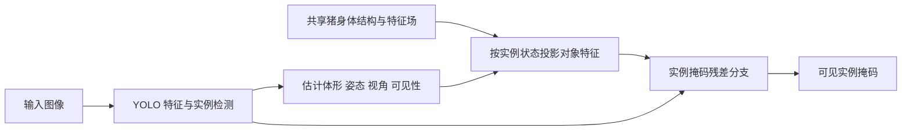

# V5 猪对象原型的设计与训练

2026-10-23设计初稿（训练前快照）。随后已完成对象v0的2304图、两分支各4000步和固定评价，见[实际结案](../../../experiments/spm_object_prototype_20261023/REPORT.md)；几何预测获益，体形编码稳定性未通过。本文保留完整V5设计，v0不代表所有阶段已经实现。当前动作以 [ACTIVE_PLAN](../../../project/ACTIVE_PLAN.md) 为准，设计登记见 [Study](../../../experiments/spm_object_prototype_20261023/study.json)。

**主张：把原型定义成一个可变形、可摆姿态、能预测不同观察结果的猪对象模型。** 它保存跨图像共享的身体结构与形状规律，每张图再推断具体猪的体形、姿态、视角和可见性。掩码约束对象投影与图像的对应；形成对象表征的核心训练则是跨视角预测、部位对应和遮挡下的对象一致性。人的“脑海中对象”在这里是功能上的启发，不作脑机制等价主张。

这一版本取代“直接增加掩码监督的实例 query/basis”作为下一方法的优先建议，保留可见实例分割任务及至少 +5 个绝对 Mask mAP50–95 百分点的目标。V4 与实例均值读出实验的协议、Run 和阴性结果保持原样。

## 现有证据能说明什么

全量 V4.1 的 F/B Mask AP 为 57.3570/57.3153，增量仅 +0.0417pp；关闭 F 的原型只降低 0.0565pp。继续扩大现有全局特征中心缺少实测支持，见 [V4.1 报告](../../../experiments/spm_v4_scale_20261023/REPORT.md)。

随后完成的 [实例读出实验](../../../experiments/spm_instance_readout_opportunity_20261023/REPORT.md)发现：训练后的 128 维特征优于同结构随机投影，但用 GT 为每只猪构造均值原型，305 个固定好框差掩码对象仅修复 2 个，失败组平均 IoU 从 0.6613 降至 0.5660。**已有训练学到了一些区分信息，却没有得到能由单个均值直接读出准确实例的表示。** 这不证明特征里完全没有形状信息，也不证明 3D 模型必然有效；有限均值读出不是所有读出器的性能上界。

当前代码没有显式的标准身体坐标、部位关系或“同一对象换观察条件”的预测任务。缺少这些训练约束是设计事实；它是否是 AP 瓶颈，仍需下面的匹配对照验证。

## 文献依据和路线选择

| 已核验方法 | 对本设计的帮助 | 实际边界 |
|---|---|---|
| [Slot Attention，NeurIPS 2020](https://arxiv.org/abs/2006.15055) | 将一幅图分解为多个对象表示 | 每图槽位不自动成为跨图共享的类别形状模型 |
| [DINOSAUR，ICLR 2023](https://dinosaur-paper.github.io/) | 自监督视觉特征可为真实图像的对象学习提供目标 | 对象发现成绩不能替代猪群 Mask AP，也不直接给出身体几何 |
| [MagicPony，CVPR 2023](https://3dmagicpony.github.io/) | 将动物形状、关节姿态、观察视角与外观分开建模，并利用视觉特征辅助学习 | 单目动物重建与密集猪群分割是不同任务 |
| [3D-Fauna，CVPR 2024](https://arxiv.org/html/2401.02400v2) | 共享形状先验结合个体形变；标准姿态下建立语义特征场 | 仍依赖掩码与特征监督；复杂姿态、左右腿歧义仍会失败 |
| [NeMo，ICLR 2021](https://arxiv.org/abs/2101.12378) | 在三维表面保存可渲染的神经特征，用图像特征检验对象假设 | 主要验证刚性物体姿态；粗几何足够估姿不代表足够做精细分割 |

据此选择**轻量的关节形状先验加标准坐标特征场**。它比增加向量中心更直接表达部位关系，也比从零训练完整写实生成模型更贴近当前分割目标。重点生成几何与语义特征，写实纹理不是首版必做项。以上是对现有方法原则的组合设计，尚不构成新机制或创新性已成立的结论。

## 对象本身保存什么

把共享对象与具体实例分开：

\[
\mathcal P_\Theta=\{X_0,\,G,W,\,D_\Theta,\,F_\Theta\},\qquad
s_i=\{z_i^{shape},\theta_i^{pose},C_i,a_i,v_i,u_i\}.
\]

| 层次 | 内容 | 应当学到的行为 |
|---|---|---|
| 共享身体结构 | 标准姿态的表面或锚点、部位连接图 G、蒙皮关系 W | 头连接颈部，四肢与躯干有稳定关系；图像旋转后仍能对应 |
| 可变体形 | 基础形状 X0、低维形变 D、个体体形编码 | 区分长短、胖瘦、头身比例；同一猪换视角时体形基本不变 |
| 表面语义 | 标准坐标上的可学习特征场 F | 同一身体位置跨外观与视角仍能对应，又能区分相邻部位 |
| 实例状态 | 关节姿态、相机、外观、可见性及不确定性 | 站立、进食、腹卧、侧卧是身体状态；遮挡改变可见部分 |

“一个对象”允许体形分布和多种可能姿态，不把所有猪压成一只平均猪。类别共享结构不等于具体猪的身份；没有真实跨帧身份标注时，不宣称学到长期身份跟踪。

首版使用现有有骨骼 Pig 网格初始化，粗分为头、颈、前躯干、后躯干和四条腿共 8 组。部位名称、骨骼拓扑来自资产先验，**不是模型自行发现的语义**；要学习的是表面特征、体形分布、从观察估计状态的映射，以及哪些局部证据属于同一对象。耳朵、尾巴等先保留在表面几何，不立即增加独立关节分支。

实现起点为有界低秩体形形变、现有骨骼蒙皮、标准坐标特征 MLP 和每实例状态预测头。可用 16 维体形码与 64 维表面特征做容量测量的起点，数值不是已经验证的最优选择。先保留已有拓扑，再学习可解释的变形；不让任意逐像素形变把三维体形变成贴在相机前的平面。

## 数据要围绕同一个对象组织

现有 [资产检查](../../../experiments/spm_v4_scale_20261023/render_plans/shard_0/ASSET_INSPECTION.json)记录 Pig 网格有 283 个顶点、骨骼和蒙皮；可复用其标准坐标与姿态。V4.1 的 4096 张场景外观图主要来自同一资产及程序化变化，不能视作 4096 个独立体形。现有同几何双外观配对也不等于同一对象的多相机配对。

新样本单位是一组具有相同 `object_family_id` 的观察，独立记录 `asset_id / shape_id / pose_id / camera_id / appearance_id / occlusion_id`。需要以下三种成对变化：

1. **同体形、同姿态、换相机**：输入视图 A，预测留出的 B；让模型必须掌握表面位置与投影关系。
2. **同体形、换姿态**：站立与腹卧使用同一个体形码，姿态码改变；标准坐标中的同一部位仍对应。
3. **同体形、同姿态和相机、改变外观或遮挡**：有干净观察及带栏杆、相邻猪遮挡的观察；外观改变不能任意扭曲体形。

每张合成图除 RGB 与可见实例 RLE 外，导出相机内外参、对象变换、骨骼姿态、深度、表面三角形与重心坐标、标准坐标、粗部位 ID、可见性。单独渲染同一对象取得无外部遮挡的完整投影目标，记录相同光照和相机；身体背面自遮挡与外部遮挡分开。用射线和投影重放检查对应，不把后期贴图生成的猜测当作精确三维标签。

先用现有资产验证训练链路。候选工程集合为 32 个形变参数族 × 6 姿态 × 3 相机 × 2 外观 × 2 遮挡状态，共 2304 张图；它只检验同资产条件下的对象学习。正式扩展可按 512 个形变参数族组织 36864 张图，但这些仍不等于独立资产。扩训前必须补多来源猪体形或经训练图验证的真实体形适配，至少把单资产内插与留出资产评价分开；具体资产和数量写入启动前合同，不能靠重复渲染冒充形状多样性。

真实数据继续保留 1272 train / 432 dev / 426 test 的现有边界。真实 train 提供外观与可见轮廓对齐、图像特征蒸馏；低遮挡样本先用于稳定体形学习，再加入密集样本学习可见性。未标注的真实部位、三维、完整遮挡轮廓不伪造为 GT。DINO 等模型给出的对应只能作置信度加权的弱目标。文件名不能充当已核实的跨视角同一猪身份。

按对象族划分合成 train/dev，换外观、换相机的同一族不跨集合；另报告留出姿态和留出资产。真实 dev 不参与无标签适配、PCA、原型提取或形状拟合训练，原 test 在方法冻结后才评价。采样以实例为单位轮转覆盖所有真实训练实例，取消固定每图最多 8 只导致的永久遗漏；逐轮记录实际对象及面积分层曝光。

## 监督目标怎样设置

掩码可以是对象学习的辅助约束，但对最终分割仍是主任务监督。这里的“辅助”指功能位置，不能靠任意调小损失权重来定义。保留轮廓锚定，增加迫使潜变量表达对象的预测任务。

| 目标 | 网络实际预测什么 | 防止的捷径 |
|---|---|---|
| 跨视角预测 | 从 A 的对象状态渲染 B 的深度、标准部位与语义特征 | B 的 RGB/特征仅作目标，不能输入状态编码器；不允许 A→B 直接像素跳连 |
| 标准部位对应 | 同一表面点经视角、关节变化后仍映射到同一标准坐标 | 部位内聚合与不同部位区分共同约束，不能全体输出同一向量 |
| 形状与姿态分解 | 同体形不同姿态共享 shape；不同体形相同姿态保留 shape 差异 | 只让体形码稳定，姿态应随运动变化；不把站与躺硬压成同状态 |
| 部分观察恢复 | 遮挡输入估计干净对象的形状与部位，输出不确定性 | 合成配对有真值；真实遮挡区域不使用自己生成的硬伪标签闭环 |
| 真实视觉对齐 | 标准特征投影匹配真实图像的冻结视觉教师特征 | 背景和外观独立变化；教师冻结，跨图 PCA/投影只用 train |
| 轮廓与可见性 | 对象完整投影、被遮挡后的可见轮廓分别对应目标 | 禁止用完整身体投影充当可见实例 Mask |

可以写成 `Lobject = Lcross_view + Lcanonical + Lstate + Locclusion + Lfeature + Lsilhouette + Lregularity`。这一行只说明组成，不预设各项等权；各项按对象与有效表面点归约，量纲、权重、缺失目标处理和梯度范围在启动前冻结。形状平滑、关节范围、左右结构对称用于减少单目歧义，但俯卧软组织压缩仍允许有界非刚性形变。

RGB 重建可作弱辅助，不作为第一主目标：把纹理和光照画得相似不能单独说明形状正确。对前后方向、不可见四肢保留多个候选或低置信度，不强迫网络自信地输出唯一隐藏形状。部分观察恢复应优于同容量的普通对象编码器，不能只优于随机初始化。

## 训练顺序和 YOLO 接入

**先学对象，再接分割，最后有限联合微调。** 这是本项目的实施选择，不宣称所有对象模型都必须分阶段训练。

1. **对象学习 v0。** 冻结图像底座，训练标准形状/特征场及状态预测，用成组数据完成留出视角预测和遮挡恢复。已有骨骼用于初始化；逐步释放关节与体形自由度，避免第一步同时学习相机、任意形变和纹理导致互相补偿。采用冻结 DINOv2 ViT-S/14 作为离线真实语义目标的候选，正式使用前登记权重与预处理；不向部署端增加教师依赖。
2. **真实适配。** 在真实 train 上对齐语义特征、可见轮廓和状态分布，保持合成的跨变化任务，防止标准坐标漂移。合成数据教可控几何，真实数据纠正猪体形和观察域；两者职责不能互相替代。
3. **YOLO 适配。** 从同一实例的 YOLO 特征和预测框估计对象状态，将对象特征按该姿态/视角投影到实例区域，供轻量残差掩码分支使用。先冻结共享对象模型与 YOLO 底座，只训练接口；初始化残差为零，先验证原生输出重放，再检验真实增量。
4. **有限联合训练。** 只有对象任务与分割接口都确实工作后，再小学习率开放指定参数，保留对象预测损失，持续检查标准坐标漂移和形状退化。对照组获得同数据、教师、监督、更新步数和同等模型选择预算。

首版固定正常检测的框、类别、分数和排序，明确登记新增实例掩码分支；不把这种接口变更隐藏成原来的 P3 全局检索。推理只读当前 RGB 和自身预测，GT 框/姿态/掩码不能进入部署推理。对象完整性是内部先验，可见性分支必须阻止把相邻猪覆盖的身体画成前景。先保留原生掩码作为局部细节依据，避免低分辨率几何损伤小目标。

[3DAnimals 官方代码](https://github.com/3DAnimals/3DAnimals)提供相关预训练模型下载入口与重建可视化。它可作为初始化/几何教师的候选参照；下载可用性、猪群俯视和躺卧适配尚未实测，不能直接当本项目真值。若使用其权重，普通对照也要获得相同额外先验。首版不复刻一个面向上百种动物的完整训练工程。

## 怎样判断学到了对象并改变决策

**H_object：** 标准身体位置及部位关系，使局部观察能约束同一对象未见的部分，因而比同信息的无显式几何分支更能分离接触猪和保持遮挡下的可见轮廓。支持依据为现有中心压缩缺少这些约束，以及上述对象模型在各自任务上的可行性；本项目还没有该机制的阳性证据。

**主要竞争解释 H_alt：** 增益来自额外真实/合成训练、教师特征或普通实例解码容量；结构化形状并非必要。另一个会直接改变执行的风险是：单目俯视和躺卧使状态估计不可靠，几何先验反而覆盖真实边界。

| 必做比较 | 预先规定的区别 | 决策 |
|---|---|---|
| 留出视角与干净对象目标，结构模型 vs 同容量普通对象分支 | 同编码器、潜变量预算、目标、输入和步骤；普通分支用自由解码代替显式蒙皮/坐标投影 | 结构模型在新视角对应及隐藏部分预测均有增量，且真实可见轮廓不退化，才接入正式分割比较；只有训练集重建好则不扩训 |
| 换外观、换姿态、遮挡的成对干预 | 换外观应保体形；换姿态应保标准部位但改变投影；遮挡增加不确定性 | 体形随背景乱变、隐部位高置信度乱补，停止该参数化，保留失败样本 |
| 正常对象结构 vs 定向错误部位关系，配等幅扰动 | 保留 token 集合、数量与特征分布，只破坏其对应的身体位置/连接；同时保留等幅非结构扰动 | 只有更大的数值扰动有害不算结构证据；同检查点干预还需去掉显式结构的重训练对照 |
| YOLO 原生续训、普通分支与对象分支 | 相同训练数据和选择预算；普通分支也有相同教师与辅助监督 | 对原生涨而对普通分支不涨，收益归普通适配；停止复杂对象分支的机制主张 |

v0 的主要量为标准表面对应误差、留出视角部位转移、合成隐藏部分恢复、真实可见轮廓质量；以对象族为统计单位，固定分母和配对区间，避免把同族几千像素当独立样本。具体数值门槛与完整预算在 v0 实现/数据清点后、首个训练前冻结，本设计不冒充可直接提交的 Protocol。

阳性按计划进入同预算 YOLO 比较；明确阴性关闭当前对象参数化的扩训；样本缺失或实现错误只允许修复相应工程项，不按结果更换对象、阈值或选择规则。对象学得好却分割无增量时，结论为该接口没有提供任务效用，不回避为“原型看起来更好”。

最终目标仍按同配置真实评价，对最强原生参照至少 +5pp，并交代普通分支及既有方法的额外收益、原成功样本损伤、小目标和延迟。当前 dev 最强已验收原生为 57.3153，按该锚点算数目标为 62.3153；新同预算原生若更强，跟随更强参照。该数值不是独立 test 的预知基线，test 必须同时评价各冻结模型。不得把表征诊断、合成补全或漂亮三维图计作 +5 目标完成。

## 交付的对象与重点可视化

权重应能独立加载成一个对象：展示标准身体、部位/特征场、体形变化、姿态变化，并由图像估计状态后重投影。模型包保存坐标轴、尺度、拓扑、教师/编码器版本、归一化、状态定义和训练来源，不能只交一组无空间含义的中心向量。

固定案例集交付五组图：标准对象与部位；同一对象跨视角/跨姿态对应；形状/姿态/外观单变量编辑；遮挡输入与有真值的完整目标及不确定性；真实原生/普通分支/对象分支的可见实例掩码。固定同一实例身份，保留失败例；生成补全与真实标签明确标识。

**唯一下一步是完成对象学习 v0 的成组数据导出和结构模型训练包，以一次有普通对象分支对照的实验检验跨视角预测与遮挡恢复。** 这项必要能力成立才投入 YOLO 联合训练。当前仅完成研究与设计登记，新的渲染、训练和 GPU 作业均未启动。
