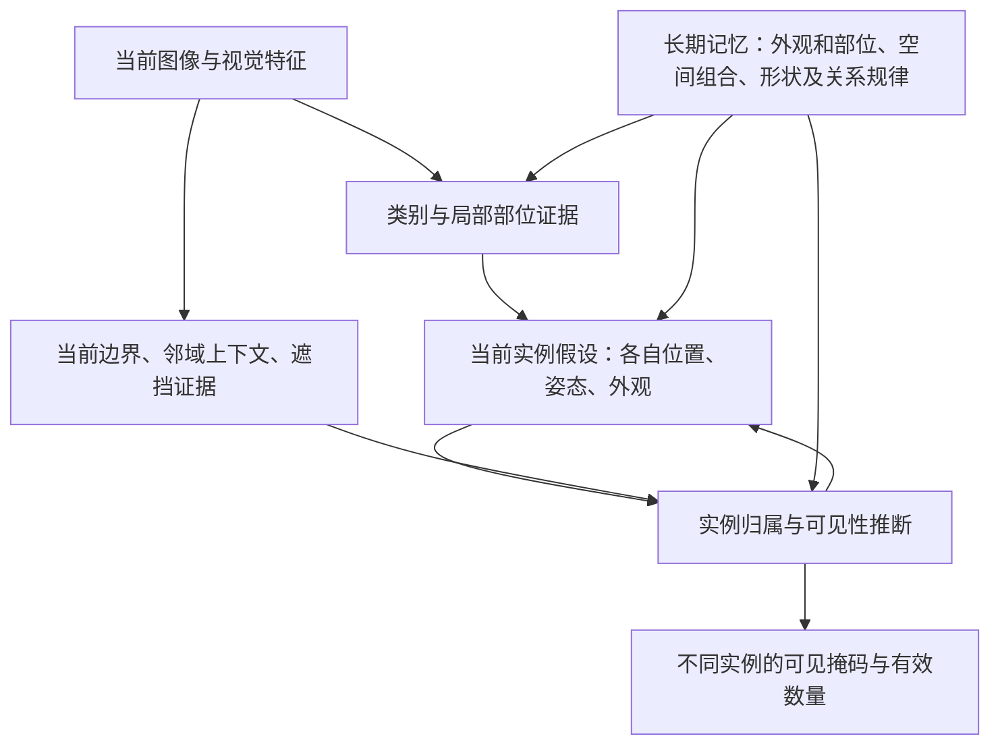

# 对象原型应该记住什么：从苹果识别到密集实例划分

2026-10-25，SPM-YOLO 文献与框架审查。依据本轮用户的苹果例子，首轮核查12项一手研究；用户随后提出共同训练部位与整体原型、让二者互相联系，另补充2项部位—整体组合研究。重点阅读方法章节或明确标注的原文摘录。逐项阅读范围、适用任务和边界见[来源记录](PROTOTYPE_MEMORY_CONTENT_REVIEW_20261025.sources.json)。这是内容设计判断，不替代旧实验协议、数值Gate或运行状态。

**本次推荐：长期记忆以有样本依据的部位/外观特征及其可变形空间组合为核心，并学习用于当前实例推断的形状、边界归属与遮挡关系先验。每张图中的实例身份、位置、姿态、可见性和数量由当前图像推断。** 这个内容组合有文献与既有实验依据；它尚未在本项目被验证为最优实现。

## 1. 苹果例子中有三个不同的问题

判断“像苹果”，需要组合轮廓、果柄、表面纹理、颜色等证据，并区分容易混淆的对象。颜色应保留多种类内变化：红色不是所有苹果的必要条件，也不是苹果独有的证据。特征可以由网络学习，不要求把每种属性手工写成检测规则。

判断“这里是一只完整的苹果实例”，还需要知道哪些局部属于同一个整体，以及遮挡和视角允许怎样的形状变化。

判断“有几只苹果”，则需要形成不同的实例假设，并决定各片可见区域归属哪一个假设。多只苹果可以调用同一套长期原型；同一只苹果也可能调用多个部位原型。**原型库容量、激活次数和图中对象数量是不同的量。**

ProtoPNet提供类别判别中部位匹配的例子；Slot Attention展示当前场景的对象绑定；InstanceCut与空间嵌入方法处理实例分组。这些职责可以协同，并不需要变成一次执行后不可修正的硬顺序。[P01](https://proceedings.neurips.cc/paper/2019/file/adf7ee2dcf142b0e11888e72b43fcb75-Paper.pdf)、[P06](https://arxiv.org/html/2006.15055)、[P08](https://arxiv.org/html/1611.08272)、[P09](https://arxiv.org/html/1906.11109)

## 2. 最适合长期保存的内容

| 内容层次 | 建议长期保存的信息 | 当前实例需要另行确定的状态 |
|---|---|---|
| 类别与部位的判别证据 | 可重复出现的局部视觉特征及类内变化，真实训练样本依据，与易混淆对象/背景的区别 | 哪些线索在当前图像可靠，当前实例的具体颜色、尺度和外观 |
| 部位到整体的结构 | 部位的相对位置、连接、形状变化范围，以及姿态/视角条件下的组合规律 | 这只对象当前的姿态、视角、体形及各部位对应位置 |
| 形状与可见性先验 | 可能的对象形状、局部缺失与遮挡解释；完整形状和可见前景分别表达 | 当前遮挡物、被遮住的位置、可见片段及不确定性 |
| 边界归属与交互规律 | 两侧区域、轮廓连续性、交汇结构和上下文怎样支持同实例、不同实例、前后遮挡的判断 | 这条边属于哪只对象，邻近片段是否应合并，谁遮挡谁 |
| 内容的证据与适用范围 | 来源样本、有效支持、外观/姿态覆盖及可靠性 | 当前输入是否落在已学知识的支持范围内 |

这些是知识职责，不等于必须增加五个独立网络或记忆库。类别证据和部位内容可以共享表示，形状与关系也可以由条件模型表达。存储形式可以是局部特征分布、可变形模板、部位图或结构化隐变量；不预设必须完整三维化。

对猪群，身体部位和可变形关系比苹果更复杂。头、耳、吻部、躯干与肢体的可见证据，应当能在姿态变化后继续关联；真实颜色、污渍、红外成像变化需要被覆盖。地面、栏杆和相邻猪的具体图像不应被固定解释为本猪身体，当前归属由场景证据决定。

## 3. 文献具体支持了什么

| 一手研究 | 实际内容/机制与本次启发 | 不可直接转移的结论 |
|---|---|---|
| [P01 ProtoPNet，NeurIPS 2019](https://proceedings.neurips.cc/paper/2019/file/adf7ee2dcf142b0e11888e72b43fcb75-Paper.pdf) | 学习用于分类的局部原型，结合类内聚合、类间分离和向训练特征块的投影，使匹配有样本依据。 | 图像分类的部位证据不能直接给出密集实例的数量与归属。 |
| [P02 Deformable ProtoPNet，CVPR 2022](https://arxiv.org/html/2111.15000) | 原型由可调整相对位置的多个部件组成，说明可以保存部位组合并适应姿态变化。 | 分类中的可变形匹配不等于已学会猪群遮挡分割。 |
| [P03 ShapeMask，ICCV 2019](https://arxiv.org/html/1904.03239) | 从规范化训练掩码聚类形状先验，再结合当前实例特征细化，支持形状知识与实例证据分工。 | 掩码原型可以有效；不能因它来自掩码就否定。它也没有单独解决本项目的邻猪归属。 |
| [P04 CompositionalNets，CVPR 2020](https://arxiv.org/html/2003.04490) | 保存局部特征分布及其空间组合；对象与遮挡解释竞争，使可见局部可以支持被遮挡对象的识别。 | 主要证据是分类与遮挡定位，不是本项目正常YOLO实例AP。 |
| [P05 Bayesian Amodal Segmentation，CVPR 2022](https://arxiv.org/html/2010.13175) | 在神经特征的生成模型中明确区分对象前景、背景上下文、形状先验和遮挡变量。 | 原论文有不同中心/框权限的评价，不能把辅助区域条件成绩直接当正常检测效用。 |
| [P06 Slot Attention，NeurIPS 2020](https://arxiv.org/html/2006.15055) | 当前图像中的slots通过竞争分配输入特征，支持把同类实体绑定为不同对象表示。 | slot是运行时实例表示，不能把它直接算成跨图像持久原型；slot数量也不是有效对象数量。 |
| [P07 DINOSAUR，ICLR 2023](https://arxiv.org/html/2209.14860) | 冻结自监督特征、竞争分组和特征重建能够在真实数据中产生对象表示。 | 特征重建本身不能被概括为无效；其对象发现表现也不证明当前记忆库或猪群分割有效。 |
| [P08 InstanceCut，CVPR 2017](https://arxiv.org/html/1611.08272) | 将类别证据与实例边界证据结合，通过图像分区获得实例。 | 边界存在不自动说明分割归属，遮挡后不连通片段还需要额外对象解释。 |
| [P09 Spatial Embeddings，CVPR 2019](https://arxiv.org/html/1906.11109) | 以像素到实例中心的空间嵌入及实例自适应聚类范围，解决同类像素的实例归属。 | 瞬时中心/嵌入是当前实例状态；它不替代长期对象结构知识。 |
| [P10 PixPNet，WACV 2024](https://arxiv.org/html/2309.14531) | 指出漂亮的原型裁图可能受错误像素映射、过大感受野影响；强调可追溯的内容与定位依据。 | 一张最强命中裁图不能证明原型只保存该部位或属性。 |
| [P11 Border Ownership，J. Neurosci. 2000](https://pubmed.ncbi.nlm.nih.gov/10964965/) | 猕猴视觉皮层中有受图形上下文影响的边界归属信号，支持区分边缘强度与边属于谁。 | 不能由该实验断言人脑按固定苹果识别流程工作，也不能直接指定人工网络实现。 |
| [P12 SAM 3，2025技术报告](https://arxiv.org/html/2511.16719v1) | 区分概念存在与实例定位；文本或图像例子可以指定一个概念，并返回多个实例。 | 不是持久原型库的直接验证。附录计数实验还指出存在token不帮助计数，整体组与个体重复预测需另处理。 |

本轮不是系统综述或穷尽检索。CVF若干页面直接访问失败后，方法核验使用作者arXiv正文；P11使用原始论文的数据库摘要与可检索全文摘录，未声称逐页审读全文。没有依据二手博客或检索到的审稿评论作技术结论。

## 4. 如何对应到用户希望的判断过程

例如两个相互遮挡的红苹果：共有的苹果证据提示候选区域；两个位置各自的曲率、果柄或局部纹理支持不同实例；边界两侧和遮挡交汇支持前后关系；对象结构允许将被遮挡而分离的同实例片段关联。颜色、阴影或表面条纹不应单独决定切成几只，边界证据也应接受整体对象解释的检验。

图中的反馈是建议的计算分工，不宣称复现人脑或要求引入某一特定循环网络。现有YOLO的正常检测可以提供初始实例假设；文献并不要求放弃检测器、另起完整对象发现系统。

## 5. 当前项目证据对内容取舍的约束

- [V15](../../../experiments/spm_canonical_object_training_20261023/REPORT.md)在同资产合成开发、GT框/参考上下文下，身体对应PCK@0.10达到89.8878%，双猪完整归属IoU仍只有57.2013%。这支持保留结构知识的有限事实，也说明仅有身体对应不足以完成实例划分。
- [V17/B](../../../experiments/spm_object_memory_training_20261024/B_STAGE_ACCEPTANCE.md)的正常查询重遮挡159例IoU为0.487747，同框参考查询为0.486532。换成参考查询没有补齐能力缺口，内容与重建器的整体不足仍未分离。
- [实际调用审查](../../../experiments/spm_boundary_protected_readout_20261024/PROTOTYPE_USAGE_AUDIT_20261025.md)确认三库参与推理，8895例正常查询中对象内容集中在12、15、20、39。空间权重仍能变化，条目数少本身不证明所有对象知识消失。
- [Blender对照](../../../experiments/spm_blender_domain_replay_20261024/REPORT.md)支持冻结系统对材质/照明敏感，并保留所有新外观下的过删现象。真实训练信息指导合成外观覆盖有依据，但加噪声不能替代实例归属与对象内容的学习。

据此，本次内容推荐的重点是**有证据依据的部位组合，以及它对当前实例归属的约束**。不把再做一次单猪几何重建视作已解决密集场景；也不把所有退化唯一归因于原型存储张量。

## 6. 修正前面讨论中过强的表述

特征重建和掩码监督都可以参与形成有用的原型；DINOSAUR和ShapeMask分别提供相关实证。缺少显式身体坐标也不等于对象知识在数学上不可能形成。对本项目准确的判断是：当前所用目标、表示和推理方式尚未展示我们需要的跨变化结构与实例归属能力。

原型也不必每条都有人类可命名的语义。若要声称条目表示特定部位或属性，需要多样本匹配、正确空间对应及相应行为证据；颜色PCA、单条目解码和最强命中裁图均不足以独立作此证明。

与普通MLP的区别应由内容约束、可追溯知识和实际行为体现。任何固定记忆检索系统都能由神经计算实现，不能把函数形式不同本身作为优势证据。本次没有新增匹配训练对照，也没有声明已排除容量或数据解释。

## 7. 合格对象记忆应交付的行为

1. 在外观、照明变化下仍能对应同一对象结构，在姿态和视角变化下能改变投影并保留部位关系。
2. 局部观测能调用适合的整体知识；被遮挡区域保留不确定性，完整对象假设与任务可见掩码分别表达。
3. 多个同类实例可以复用同一知识，同时形成各自的空间支持与可见像素归属，降低粘连、重复和错误切分。
4. 实际分割中保留可靠图像证据；记忆的定向变化应对其声称的部位或关系产生可解释响应，而非只有统一前景面积改变。

这些是框架能力要求，不追改已冻结Run的判据。新的网络、损失或训练流程若正式立项，还需另行冻结竞争解释、输入与参数范围、比较和退出条件。本轮交付文献与内容审查，未启动新的训练或自动接续。

## 8. 用户补充：共同学习部位、整体及二者关系

用户的进一步设想可准确表述为：**共同学习部位原型、整体原型以及部位到整体的组合关系，使局部证据支持整体对象假设，整体假设再反过来约束局部的类型、位置、可见性和实例归属。** 这是两层原型，而不是只有两个条目；每层可以有多个类型和变化模式。

| 学习对象 | 应表达的内容 | 应有的联系 |
|---|---|---|
| 部位原型 | 局部外观与形状特征、相应的姿态/尺度等状态 | 局部观测提出它支持哪个整体实例及何种对象状态 |
| 整体原型 | 整体形态、部位配置、可变形结构及状态分布 | 一个整体假设预测哪些部位应当在哪里、呈现什么关系，允许部分部位不可见 |
| 组合关系 | 类型相容性、相对几何、允许形变和当前实例的归属约束 | 多个局部对同一整体给出相容的解释，并在当前图像中分配到对应实例 |

例如，两只接触的猪都有合法的头和腿，单独的部位分类不能决定这些局部怎样组合。需要检查某个头、躯干和腿的位置、方向与比例能否共同支持同一个实例；整体若是侧卧状态，预期的部位布局也应随之改变。对于被遮住的部位，整体只能提供结构假设，不能将其自动加入可见任务掩码。

这项联系应体现在学习目标中：局部证据的部位匹配、部位组合对整体的解释、整体条件下的部位预测，以及接触场景中的同实例归属。一种候选监督资源是合成图可追溯的部位/表面坐标、实例ID与姿态，真实图只使用实际具有的标注。具体损失、路由、参数量和训练日程尚未选择或冻结；将两个向量拼接本身不能证明形成了这种联系。

[P13 Dynamic Routing Between Capsules，NeurIPS 2017](https://proceedings.neurips.cc/paper/2017/file/2cad8fa47bbef282badbb8de5374b894-Paper.pdf)用低层实体对高层实体状态的预测及预测之间的一致性进行组合。[P14 Matrix Capsules with EM Routing，ICLR 2018](https://openreview.net/pdf?id=HJWLfGWRb)进一步学习部位到整体的变换，并为当前图像迭代估计归属。这些工作支持把组合相容性作为显式计算对象；其原始分类/重叠数字或smallNORB结果不能直接转作真实猪群分割证据。

本次采用的是部位—整体相互约束的表示原则；双向约束是本审查的功能要求，不声称上述原始Capsule算法已经等价实现完整的顶层反馈或最适合本项目。

## 9. 编码解码与真实场景数据的整合审查

用户进一步提出用编码器—解码器规范原型，并加强真实光照、材质、高频信息与场景特定遮挡，整合要求见[专项审查](PART_WHOLE_AUTOENCODER_REVIEW_20261025.md)。现有V17已具备编码解码形式，本次补充重点是规范目标、内容依赖、成组对应监督、实例归属和真实数据覆盖，不把网络形式本身当作对象知识已形成。

## 10. 用户最终明确的词表语义与匹配要求

进一步明确的一条目一语义、多条目激活、按具体实例及可比较语义组监督匹配与排序，见[语义原型词表规格V1](SEMANTIC_PROTOTYPE_VOCABULARY_SPEC_V1_20261025.md)。它细化本审查的内容目标，不将旧自由字典的检索记录重新解释为已获得这些语义，也不追改旧Run。
