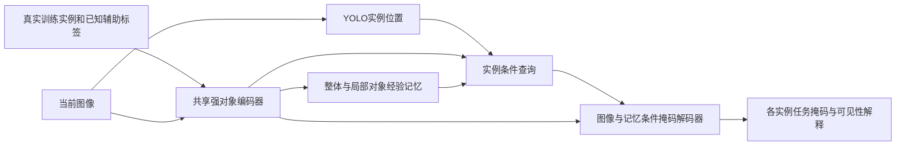

# V28 大方向重审：真实对象经验驱动的条件掩码重建

2026-10-26用户要求“换个大思路想想”。本文件记录新方向，取代未执行的V27；后续实际进展：共享对象/掩码架构、2024图特征与256经验、507/509/511工程及两轮全链审查已完成，[正式Slurm513](../../../experiments/spm_real_object_reconstruction_20261026/TRAIN_JOB_RECEIPT.json)开始8000步训练，尚无新完整效用结果。原V25/V26训练、阴性、权重及冻结Gate保留，完整训练交付goal仍未完成。所有理论和数学依据只维护[统一理论D20](SPATIAL_OBJECT_THEORY_SUPPORT_20261025.md#d20-用户要求的大方向重审真实对象经验驱动的条件重建)；实际数值以[冻结训练合同](../../../experiments/spm_real_object_reconstruction_20261026/TRAIN_PROTOCOL_V1.md)为准。

## 主张

我选择研究“强预训练对象表示＋可重建的真实对象经验＋实例条件掩码解码”。原型承担对象知识和跨图像对应，进入掩码生成过程；YOLO先提供可靠实例位置。学习的目标是依据图像证据与对象经验生成该实例的任务兼容mask，输出具有新的空间自由度。

选择依据：C21直接读出已N+3.073、V23 N+3.410；V25/26的候选质量学习均低于V23且损伤超限。V26训练MSE从旧5.45改善到4.24、正常却退化，置零新增局部特征反而+0.530347，说明只提升这一质量接口的训练拟合没有带来正常分割收益。V24和原成本GT见证说明候选机会，但它们不保证正常可学。本轮累计证据足以停止候选质量头扩展；不能由此宣称原型整体无效或所有错误机制已被分离。

## 三个根本变化

1. **对象知识从真实经验和强语义表示中学习。** 首选SAM式强预训练对象编码—解码底座，工程候选为SAM2；支持与查询使用同一冻结编码器和共同学习的投影。真实train实例是核心，合成数据提供已知部位、姿态及遮挡辅助。更换底座的预训练信息/容量必须披露，不能把其全部收益记作新原型贡献。
2. **记忆带有可恢复的对象内容。** 一个经验单元保存整体语义键、局部空间特征/部位关系、形态/姿态状态及来源实例。训练要求仅凭对象代码恢复其前景语义特征和粗对象布局；该检验禁用原支持图的稠密跳连。原始实例/部位patch、重建结果和匹配对应可以直接展示。词条数量由train覆盖和成本决定，512槽/128维/四个同型词表不作先验约束。
3. **原型参与生成mask。** YOLO框形成实例查询，检索/组合对象经验后进入强掩码解码器；高分辨率当前图像证据确定具体边界。整体约束所属部位，部位支持整体解释；遮挡作为实例与实例/设施的关系及可见性状态，边界作为空间解码能力。记忆影响的必要性必须实测，不能以接了一层attention宣布学会原型。

## 数据与训练方式

先保留真实1272train/13来源、432dev/4来源隔离和426test封存，不预设现在的数据量足够完成最终目标。支持与查询按来源分开采样，禁止查询本人或相邻帧充当记忆来伪造泛化。真实whole实例mask、对象特征重建和跨增强对应构成核心监督；已有合成的部位/姿态/深度只在已知域辅助，真实未知部位不当背景。真实task mask与物理可见/完整形状继续分字段，不能把栏杆后GT的标注约定静默改为可见mask。

基础模型的大规模预训练提供对象表示起点；猪领域记忆投影、整体—局部对应及mask解码适配在同一实例重建任务中联合学习。单独训练一个库再硬接到另一特征空间的阶段方式不作为新默认。训练时编码器冻结可缓存，记忆/查询投影共同更新；使用当前投影重算键，避免离线旧键漂移。是否进一步解冻encoder必须在正常结果和预算支持后另冻。

第一版保留原生Box/Class/score/检测身份以保护定位，不在本版同时承担从零发现所有密集实例。漏检无法由mask头恢复，密集漏框单独如实记录。需要改变检测器的后继版本不能沿用“框保持”的结论。

## 先解决哪个问题

当前唯一下一步：完成共享强编码器、真实对象记忆、自重建与实例条件解码的接口/监督原型，核其能否从对象代码恢复真实对象特征，并明确在同一底座里给记忆所增加的职责；然后冻结实际checkpoint、完整数据/训练预算和两轮全链审查，再执行有限训练。不能再次用局部调分或GT选择代替该架构。

强解码器本身的原生框提示输出须作为可复用参照，以区分底座已有能力与新增记忆作用；它是必要的路线核验，不恢复多臂训练扫描。正常方法最终仍对同配置强原生报告整体收益和损伤。正确/置零/错配记忆的同模型控制仅能证明条件使用；新增信息/参数的因果归因另有边界。

本方向优先于纯无监督Slot发现，因为已经有真实实例标签、目标要求密集同类实例精细分割；也优先于完整3D世界重建，因为当前单体形资产和单视图隐藏部位不可识别性会继续放大监督缺口。两者可提供局部机制，当前不将它们设为主干。

## 可推翻条件和交付

若对象代码无法恢复真实对象特征，或换成错误对象记忆不影响对应/重建，记忆定义未过必要条件；停止扩大词表。若强解码适配带来收益而记忆无额外实用作用，则报告底座/适配收益并裁掉无用记忆。若正常+5或定位/损伤/尺度护栏失败，保留阴性再依据失效证据修订；不保证本建议必然提点。

完整终点仍是实际训练、全量正常验收、必要确认、可重载权重/正常入口/数据环境日志和整体—部位—匹配—关系—边界—效果图。当前是经证据选择的新架构方向，尚无新模型或正收益。
