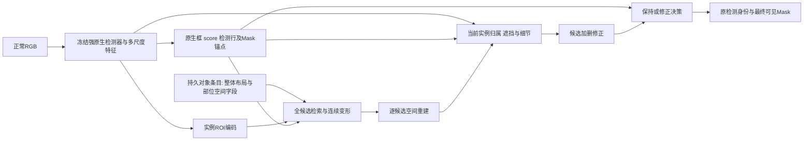

# 空间对象记忆：首个架构裁决与实现范围

2026-10-25。属于[完整训练交付目标](MODEL_DESIGN_GOAL_20261025.md)。每项依据集中保存在[理论支持文件](SPATIAL_OBJECT_THEORY_SUPPORT_20261025.md)；实际执行见[Study](../../../experiments/spm_spatial_object_memory_20261025/study.json)，路由只见总控。本文是选定后继续完善的首个主架构，不是训练完成或+5收益结论。

## 1. 依据什么改架构

V20实际10000步：规范参考形状IoU约98%，正常合成部位+姿态仅45.51%、整体姿态65.79%，真实整体/部位平均读入1.401%/.128%，真实Box/Mask AP下降8.653/5.382点。参考形状复现、正常绑定和最终分割是三个不同问题。真实前景细标签被忽略而未匹配/背景有reject，允许模型拒绝真实域；它不是已单独证实的唯一原因。证据：[V20裁决](../../../experiments/spm_semantic_dense_task_20261025/DECISION.json)。

V15在GT框条件下学到了可靠的身体对应（PCK@.10=89.89%），但两猪可见归属IoU57.20%。V17真实重遮挡的正确参考查询和当前查询同框IoU约.4865/.4877；仅让query接近参考不足以解决读出。V16/V18有稳定的过删现象。因此我优先选**显式空间对象知识＋当前实例可见证据＋原生保持**，同时重做目标与绑定，不把所有问题归因成词表检索。证据：[V15](../../../experiments/spm_canonical_object_training_20261023/REPORT.md)、[V17同框](../../../experiments/spm_object_memory_training_20261024/B_STAGE_ACCEPTANCE.md)、[V16](../../../experiments/spm_instance_body_readout_20261024/REPORT.md)。

## 2. 表示族比较与裁决

| 形式 | 对本问题的有效能力 | 本任务首轮的代价或缺口 | 裁决 |
|---|---|---|---|
| 四个平坦向量词表＋通用MLP | 容易检索和扩容；理论上可表示复杂形状 | 语义/空间未必可辨，独立规范重建可绕过query；遮挡/边界高度依赖当前图像；V20未达正常绑定 | 不保留为主架构 |
| 一个连续潜变量＋共享隐式形状解码器 | 连续体形和姿态插值，存储紧凑 | 潜轴不自动对应部位；单RGB不可见几何多解；额外对应和归属问题仍在 | 连续变量用于实例变形，不作为唯一对象定义 |
| 显式3D关节网格＋部署时渲染 | 几何、部位、投影和遮挡有明确意义 | 单RGB深度/隐藏姿态不可唯一恢复；现有单体形资产不足；多实例3D拟合成本高 | 3D用于合成监督和规范锚定，首轮不强制部署3D求解 |
| 跨图像/视频的空间实例记忆 | 真正的空间key/value可保留细节 | XMem类方法的首帧实例标注/时间关联在当前静态部署输入不存在；大样本库存储和相似实例混淆 | 不引入额外首帧信息或长视频前提 |
| **带部位布局的空间对象记忆＋连续变形** | 同一条目显式包含整体/部位位置、可直接渲染；正常图像匹配和任务损失用同一路径 | 需验证2D形变覆盖、部位监督、真实绑定；不能凭结构保证AP | **选定为首个主架构，先完成实现与数据/训练合同** |

选择不是全局最优性证明。它以V15保留的空间对应能力为正面支持，以V17参考读出不足和V20独立参考重建问题为需要改的对象；比再扩大平坦词表更直接检查对象知识是否参与分割。

## 3. 具体存什么、怎样用

每个持久条目是一个视角/姿态条件的空间对象：`{global_key, part_keys, typed_fields, relative_depth_fields, reference_frames, attachment_anchors, provenance}`。键向量是查找地址；值是可直接显示的空间部位字段。首个PIG来源实际9个非背景部位：躯干、头、左右耳、四肢、尾。**整体由同一条目的部位联合定义，不是与部位库毫无约束的另一组向量。** 各条目可相似，不要求所有向量两两正交；语义职责明确不等于每个坐标轴完全独立。相对深度与占用共同决定自身遮挡；当前图像的物理可观察rho另算，不能把原生猪前景直接当每个部位可见。

当前实例另有连续状态：每个部位的有限旋转、正尺度和位移。参考布局提供起点，父子附件点约束相对变形；这不是把所有姿态枚举成互斥词表。难以观测的部位保持不确定，不能用真实unknown标签教成不存在。

遮挡属于本图本实例的归属关系：用正常检测行、所有邻居的空间证据和当前像素推断。边界属于本图局部的几何/图像变化：从部位形状边界及细尺度证据计算。二者保留可学习的关系/细化算子，**首轮不各建一个通用静态词库**。未来若特定关系原子有额外证据可另立版本，不能仅因过去四库命名而保留。

## 4. 关键接口和当前工程起点

| 接口 | 选定形式与尺度 | 当前实际实现 |
|---|---|---|
| 原生输入/特征 | 640 RGB；P2与P3合成`[1,512,160,160]`；框内32²采样 | 两张实际train RGB已前向，未读GT |
| 持久字段 | K64，9部位，32²；键96维 | 实际768姿态/视角的失真+成本选64，每项≥2姿态支持；字段已初始化，键未训练 |
| 正常匹配 | 原生前景加非零上下文池化；整体键＋部位证据；所有候选参与目标 | 已实现，无reject词条，无静默top2截断 |
| 连续变形 | 整体G五参数＋各部位L五参数，T=GL均正行列式 | G平移±2、尺度[.25,4]、旋转±60°；局部小变形，附件只在L算，不把共同zoom误罚为脱节 |
| 组成/可见读出 | 每候选保留9张完整部位、相对深度、自身可见分配及整体；图像物理rho独立 | 已实现联合known损失与梯度；数据逐部位投影/最终RGB及实际训练仍待验收 |
| 细尺度读出 | 128格独立RGB/原始native logit/全部邻居；共享图像卷积＋逐候选逐点MLP | 已实现，直接RGB/细logit梯度通过；不把64格插值冒充细观测 |
| 密集邻居 | 全部正常检测行的空间聚合，保持行身份 | 已实现无top3上限的对称聚合；并非已验证深度关系图 |
| 原生保持 | 只向原始native160→640路径加delta；KEEP时delta严格0 | 实际RGB二值和logit逐值一致；不将原生Mask经过ROI重采样替换 |
| 输出决策 | 一个KEEP＋每候选有效加/删动作，15×16²风险图＋正常score/box上下文 | signed d唯一最小质量正/负分解、缺符号方向屏蔽；实际640成本/策略代码具备，未训练 |

64不是最佳容量定理或64姿态类别。当前[容量初始化](../../../experiments/spm_spatial_object_memory_20261025/CAPACITY_INITIALIZATION_PROTOCOL_V1.md)已比较16/32/64，在768实际资产姿态/视角上按平均失真+.025K/64选择64，平均whole/part参考IoU .88194/.71570，每项≥2不同姿态支持。当前总1,467,732参数，candidate1,447,544、policy20,188；旧K4参考230616/267900/273166仅历史探针，不当现模型参数。当前键与任务使用尚未学习。

## 5. 实际完成与剩余项

最新真实工程Run [75a3a06c34b1](../../../experiments/spm_spatial_object_memory_20261025/runs/RUN_SPM_SPATIAL_LOCAL_REFERENCE_V1_75a3a06c34b1/SUMMARY.json)：27项通过；实际11239顶点/22446三角面/62关节、9非背景标签；2张既有合成train RGB、0真实图、0优化更新。检验了静止/旋转LBS、字段坐标/方向/行列式、附件、15邻居覆盖、任务证据与梯度路径、KEEP原生精确保持。首次过严蒙皮容差失败及源审计分别保留。先前26项通过后，实际看图发现camera-up/image-y-down投影缺负号；原Run/图保留，修正后新增真实解剖方向检查并独立重跑，见[工程修订](../../../experiments/spm_spatial_object_memory_20261025/ENGINEERING_REVIEW.md)。最新[实际资产图](../../../experiments/spm_spatial_object_memory_20261025/runs/RUN_SPM_SPATIAL_REFERENCE_FIGURES_1518d03a3d25/ACTUAL_PIG_GEOMETRY.png)与[空间字段](../../../experiments/spm_spatial_object_memory_20261025/runs/RUN_SPM_SPATIAL_REFERENCE_FIGURES_1518d03a3d25/SPATIAL_FIELDS_INITIALIZATION.png)均标记未训练。

上述27项是历史核心快照。最新[数据整体报告](../../../experiments/spm_spatial_object_memory_20261025/DATA_PREPARATION_REPORT.md)记录406最终24RGB/完整标签通过、407的640独立几何/10,120实例、409的1280RGB后处理和411/412/413最新四卡/完整缓存/执行链核验。signed编辑、重复owner/RLE/unknown、空间风险缓存与完整训练至图册程序已实现；[完整训练合同](../../../experiments/spm_spatial_object_memory_20261025/TRAINING_PROTOCOL_V1.md)选8000候选更新+8epoch策略、固定末权重与完整432正常验收。复审仍0、新优化0，不冒称部位匹配已学好或真实AP改善；当前工程通过后真正训练，goal仍active。
