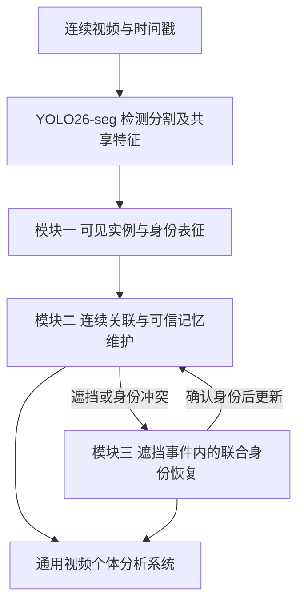

# 密集视频个体身份保持与遮挡恢复模型方案

日期：2026年10月18日

建议毕业论文题目：**面向密集场景的个体跟踪与遮挡恢复方法及系统研究**。

毕业论文以连续视频中的身份可靠性为主线：先取得可用于辨认个体的观测，再维持身份记忆，最后在遮挡后恢复正确编号。检测分割提供前端观测，猪作为应用案例；方法不预设猪的身体部位、外观规则或专用编号体系。

当前具备连续视频，但尚无跨帧真实个体 ID 标注。以下为模型与实验设计，视频方法尚未完成实现和验证。现有原型—系数研究继续服务于小论文，本方案不变更其研究路由、协议或运行任务。

## 研究问题与已有方法

应用中真正需要的是“同一个体的记录能够持续积累”。某一帧检测到了所有目标，仍可能在下一次交叉时交换编号；目标被遮挡后重新出现，也可能被系统当成新个体。前者会把两条个体记录拼错，后者会把一条记录拆开，影响活动轨迹、区域停留时间和去重统计。

已有方法能够处理相当一部分关联和遮挡问题。BoT-SORT 将运动与外观结合，Deep OC-SORT 进一步自适应地利用外观信息；本仓库所含实现中，后者已按检测置信度调节外观记忆更新。因此，“结合运动与外观”“低分时少更新”应作为基线能力。[BoT-SORT](https://arxiv.org/abs/2206.14651)、[Deep OC-SORT](https://arxiv.org/abs/2302.11813)

已有工作也覆盖了更接近的思路：Multi-track Pooling 利用其他轨迹改善区分能力，UpdateNet 学习模板更新，SAM2Long 使用多条分割记忆路径缓解错误传播。MASA-OA 则引入遮挡感知关联，论文摘要说明了重叠条件下的特征冻结。单纯添加邻居信息、记忆库、更新网络或多帧确认，均不足以独立构成新颖性。[Multi-track Pooling](https://arxiv.org/abs/2101.12159)、[UpdateNet](https://arxiv.org/abs/1908.00855)、[SAM2Long](https://arxiv.org/abs/2410.16268)、[MASA-OA](https://www.sciencedirect.com/science/article/pii/S0020025526004640)

本课题选择一个更具体的待检验问题：**在相似个体相互遮挡时，一次看似合理的外观更新，是否会使后续身份判断更容易出错；能否预先识别这种有害更新，并在重现时利用受保护的记忆联合恢复身份？**

支持依据来自已有研究对遮挡下外观干扰、记忆更新和错误传播的分析；ORCTrack 也明确讨论了遮挡目标的身份特征包含干扰信息的问题。这些证据支持研究该问题，但尚不能说明它是本项目视频的主要错误来源。[ORCTrack](https://arxiv.org/abs/2308.15795)

## 总体模型与三个模块

首版采用 **YOLO26-seg 前端、轻量身份特征分支、Deep OC-SORT 跟踪骨架、记忆写入收益预测和遮挡事件恢复**。先用已有动物图像与标注确认或适配前端的目标类别覆盖，再固定检测分割模型、缓存其输出和特征。视频方法第一阶段训练身份分支及小型收益预测头，恢复阶段再训练轨迹对评分头，使各项作用可以单独判断。

用于小论文的通用预训练检查点不能未经验证就视为已适配猪场的视频前端。不同方法的跟踪比较必须使用同一份已冻结的场景前端输出，动物类别适配的收益与新增身份方法的收益分别报告。

| 模块 | 应用中要回答的问题 | 主要模型组件 | 工作定位 |
|---|---|---|---|
| 一 可见实例与身份表征 | 当前看到了谁，哪些像素适合用于辨认？ | 检测分割、掩码引导特征提取、轻量身份编码 | 复用基础与视频接口 |
| 二 连续关联与可信记忆维护 | 连续帧是否仍是同一个体，这次观测是否值得记住？ | 运动关联、身份特征、写入收益预测头、可信记忆与暂存观测 | 第一项核心方法 |
| 三 遮挡事件内的联合身份恢复 | 多个相似个体重现后，分别对应原来的谁？ | 遮挡事件管理、短轨迹评分、多帧一对一分配、确认或拒绝 | 第二项核心方法 |

三个模块共同服务于一套个体状态。模块二处理正常连续关联和记忆维护；模块三专门处理暂时失去可靠对应关系后的恢复，避免两个章节重复描述一般外观匹配。

## 模块一 可见实例与身份表征

模型输出每个可见实例的框、掩码、检测分数和身份特征。检测分数表示“这里像不像一个目标”，身份特征用于比较“它是否还是之前那个个体”，两者分别使用。

初版身份分支从 YOLO 的多尺度特征中提取每个实例的局部特征，经通道投影、ROIAlign、小型卷积和掩码加权池化，得到归一化身份向量。可采用 7×7 的实例特征和 128 维向量作为首版结构设定，实际开销须测量。掩码参与前景加权，邻居掩码用于描述干扰风险；掩码重叠和可见面积变化只是风险线索，不当成真实遮挡比例。

第一版先使用一个前景身份向量，不同时引入关键点、身体部位分解和大型时序网络。其训练使用同一真实 ID 的跨帧样本作为正样本，同一场景中的其他个体作为负样本，尤其覆盖相互靠近的相似个体。标准对比学习是训练工具，不作为独创贡献。

现有静态图像可以提供同一实例的两种增强视图，以及其他实例干扰的训练样本。MASA 已验证了从静态图像增强中学习实例对应关系的路线；这里可借用这一训练思路降低起步成本，但静态增强不能替代真实视频中的姿态、遮挡和重现验证。[MASA](https://arxiv.org/abs/2406.04221)

本模块要回答的验证问题是：在相同检测与编码容量下，掩码引导的特征是否比整框特征更少受到邻居污染，并最终改善身份关联。若只提高图像分割 AP，没有改善身份区分，就仅记作分割收益。

## 模块二 面向后续身份判别的记忆写入

### 具体场景

个体 A 和 B 接触时，A 的检测分数可能仍很高，但提取的外观已经混入 B。若立刻将该特征写入 A 的记忆，后续系统可能越来越倾向于把 B 认作 A。需要判断的是“这次更新是否有助于以后认对 A”，而不只是当前检测是否可信。

### 模型结构

沿用 Deep OC-SORT 的运动估计和关联框架，加入轻量写入收益预测头。该预测头读取当前身份特征、已有可信记忆、与附近竞争身份的相似度差、掩码干扰线索和近期关联状态，输出预期写入收益。检测分割分支保持冻结。

每条轨迹维护一个有固定容量的可信特征库，以及一个短暂观测队列。低可信观测仍可用于运动关联和后续确认，但不立即改变可信外观。新轨迹先积累连续一致观测再初始化记忆；推理时的确认全部依赖模型输出，不使用真实 ID。

### 训练监督的具体区别

拟用训练视频构造同一历史状态的两个分支：一个写入当前外观，一个保持原记忆。随后在训练片段中的后续可见帧，比较两份记忆区分本人和竞争个体的能力。

对于记忆库 M，定义训练用的身份判别效用：

\[
U(M)=\frac{1}{|F|}\sum_{u\in F}\left[s(M,e^+_u)-\max_{k\in\mathcal N_u}s(M,e^-_{k,u})\right].
\]

其中，F 是预先确定的训练后续帧集合，e⁺ 是同一真实个体的特征，e⁻ 是同帧竞争个体的特征，s 可以使用记忆库内最大余弦相似度。没有有效正样本或竞争对象的片段不生成这一监督，单独计数。

\[
\Delta U=U(M^{\mathrm{write}})-U(M^{\mathrm{keep}}).
\]

模型学习从当前及历史信息预测这个差值；当预测收益超过开发集确定的阈值且身份关联满足确认条件时才写入。训练样本来自跟踪器实际预测及其历史，GT 仅用于标记真实身份、构造竞争样本和计算监督，避免全部用理想 GT 框制造过于容易的训练输入。错误关联样本需要作为独立负例纳入。

**后续帧与 GT 只参与训练标签构造，推理输入不包含未来帧或 GT。** 生成收益标签前先固定身份编码器和记忆更新规则，防止标签随编码器漂移。ΔU 是监督代理量，最终效用仍由完整视频的跟踪结果判定。

拟形成的贡献是：**以未来身份区分收益监督当前记忆写入，使检测置信度高但会污染身份的观测受到抑制。** 学习更新本身已有 UpdateNet 等先例；本课题需验证相对“预测下一帧模板”“置信度更新”“重叠时冻结”的具体增量，不能直接使用“首次提出”表述。

## 模块三 遮挡事件内的联合身份恢复

### 具体场景

A、B 两个相似个体进入同一遮挡区域，随后出现 X、Y 两段观测。对每个重现检测单独做一次最近邻选择，可能让两个原身份竞争同一目标，或者先误接一个，导致另一条轨迹也被迫接错。

### 恢复模型

1. **形成待恢复事件。** 根据实际跟踪输出、空间接近、接触和丢失状态，将可能相互混淆的旧轨迹放入同一事件。事件分组是预测结果，不能在正常评价中使用 GT 遮挡组。
2. **保留遮挡前证据。** 保存模块二中的可信外观、最后可靠位置、速度和时间戳。完全不可见期间只保留状态与位置不确定性，不把预测位置作为真实观测。
3. **积累重现短轨迹。** 新出现的检测先构成临时轨迹，收集有限时间内的多个外观和运动观测。首版用约 0.2 至 0.5 秒作为开发候选窗口，最终在独立测试前固定。
4. **进行事件内联合分配。** 使用小型轨迹对评分头，输入旧记忆与新轨迹的多帧外观相似度、运动可达性、时间间隔及可信度，预测对应关系。再用带“未匹配”选项的一对一分配，联合判断这一组旧 ID 与新轨迹的对应。
5. **达到证据要求后确认。** 比较最优与竞争分配的分数差，并检查连续观测的一致性。证据不足时维持待确认状态，到期后新建身份或结束恢复；确认后才允许向旧身份记忆写入新观测。

允许个体在遮挡期间交叉和改变相对位置，不使用“遮挡前在左边，出来后仍应在左边”这种硬约束。出画后远距离返回暂不与场内遮挡混为同一任务。

拟形成的第二项贡献是：**在同一次遮挡事件内，以受保护的身份记忆和重现短轨迹联合确认身份，并控制误接风险。** 一对一分配、多帧信息和延迟确认都已有基础；需证明事件建模与记忆保护的增量，而不能把多等待几帧产生的收益全部归给新模型。

首版系统采用有上限的确认延迟。实时画面可显示临时编号，确认后输出身份对应关系及确认时间。历史离线回填结果与当时实时输出分别存储、分别评价，不用事后修正的视频掩盖在线错误。

## 最接近方法与创新边界

| 已有方法或思路 | 已有能力 | 本方案需要验证的额外内容 |
|---|---|---|
| Deep OC-SORT | 自适应利用外观；本地实现按检测分数调节记忆更新 | 训练得到的写入收益能否识别检测分数与身份价值不一致的观测 |
| Multi-track Pooling | 利用其他轨迹形成可区分的记忆 | 同一状态下写入与保留的收益监督，是否优于仅加入竞争身份信息 |
| UpdateNet | 学习模板更新以服务后续跟踪 | 多实例竞争下的身份判别收益，而非单目标模板预测 |
| MASA-OA | 遮挡感知关联、运动估计及重叠下特征冻结 | 是否超越简单冻结策略，并改善重现后身份恢复 |
| SAM2Long | 用多条分割路径缓解长视频记忆错误 | 本课题研究自动多目标身份对应与有上限的确认延迟，任务与输出条件不同，不能直接比较榜单数值 |

上述比较支持方法设计的具体化，不构成新颖性已被穷尽核验的证明。正式论文贡献应由针对性的同期文献比较与真实消融结果共同确定。尤其注意，MASA-OA 官方仓库公开示例使用 GT 检测开展基准评价；其公开成绩不能当成本课题真实检测输入下的部署参照。[MASA-OA 官方实现](https://github.com/gonzalocarreteroh/MASA-OA)

## 视频标注与泛化验证

先从已有连续视频选取完整的交叉、接触、遮挡与重现片段，建立开发集；另保留完整拍摄时段或独立场景作为测试。相邻帧和同一遮挡事件不得跨开发与测试，反复出现的同一个体也要记录，区分同个体新片段和未见个体泛化。

起步工作以约 20 至 30 个可核实身份的遮挡重现事件为目标，用于识别失败机制和确定标注成本，不作为正式显著性样本量。片段内所有纳入评价的可见目标都要有真实 ID 与位置，保留原始帧率和时间戳；不能只标恢复成功的几个对象。

现有检测分割和跟踪器可先生成预标注，人工重点检查交叉点、遮挡前后编号以及漏检。跟踪评价优先补齐逐帧 ID 和框；掩码模型训练、分割评价及错误分析所需帧再人工校正掩码，不要求一开始逐像素重标所有视频。

完全遮挡前后如果人也无法确定身份，应标记为不可判定，不猜测 GT。此类事件单独报告数量和占比，不能用来声称成功恢复，也不能悄悄从数据说明中消失。

外部验证优先采用 AnimalTrack 中与前端类别覆盖相容的非猪动物序列。该基准有 58 个视频、10 类动物，适合检验方法是否依赖单一动物场景；若使用其训练划分训练，就只能将未参与训练和选择的划分用于测试。框与 ID 标签支持跟踪评价，不能据此直接报告像素分割指标。[AnimalTrack 官方项目](https://hengfan2010.github.io/projects/AnimalTrack/)

动物跨物种验证支持动物场景泛化；若论文声称对人员等更广泛密集目标也有效，还需加入相应独立数据域。在未验证前，系统采用通用接口，论文结论限定在实际测试范围。

## 实验如何回答机制与效果

**主假说 H：**相似个体遮挡期间的不可靠外观被写入记忆，会损害后续身份区分；保护记忆并进行事件内联合确认可以减少持续性误接。

**主要竞争解释 H_alt：**身份特征本身无法区分个体，或运动与检测缺失才是主要瓶颈；更大外观网络、更多记忆或更长等待即可解释表面收益。

| 完整实验 | 核心比较 | 主读数与必要护栏 | 结果如何改变取舍 |
|---|---|---|---|
| 起步实验 判断记忆污染是否值得研究 | 同一检测和特征缓存下，回放正常更新与写入或保留分支；结合真实身份定位后续错误 | 候选已存在时的身份判断，以及有害更新后的差异；GT 辅助分支单独标为诊断 | 有稳定可改善空间才训练收益头；若可信记忆也无法区分，优先解决表征或运动瓶颈 |
| 记忆实验 验证收益监督 | 同一编码器下比较固定更新、置信度更新、重叠冻结、预测收益更新 | 全视频 HOTA 为主要效用读数，AssA 和 IDF1 解释关联变化；同时看错误续接和开销 | 超过最强受控基线才保留新方法；若只超过弱基线，采用较简单的既有方案 |
| 恢复实验 验证联合确认 | 同样记忆容量和确认窗口下，比较普通延长保留、逐轨迹恢复、事件内联合恢复 | 遮挡事件正确恢复率；误接率、未恢复比例和确认延迟为护栏 | 同预算下减少误接并提高有效恢复才支持该机制；仅等待更久的收益归因于时间预算 |
| 系统实验 验证整体输出 | 基线系统与完整方法，固定前端输出及视频 | 完整视频跟踪质量、事件恢复、端到端延迟、持续运行资源变化 | 判断方法是否在实际输入和硬件预算下有应用价值 |

基线至少保留 ByteTrack 和 Deep OC-SORT；可加入 TrackTrack 等较新公开跟踪器作方法对照，但不能只挑未开启外观分支的默认配置。当前仓库的 BoT-SORT 默认配置中 `with_reid: False`，报告时必须区分是否真正启用了身份特征。

机制比较固定视频、检测框、掩码、分数和身份编码器；各记忆策略使用相同容量和更新机会。收益头须与同输入、相近有效参数和相同训练预算的常规正确关联预测头比较，区分“训练了额外网络”与“收益监督”的作用。另以同容量受限模型移除竞争身份信息，并在同一检查点进行针对性替换，检查该信息是否按预测影响收益。

恢复模型的对照使用相同历史长度、候选轨迹、最大确认延迟、轨迹保留时间和输入特征。消融事件内联合约束与确认前记忆保护，分别检查误接的变化；训练容量不易完全匹配的部分须作为复合配置差异披露。

所有效应区间按视频或场景成簇，不能把相邻帧当成独立样本扩大精度。正式训练前，根据开发集规模、误接容忍度和硬件预算，冻结最小效应、区间规则、训练步数和停止条件。

决策分为三种：阳性且护栏满足，进入完整方法与外部验证；无独立增量或造成明确损伤，关闭对应新增部件并保留较强基线；样本精度不足时保留未决，不换切片追逐阳性，也不立即扩大网络。

## 遮挡事件的评价口径

事件由真实标注预先定义，包含遮挡前身份、遮挡区间、首次重现时刻和固定恢复窗口。所有方法使用同一事件集合，不能只统计某方法检测到或已经成功接回的事件。基线没有建立前置轨迹、重现后未检出等情况也要在结果中体现。

对可判定身份的事件，在固定窗口内统计原 ID 正确恢复、错误接到他人、形成新 ID、未检出或仍未确认。正确恢复要求身份持续正确达到约定时长，不以某一帧短暂命中计成功。

\[
\text{正确恢复率}=\frac{\text{固定窗口内持续正确接回原 ID 的事件数}}{\text{预定义的可评价遮挡重现事件数}}.
\]

误接率使用同一事件分母；另报告已确认恢复中的正确比例和恢复延迟，防止通过全部拒绝关联获得看似很低的错误率。部分遮挡、完全遮挡和出画后重现分开统计，正式第一阶段聚焦场内遮挡。

## 系统落地

系统支持视频文件和摄像头流输入，显示检测框、可见掩码、稳定或临时编号、轨迹及身份状态。用户可以按个体查看历史轨迹、区域停留记录，以及遮挡、重现、恢复和不确定事件。

推理服务维护每路视频的独立状态，以帧时间戳而非“处理了多少帧”计算运动和超时。事件与轨迹保存到数据库，前端提供视频回放、事件定位和结构化导出。首版可采用 Python 与 PyTorch 推理、FastAPI 服务、Vue 界面和 SQLite 存储，具体实时能力由硬件测试决定。

系统展示可见实例数量、区域内可见占用和轨迹统计。暂时丢失的保留轨迹不当成当前可见目标，完全遮挡期间不输出未经观测的真实掩码。需要连续编号的应用允许有限确认延迟，界面和导出明确记录临时状态与最终确认时间。

工程验证同时测量模型耗时、队列等待、解码和展示延迟、掉帧以及长时间内存增长；离线缓存实验的速度不作为视频流实时速度。

## 现有项目的复用范围

| 现有资产 | 毕业论文用途 | 边界 |
|---|---|---|
| YOLO26 检测分割模型及推理流程 | 视频前端、预标注、特征缓存 | 是基础模型能力，不能自动算作新增方法贡献 |
| 动物图像、掩码和标注转换 | 前端适配、身份表征预训练样本、视频掩码校正工具 | 静态实例标签不能充当跨帧真实 ID |
| GT 候选划分、像素错误和拥挤分层 | 分析前端错误与挑选诊断切片 | 精简进入基础分析，不占据视频方法主线；GT 指标不作为部署输入 |
| 原型—系数和掩码修正实验 | 相关研究基础；需要时作为可替换前端消融 | 保留原实验范围，不换名包装成身份保持或恢复成果 |
| 评价脚本、运行记录和可视化工具 | 建立可追溯的视频比较与系统报告 | 补充序列时间、真实 ID、事件与确认延迟语义 |

系统可形成独立工程成果，研究贡献优先落在“面向后续身份判别的记忆写入”和“遮挡事件内的联合恢复”。模块一承担必要前端与身份表征，避免为了凑三个模块再开一条庞大的分割网络创新路线。

## 优先动作

**先建立一组人工核实身份的遮挡开发片段，完成固定前端的跟踪基线与记忆写入回放。** 这一项工作同时确定标注成本、区分检测缺失与身份关联错误，并检验可信记忆是否确实有恢复价值。

优先选择该动作，是因为用户已有连续视频和分割基础，而跨帧真实身份与本场景失败证据尚未建立。若存在有害更新且可信记忆提供明确区分能力，下一阶段只推进收益预测头；若后续帧仍无法区分本人和邻居，则将优先问题改为身份表征或运动证据，并据此修订毕业论文方法方案。此处完成的是研究设计，尚未启动标注、推理或训练任务。
